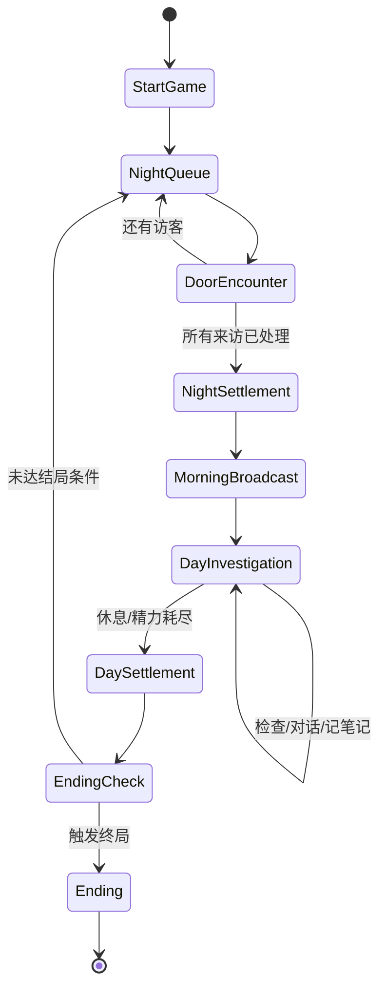
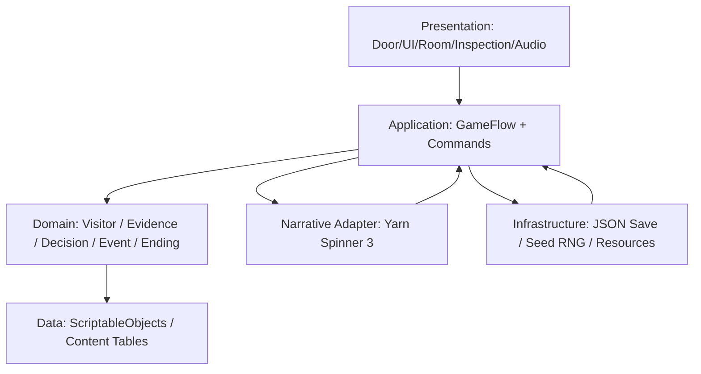
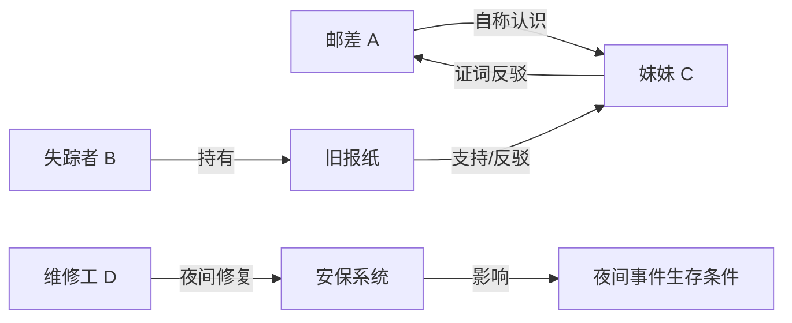

# 《寻找伪人》相似玩法源码与 Unity 复刻开发研究报告

> **版本**：V1.0 · 2026-10-12  
> **研究目标**：以《No, I'm not a Human》（中文常称《寻找伪人》）为参照，研究可合法借鉴的开源游戏与框架，设计一款原创的「来客筛查 × 不完全信息 × 生存资源 × 分支叙事」游戏，并输出可执行的 Unity 6 开发方案。  
> **适用读者**：个人游戏开发者、Unity/C# 工程师、游戏设计师、技术美术、AI 编程 Agent。  
> **资料范围**：游戏官方页面与开发者访谈、GitHub 公开仓库、itch.io、YouTube、工具文档、社区攻略。  
> **审查限制**：已核对主要仓库的公开 README、版本文件、部分具体脚本和许可证标记；**尚未逐个在本地下载、编译、试玩**。文中“工程存在”≠“零错误可运行”，MIT 代码≠“全部美术/音频可商用”。

---

## 0. 执行摘要：先看这一页

**明确结论**：截至本次调研，未核实到《寻找伪人》官方公开的完整游戏工程。最有效的路线不是搜索一个“百分百相同的开源克隆”，而是从已公开的相似项目中提取四类可验证的设计：**身份筛查 / 风险决策 / 2.5D 场景交互 / 角色与剧情状态管理**，然后在单一 Unity 工程内重新实现。

**推荐参考顺序**：

1. **The Gatekeeper's Insight**：机制最贴近“检查特征→消耗资源→放行/拒绝→记分后果”。Godot 4.4、MIT、可在线试玩。适合研究系统边界和数值，**不是 Unity 可直接导入的代码**。[S04][S05]
2. **Death and Taxes**：正式发行游戏的 Unity/C# 代码公开，MIT；适合研究「角色资料→决策→全局状态→结局」。**缺少完整美术与若干发行资源，不保证克隆仓库后直接获得完整成品**。[S06]
3. **Moral Matrix**：Unity 2023.1.20f1、URP 15.0.7、MIT；有 2D 人物/3D 场景、点击移动、房间切换、NPC 对话和镜头。适合先研究场景与交互，但**存档/复杂分支对话仍在路线图，尚不能当作现成系统使用**。[S07]
4. **Dead Letter Office**：Unity 2022.3.16f1，公开工程和随机内容生成脚本；有文件核验与处罚机制。仅有第 1 天内容；**没有发现明确许可证**，先学实现思路，不直接并入商业作品。[S08]
5. **The Guest**：Unity 6000.0.58f2，完整仓库结构；NPCProfile、NPCMemory、NotebookManager、GroqClient 等，对话驱动调查有借鉴价值；**API Key 与第三方美术授权需要独立处理，未见清晰的商业复用许可**。[S09]
6. **Yarn Spinner 3**：Unity 2022.3+ 可用，MIT；推荐正式工程的分支对话中间层。原作的第三方无障碍 MOD 也报告其基于 Yarn Spinner 对话管线。[S02][S13]

**研发建议**：第一阶段只实现 **3 昼夜、8 名原创角色、4 种调查方式、3 个结局、1 个房屋场景**。先完成可重复验证的核心循环，再扩展为 7~14 天。不要一开始就做 AI 自由聊天、完整 3D 第一人称漫游或者几十位 NPC。

**技术基线**：Unity 6 LTS（固定具体 Editor 版本）、URP、C#、uGUI + TextMeshPro、ScriptableObject（静态配置）、纯 C# 状态与规则层、Yarn Spinner 3（剧情）、JSON（运行时存档）、定种子 RNG（可复盘），后期再补 CRT/VHS Shader。

**成功标准**：玩家能够独立做出判断，误判不是由隐藏规则或完全随机造成；系统能够记录“看到了什么、为什么判断、付出了什么代价”；同一随机种子能复现角色身份、线索及事件结果。

---

## 1. 研究问题、方法与证据等级

### 1.1 本次需要解决的七个问题

1. 有没有原作完整源码？如果没有，有没有原作技术结构的公开证据？
2. 哪些相似游戏确实公开了**游戏玩法代码**，而不只是模组、存档工具或插件？
3. 哪些仓库包含可在编辑器打开的完整项目结构，哪些只开放部分代码？
4. 哪些代码明确允许修改和再分发，哪些只是“可读”而未明确授权？
5. 核心规则如何设计，才能做到有推理性而不是纯猜测或记住固定答案？
6. 基于 Unity，场景、美术、对话、NPC、资源、事件和存档如何分层？
7. 一个人或小团队应以什么顺序完成可玩的 Vertical Slice（垂直切片）？

### 1.2 核验分级

- **A：直接核验**：官方页面 / 仓库 README / 配置文件 / 具体源码 / LICENSE 中明确可见。
- **B：开发者自述**：开发访谈、项目作者说明，能够支撑设计缘起、开发目标等，但不能代替独立编译验证。
- **C：社区分析**：攻略、视频、玩家观察；可能受游戏版本、随机角色和攻略错误影响。
- **D：本报告方案**：我们建议的数值、架构、伪代码、任务计划，**不是原作的内部实现，也不是现成仓库的功能承诺**。

**特别说明**：GitHub 代码公开不等于获得复用授权。MIT 通常允许复用代码，但必须遵守许可证保留等义务；游戏内的字体、模型、立绘、商标、音乐和素材包可能由不同条款控制。针对没有 `LICENSE` 的仓库，按“不具有明确再分发许可”对待。

### 1.3 评估维度（本报告自定义）

| 维度 | 判断标准 | 权重（推荐） |
|---|---|---:|
| 机制相似度 | 身份、检查、资源、分支、后果的覆盖情况 | 30% |
| 源码完整度 | 有无脚本/场景/配置/入口/素材，能否用固定版本打开 | 20% |
| Unity 接入成本 | 同引擎且版本接近优先；Godot 仅可参考逻辑 | 20% |
| 许可证清晰度 | 明确 MIT/其他许可优于无许可 | 15% |
| 工程学习价值 | 结构清晰、有文档、有代表性实现 | 15% |

这些权重仅用于选择参考材料，不是公开平台评分，也不能说明项目质量绝对高低。

---

## 2. 原作事实与玩法逆向设计

### 2.1 已知官方信息

- 游戏：**No, I'm not a Human**；开发者 **Trioskaz**，发行商 **CRITICAL REFLEX**；Steam 发售日期 **2025-09-15**。[S01]
- Steam 官方介绍的最主要矛盾：白天的极端高温迫使人待在室内；夜晚有人敲门寻求避难，而伪装成人类的 Visitors 会混在其中。玩家需要判断谁进入房屋，不能简单地拒绝所有人。[S01]
- 制作人 Nikita Veter 在采访中确认：《Papers, Please》是主要玩法灵感之一，团队关注的是“玩家对别人命运负责”的决策。原型约 3 个月；此后扩展为独立游戏约 1 年。[S03]
- 该采访还说明，角色剧本通常先定主题和人物，再分别写对白，最终交叉修改。场景气氛参考了《The Mandela Catalogue》和《Kraina Grzybów TV》。[S03]
- 第三方无障碍 MOD 报告：所适配的游戏使用 Unity 6.3 / IL2CPP，并通过 Yarn Spinner 管线播放对话；能捕获房间照片、冰箱、广播、电话、检查提示及 HUD 状态。[S02] 这是 **MOD 作者的技术观察**，不是官方游戏工程开放。

### 2.2 从玩家行为出发的核心循环（分析性抽象）

```text
夜间敲门 → 观察来访者 → 对话与初步判断 → 收留 / 拒绝
                                   ↓
白天电视报道新异常征兆 → 看屋内住客 → 选检查项目 → 精力消耗
                                                     ↓
                     收集多条不完全证据 → 决策（继续观察/驱离/伤害等）
                                                     ↓
                         夜间事件结算 → 人员与资源变化
                                                     ↓
                     跨日支线推进 → 生存、失败或特殊结局
```

**设计张力由三层构成**：

1. **不完全信息**：玩家无法直接看到 `isImpostor`，只看到症状、证词、行为、新闻提示；表象与身份不是一一对应。
2. **不可逆或高代价决策**：误放危险角色可能导致人员损失，误伤正常人有道德和系统惩罚；延迟检查又会耗尽资源。
3. **时间与叙事反馈**：短期判断影响当晚生存，长期选择影响角色关系与结局。游戏的恐怖感来自“无法百分之百确信，但必须行动”。

### 2.3 不能简单照抄的地方

- **不是** `出现红眼 = 一定是伪人`。社区攻略指出人类也可能出现异常特征，不同版本的条件还会变化。[S21]
- **不是** 将多个图片线索随机置乱即可形成推理。线索需要与人物背景、伤病、环境和潜在身份具有可解释的因果联系。
- **不是** 用单纯人数和伪人比例就能制造悬疑。需要通过玩家承担的调查成本、可信度和延迟后果产生策略空间。
- **不是** 角色对话越多越好。应保证对白承担线索、情感、可选决策或后续事件触发作用。

### 2.4 版本差异与攻略信息的可靠性

- 原型、Demo、正式版和后续更新的来访者身份及检查规则可能不同，旧攻略不能当作新版本的稳定数据。[S21]
- 2025 年 9 月的长视频覆盖当时的多个结局，但不可能覆盖后来添加的全部内容。[S22]
- 本项目应该建立**版本化规则数据**（例如 `contentVersion`），避免未来新增角色后旧存档与新事件不兼容。

---

## 3. 相似游戏源码全景对比

### 3.1 游戏工程与源码清单

| 项目 | 引擎 / 已核验版本 | 公开内容状态 | 许可证核查 | 最值得看 | 不适合直接使用的部分 |
|---|---|---|---|---|---|
| [The Gatekeeper's Insight](https://github.com/adamico/gatekeeper-insight) | Godot 4.4（`project.godot`） | 游戏原型工程，含 scenes/data/resources/global，itch.io 可玩 | **MIT** | 调查资源、身份判定、EventBus、日评分 | Godot 脚本不能导入 Unity；Jam 原型规模有限 |
| [Death and Taxes](https://github.com/oakwarrior/DeathAndTaxes) | Unity，README 建议 2019.2.10f1+ | 发售游戏的代码工程；部分资源被有意移除 | **MIT（代码）** | 每日裁决、状态和结局、商业项目代码组织 | 不含完整美术；版本老，项目设置需核验 |
| [Moral Matrix](https://github.com/sedmugen/moral-matrix) | Unity **2023.1.20f1**, URP 15.0.7 | 有 Assets/Packages/ProjectSettings、文档、Web Demo | **MIT（仓库）** | 房间切换、2.5D billboard、NPC 对话、相机、音频 | 复杂分支对话、存档仍属路线图 |
| [Dead Letter Office Day 1](https://github.com/AnhKimHaTran/DeadLetterOffice_Day1) | Unity **2022.3.16f1** | 有 Unity 工程、第 1 天玩法、可试玩 Demo | **未发现明确 LICENSE** | 检查规则、随机文本与对象生成、拖拽交互 | 内容未完成，不能直接商用复制 |
| [The Guest](https://github.com/PeppeLe21/The-Guest) | Unity **6000.0.58f2** | 有 Unity 项目、场景和 README，依赖 Groq API | **学术说明，未见统一复用授权** | NPCProfile/NPCMemory、对话 LLM、调查笔记、信任度 | 外部 API、成本、隐私及资产许可问题 |
| [Human, Please](https://github.com/lamnguyenkhoa/human-please) | Godot **4.2** | 有 project.godot、scene/entity/ui/shader/Singleton | **未发现 LICENSE** | 模拟恐怖＋审核游戏的视觉和交互结合 | 非 Unity；许可未明确 |
| [Papers-Please_Unity](https://github.com/limeraiin/Papers-Please_Unity) | Unity（旧 Jam 工程） | 有 Assets/Packages/ProjectSettings，但作者明确未完成 | **未发现 LICENSE** | 审查类最小游戏循环、UI 呈现 | 稳定性、完成度、资产授权均待确认 |
| [Do You Trust Them?](https://github.com/katrinrash/Do-You-Trust-Them) | Unity/C# | **只有 Scripts 和 Screenshots，不是完整 Unity 工程** | **未发现 LICENSE** | 时间推进、笔记系统、剧情事件、成就/结局 | 不能直接在 Unity Hub 打开 |
| [NINAHSaveEditor](https://github.com/juliangrtz/NINAHSaveEditor) | Windows C# / .NET Framework 4.8 | 存档解密、解析、编辑、重新加密工具 | **Unlicense（工具代码）** | 原作存档持久化思路和类型化数据 | 不是游戏实现，禁止将其当作官方源代码 |
| [I'm a Blind Human](https://github.com/ObjectInSpace/im-a-blind-human) | Unity 游戏的 C# / MelonLoader MOD | 无障碍 MOD，含 Dialogue/World/Menu 等 hooks | **MOD 本体许可需逐文件核对** | 原作系统切面与交互分类 | 不是本体项目；依赖现有游戏安装 |
| [NINAH-Docs](https://github.com/OOM-WG/NINAH-Docs) | Next.js 文档站 | 角色与玩法攻略数据 | 站点 LICENSE 需另核对 | 逆向记录、角色目录、规则归档 | 不是游戏源码 |

**解读**：这些仓库不在同一个层级；本表的“可参考”包括：`完整工程`、`部分游戏代码`、`MOD`、`存档工具`、`攻略资料`。它们的性质必须严格区分。[S02][S04][S06][S07][S08][S09][S10][S11][S12]

### 3.2 推荐策略（不是直接按 GitHub Star 排序）

| 场景 | 推荐 | 原因 |
|---|---|---|
| 只学一个项目的**机制** | Gatekeeper's Insight | 与本题核心“有限检查 + 决策”距离最近 |
| 只学一个项目的**决策代码** | Death and Taxes | 正式发行游戏的真实代码结构更有参考价值 |
| 直接建立 Unity **房屋演示** | Moral Matrix | 2.5D 房间 + 镜头 + 角色可见交互已有基础 |
| 先搭最短 **无场景 UI 原型** | 自建 Unity 6 + Yarn Spinner | 避免旧项目升级成本，直接验证规则 |
| 要做 **复杂 NPC 对话** | The Guest（结构参考）+ Yarn（实际落地） | 前者适合研究状态与记忆；后者可控、离线、可回归测试 |
| 要做 **批量随机线索** | Dead Letter Office（设计参考） | 随机数据与可视检查对象之间的解耦做得具体 |

---

## 4. 重点仓库的深入代码阅读说明

### 4.1 The Gatekeeper's Insight：检查玩法最接近

**来源**：
- 仓库：https://github.com/adamico/gatekeeper-insight
- 试玩：https://kc00l.itch.io/the-gatekeepers-insight
- 实际工程 `project.godot`：Godot 4.4；主场景与自动加载项位于配置文件。[S04]

**真实存在且已打开的代码**：
- `global/event_bus.gd`：广播 `sense_focus_changed`、`visitor_admitted`、`visitor_denied`、`next_day_started`。[S04a]
- `global/game_stats.gd`：`current_day`、`daily_goal`、`correct_decisions`、`incorrect_decisions` 等状态；默认 7 天、每日处理目标 10 名来访者；当本日处理结束时计算答对率及 A~F 等级，发出 `day_completed` / `week_completed` 事件。[S04b]
- 项目包含 `assets/`、`data/`、`global/`、`resources/`、`scenes/` 和 `project.godot`。[S04]

**可借鉴流程**：

```text
VisitSpawner / VisitorData 产生来访者
            ↓
Sense / Inspection 请求检查，核算 Focus
            ↓
EvidenceUI 呈现感知结果（玩家可见）
            ↓
AdmissionController 发出 Admit / Deny
            ↓
EventBus → DailyStatistics / OutcomeResolver
            ↓
日终评分和下一批访客
```

> 上图的类名（除了原仓库已确认的事件与类）是**建议移植到 Unity 时的抽象命名**，并非逐字摘录原仓库代码结构。

**判断**：最值得“把玩法变成接口图”的仓库。可借鉴事件及数据结构设计，但 Godot 的 Node / Signal / Resource 对应到 Unity 时需要替换为 MonoBehaviour / C# event / ScriptableObject。

**审查关注点**：默认“一天 10 人、7 天评分”适合处理型审查游戏，但我们目标偏叙事生存，第一版应缩减为每天 2~4 人，并把“评分”更多变成隐性存活后果，而非 UI 显示 A~F。

### 4.2 Death and Taxes：成熟决策与结局参考

**来源**：https://github.com/oakwarrior/DeathAndTaxes 。README 明确：作者公开正式发售游戏代码，许可证 MIT，艺术及部分许可敏感文件未公开；建议 Unity 2019.2.10f1 或更新版本，但“可打开”不等于保证在 Unity 6 上没有升级问题。[S06]

**应该研究的问题**：
1. 游戏如何将“今天的角色资料”与“全局宏观状态”区分？
2. 做决定之后，何时结算：即时反馈、当天结束、若干天后？
3. 不同人物判定是否共同推动全局指标？
4. “同一套裁决 UI”如何复用在多个角色之上？
5. 一条剧情是否由多个条件门控，并且能够被记录到存档？

**建议借鉴的架构原则**：
- `DecisionRecord` 应独立于角色立绘和按钮。玩家选择必须先转化为纯数据记录，再参与结算。
- `DecisionEffect` 不应直接在 UI 代码中修改“后日某角色死亡”。使用事件队列和规则层统一处理。
- 剧情分支可以由 `GlobalFlags`、人物状态和已做选择共同决定。

**不建议**：直接拿旧项目作成品底座并升到 Unity 6；首先代码/美术不齐，其次现代输入、URP、Cinemachine、包管理等都可能增加迁移成本。

### 4.3 Moral Matrix：场景与人物展示底座

**来源**：https://github.com/sedmugen/moral-matrix；版本可由 `ProjectSettings/ProjectVersion.txt` 核对：`2023.1.20f1`。[S07]

**README 明确列出的关键实现**：
- `ClickMovement` 使用 `NavMeshAgent` + `NavMesh.SamplePosition` 实现点击移动。
- `DirectionalSpriteUtility` / Billboard 支持 8 方向 Sprite 面向相机的展示。
- `DoorClickDetector` / `PlayerTeleport` 管理房间节点传送与摄像机切换。
- `NpcDialogue` 提供 Typewriter 打字效果、NPC 交互与 `OnTalkEnd` 回调。
- `CutsceneManager` 使用 `StreamingAssets` 播放视频，`AudioManager` 使用 AudioMixer 控制音量。
- 官方 README 的路线图尚列出 `Save / Load` 和扩展多选对话，表明这两项**不能默认视作现成功能**。[S07]

**可以直接观察的效果**：房屋/场景从一个房间移到另一个房间；2D 人物放在 3D 近景中；点击 NPC 进入对话；视频过场控制游戏节奏。建议先在项目原 Unity 2023 版本运行，确认原始场景与操作方式，再决定移植具体组件还是参考重做。

**对目标游戏的适配建议**：
- 如果《寻找伪人》风格主要通过鼠标点击房屋交互，初期只需 `CameraAnchor` 节点切换，不一定需要完整 NavMesh 走路系统。
- NPC 立绘可以使用静止的 SpriteRenderer + 少量局部动画，比 8 方向走动角色更省时间。
- 房屋里的门、电视、电话、冰箱是独立的 `IInteractable`，而不是特判碰撞器的名字。

### 4.4 Dead Letter Office：数据驱动和随机内容生成

**来源**：https://github.com/AnhKimHaTran/DeadLetterOffice_Day1；Unity 2022.3.16f1；作者说明目前完成 8 天中的第 1 天。[S08]

**README 确认的脚本**：
- `MainDataset.cs`：不同国家的邮件类型、邮票、信件内容、名字等数据源。
- `MailGenerator.cs`：随机邮件、国家、邮票、位置的组合。
- `LetterReader.cs`：基于选中的数据生成信件正文。
- `MailOpener.cs`：点击/键盘查看信件并实例化内容。

**值得借鉴的技术点**：
- “数据来源”与“生成实例”分离，原型应把 `VisitorTemplate` 和 `VisitorInstance` 分开。
- 检查工具应接收 `VisitorInstance` 并返回可显示的 `EvidenceResult`，而不直接读取 UI 文本。
- 可利用 ScriptableObject 做模板，运行态状态放入普通 C# 对象，避免玩家选择修改编辑器资产。
- 生成结果应可复现：同一 seed、相同规则版本、相同玩家决策轨迹，应产生相同的可控结果。

**限制**：未核验到许可证，不要把其源码或人物美术直接放入计划商用的 Unity 工程。

### 4.5 The Guest：带记忆的 NPC 调查（进阶）

**来源**：https://github.com/PeppeLe21/The-Guest；Unity `6000.0.58f2`。[S09]

仓库 README 给出的系统包括 `NPCProfile`（ScriptableObject）、`NPCMemory`、`DialogueUI`、`NotebookManager`、`CostumeManager`、`GroqClient` / `GeminiClient` / `OllamaClient` 等。其流程为：玩家使用伪装进入社交场景→与 NPC 自由提问→模型结合人物档案、伪装和聊天历史生成回应→解析结构化结果→改写信任度和调查笔记。其初始开门信任阈值示例是 65/100。[S09]

**可复用的设计思想**：
- 将 NPC 不变事实与会话记忆分开。
- 每条关键证词应进入一个证据账本，并有来源、时间、是否公开、可否被反驳等元数据。
- 自由聊天只负责叙事表达，不负责生成或更改真实身份；改变核心游戏状态要经过可校验命令。

**谨慎事项**：
- README 要求外部 Groq API Key；原型可以运行在线模型，但正式产品不应把秘密 Key 直接打包到客户端中。
- 模型可能产生自相矛盾的证词；核心线索不能完全依赖不可复现的自由生成。
- 第三方模型、场景、字体等资产的商业授权需要逐一检查。该学术项目并未给出完整的一站式商用许可。

### 4.6 Human, Please：模拟恐怖融合审查机制

**来源**：https://github.com/lamnguyenkhoa/human-please；工程配置中声明 Godot 4.2。[S10]

项目包含 `scene/`、`entity/`、`ui/`、`shader/`、`singleton/`；工程自动加载 `GameManager.tscn`、`utils.gd` 等。题材是 Papers, Please-like + Analog Horror。适合作为**视觉/音乐/节奏/审查界面**参考，但不是同 Unity 可复用工程，且未发现 LICENSE，不宜直接复制其字体/美术/Shader。[S10]

### 4.7 其他仓库的正确用法

- **Papers-Please_Unity**：可以观察一个未完成 Jam 项目从输入、UI、对象状态起步的方式；作者主动说明未完成，因此不要期望完整判定/结局闭环。[S11]
- **Do You Trust Them?**：只公开部分 Scripts，适合看“跨日事件 + 调查笔记 + 结局”功能如何拆分；无法直接 Unity Hub 打开。[S12]
- **NINAHSaveEditor**：作者说明可解析原作 `.sav`，其中涉及 AES-256-CBC / PKCS7、Base64 和带 IL2CPP 类型元信息的 JSON。**这些是该工具对原作存档的分析，并不说明我们需要采用同一种加密方案**。[S23]
- **I'm a Blind Human**：参考 `src/Dialogue/`、`src/World/`、`src/Menus/` 对原作交互范围的分类；不接触其对目标进程的挂钩逻辑。不要把游戏内抓取的素材、对白和角色数据当作可直接复用的原创内容。[S02]
- **NINAH-Docs**：可用于整理原作人物与事件关系表，但它是攻略站代码，不是游戏逻辑源码。[S24]

---
## 5. YouTube、开发者教程及拆解视频

### 5.1 真实玩法录像（优先核对）

| 资源 | 已确认信息 | 用法 | 局限 |
|---|---|---|---|
| [NeatPick：No, I'm Not A Human FULL GAME — All Endings](https://www.youtube.com/watch?v=vNOgqcowamk) | 2025-09-19 发布，无解说、带 10 条结局路线时间戳 | 录像抽样、逆向流程、统计来客数量及 UI 事件 | 录制时间早于后续更新，非现行版本全量说明 [S22] |
| [Yarn Spinner 官方：Getting Started with Yarn Spinner 3 for Unity](https://www.youtube.com/watch?v=OoVBRmeUYMA) | 官方于 2025-05-15 发布，介绍 Unity 对话工具的基础使用 | 直接跟着建立对话项目和选项 UI | 只能演示对话集成，不实现身份规则 [S16] |
| [Code Monkey：How to Inspect Items and Objects](https://unitycodemonkey.com/video.php?v=tJ_ycboPFmY) | 有视频与文字教程，演示 3D 物品检查、旋转物体 | 改造为“检查眼睛/牙齿/手”等特写交互 | 需要重做隐私与动画、UI/资源检查逻辑 [S17] |
| [PowerQuest Intro + Quick Tutorial](https://steamcommunity.com/app/1170570/discussions/0/3775742649556830137/) | 作者在 Steam 社区帖中分享 2024 版入门视频 | 点击交互式 2D 冒险框架 | 工具授权和 Unity 包版本应在官网核对 [S18] |

### 5.2 观看时需要做的“工程拆解记录”

每看一个原作或类似游戏录像，应填一条观察记录，而不是只记录“画风很像”。建议统一记录以下字段：

```yaml
record_id: reference-001
video: https://www.youtube.com/watch?v=vNOgqcowamk
video_time: "00:00:00-00:08:00"
version_date: "2025-09-19"
interaction: "门口人物选择 / 对话"
player_information: ["立绘", "证词", "可见异常"]
player_action: ["问话", "收留", "拒绝"]
resource_cost: "待实测"
feedback_latency: "立即或日终"
branch_condition: "待验证"
ui_notes: "门口构图、主要按钮布局、危险音效"
implementation_candidate: "VisitorDoorPresenter + DialogueRunner"
confidence: "录像可见 / 推测需核实"
```

**建议抽样**：
- 从原作完整流程中选择**第 1 天、新征兆公布日、首次明显误判、某个多角色联动事件、终局前一天**共五段；
- 每段用 `观察 → 提问 → 查看证据 → 选择 → 系统反馈` 五个标签标注；
- 做一份“相同功能出现了多少次”的表，决定系统是否值得独立模块化；
- 把未知项明确写“待核实”，不从录像推测原作真实内部变量名或算法。

### 5.3 官方教程与文档（比零散视频更可靠）

1. [Yarn Spinner Unity 安装](https://docs.yarnspinner.dev/yarn-spinner-for-unity/installation-and-setup)：Unity 2022.3+，支持 Git URL / OpenUPM 等方式；官方开源包 MIT。[S13]
2. [Yarn Spinner Unity Quick Start](https://yarnspinner.dev/docs/unity/02-installation-and-setup/01-quick-start/)：创建 Dialogue System、Yarn Script、Yarn Project，再运行场景。[S14]
3. [Yarn Spinner Storylets & Saliency](https://yarnspinner.dev/docs/unity/08-samples/10-storylets-and-saliency/)：条件满足时从多个剧情片段中选择合适内容；适合多人、多日事件。[S15]
4. [Ink Unity Integration](https://github.com/inkle/ink-unity-integration)：备用方案，有运行/调试器、存档接口和示例场景；MIT，支持 Unity 2022.3+。[S19]
5. [Unity 序列化规范](https://docs.unity.com/en-us/engine/6000.6/manual/programming-environment/code-reload-serialization/script-serialization/rules)：解释 `SerializeReference`、引用、可序列化字段等；存档数据与编辑器资产必须区分。[S20]

---

## 6. 游戏设计目标：不要只做“来人就点检查按钮”

### 6.1 产品定位（原创建议）

**工作名**：《夜门档案 / The Last Shelter》（仅开发占位）。

- **类型**：单机、轻策略、叙事推理、生存恐怖、第一人称/2.5D 点击交互。
- **体验时长（MVP 规划目标）**：单局 20~40 分钟，支持失败后快速重开；正式产品可扩展到 1.5~3 小时。属于策划目标，不是已有成绩。
- **最小互动单位**：一名访客的一次审查；一次审查要让玩家产生至少一次可解释的取舍。
- **核心卖点**：怀疑并不等于证据；错误决定会影响活人的关系与安全；不同局会有不同身份和线索组合。
- **差异化切入**：比原作更清晰的“线索因果 + 访客证言关系”，而不是照搬原作人物和器官征兆。

### 6.2 基础系统表

| 系统 | 玩家感知到的动作 | 隐藏数据 | 必须具备的反馈 |
|---|---|---|---|
| Door / Night | 观察并与访客交谈 | 访客身份、当夜登场、关系 | 门铃、脚步、立绘与对白 |
| Inspection | 点击身体/物品/证词 | 线索生成模型、误报率、可用检查项 | 消耗资源、检查结果、记录证据 |
| Evidence Notebook | 查看已收集线索 | EvidenceRecord 和来源 | 按人/按日检索，是否已经检查 |
| Decision | 收留、拒绝、延迟/隔离 | 不同代价和后续变化 | 明确后果类型、不可逆警告 |
| Residents | 查看家中住客 | 存活、信任、位置、冲突 | 房间人员变化与状态反馈 |
| Resources | 管理精力、食品、安保物资 | Energy/Supply/Security 等变量 | 数量变化和原因 |
| Broadcast | 收看新闻或广播 | 当天新增的诊断知识 | 玩家可学的新规则（可翻阅） |
| Events | 接受/拒绝特殊访客 | 触发条件、优先级、排他组 | 事件后的可观察世界变化 |
| Endings | 进入结局与复盘 | GameState 与优先级规则 | 玩家能够理解自己为何进入此结局 |

### 6.3 核心日循环状态机



**状态机的关键约束**：
- 任何时候只能有一个顶层阶段 `GamePhase`。
- 切换场景不等于切换游戏阶段。
- 一次访客决策的提交必须**幂等**：按按钮两次不能收留两次。
- 每次进入结算阶段时生成不可变的 `DaySummary`，便于复盘和存档。
- 对话未结束时不能跳过当天触发事件，除非存在明确的中断规则。

### 6.4 最小三天剧情（MVP 故事骨架）

| 时间 | 玩家学到什么 | 来访者与事件 | 想制造的抉择 |
|---|---|---|---|
| 夜 1 | 不能独自面对夜间威胁；并非每人都可信 | A：受伤邮差，B：神色正常的失踪者 | 是否收留一个缺少证据的人 |
| 昼 1 | 新闻引入“声带共鸣异常”；可检查、消耗精力 | 审核屋内两人；A 提及昨晚的爆炸 | 先查谁？能否接受暂时不确定 |
| 夜 2 | 外面危险加重、资源不足 | C：自称是 A 的妹妹；D：路过维修工 | 两人口供不一致，是否允许二人见面 |
| 昼 2 | 多个迹象可能由同一外因导致 | C 对 A 的描述互相矛盾；可查旧报纸 | 证词与生理异常哪个更可靠 |
| 夜 3 | 之前决定产生延迟后果 | 安保装置失灵；有人请求开门 | 持续怀疑 vs 保护已经收留的人 |
| 昼 3 / 终局 | 综合证据、接受结果 | 多个结局判定 | 不靠“猜中了几个人”的单一数字评判 |

这是原创概念示例，**不是原作的剧情或角色**。最终台词和美术需要重新创作。

---

## 7. 玩法机制的形式化建模：可推理的不确定性

### 7.1 把真实身份、可观察线索和玩家判断分离

对每个访客 `i`：

- `Z_i ∈ {Human, Impostor}`：真实身份（玩家不可见）。
- `C_i`：人物背景变量，例如职业、病史、疲劳、受伤、环境暴露、随身物品。
- `E_i = {e_i1, ..., e_ik}`：检查可能观察到的征兆与证词。
- `O_i ⊆ E_i`：玩家**实际支付资源后看到的证据子集**。
- `D_i`：玩家决策（Admit / Reject / Quarantine / Other）。
- `R_i`：该决策的结算结果（可以延后出现）。

生成顺序建议为：

`身份 Z + 背景 C → 潜在线索 E → 玩家选择检查项 → 看到 O → 做出 D → 延迟后果 R`

绝对不要写成 `玩家点开某项检查 → 系统临时随机决定当前人是否是伪人`。身份必须在该局生成时就固定，且对话、检查和事件要基于同一份真相。

### 7.2 用条件概率定义“并非绝对可靠的征兆”

假设当前访客是伪人的先验概率为 `P(I)=0.30`，某项异常眼部征兆的条件概率为：

- `P(Eye+ | I)=0.70`
- `P(Eye+ | H)=0.20`

观察到异常后，贝叶斯更新：

\[
P(I\mid Eye+)=\frac{P(Eye+\mid I)P(I)}{P(Eye+\mid I)P(I)+P(Eye+\mid H)P(H)}
\]

代入得：`0.70×0.30 / (0.70×0.30 + 0.20×0.70) = 0.60`。

**解释**：眼部异常会把嫌疑从 30% 提高到 60%，但并不能证明此人一定是伪人。数值是本报告的演示参数，并非原作数据。实际游戏也不必把概率直接显示给玩家。

再假设另一项检查独立且 `P(Voice+|I)=0.65`、`P(Voice+|H)=0.15`，两项均异常时，后验约为 `0.867`。**该计算严格依赖给定身份后线索条件独立的简化假设。**

### 7.3 必须处理线索相关性，否则玩家会“证据重复计数”

错误例子：环境粉尘同时造成红眼、咳嗽、指甲变色。如果系统把这三项当作三个独立证据，那么普通工人可能不合理地获得 99% 的嫌疑。

建议引入潜在背景因素：

```text
真实身份 Z ─────┐
                 ├─→ 眼睛状态
潜在暴露 C ─────┤
                 ├─→ 咳嗽声音
受伤/疾病 B ────┤
                 └─→ 手部痕迹
```

这意味着：
- 每名 NPC 先确定 1~3 个背景因素；
- 每个因素影响多条线索的生成概率；
- 人物口供必须能够**部分解释**自己的症状；
- 少数伪人也能拥有正常体征，正常人也可以有异常；
- 高置信判断应来自**独立来源**：身体检查 + 物证 + 第三方证言，而不只是三个高度相关的症状。

### 7.4 资源经济：检查不可能全部做完

推荐第一版资源设定（待试玩调参）：

| 操作 | 精力消耗 | 获得信息 | 可能的限制 |
|---|---:|---|---|
| 普通问话 | 0 | 表面口供、基本人物关系 | 每日每主题限一次，可能拒答 |
| 眼部观察 | 1 | 眼部异常 | 背景灯光影响可信度 |
| 手部检查 | 1 | 痕迹、伤口、污染 | 角色可能拒绝检查 |
| 声带/呼吸检查 | 2 | 高频声或非自然呼吸 | 需要设备、电量 |
| 核对旧档案 | 2 | 证词间的矛盾 | 只在某些日期开放 |
| 隔离观察 | 2/天 | 延迟获得行为线索 | 占房间和补给 |

- `Energy` 为每天可重置资源，如初始 4 点，允许通过消耗物资恢复；`Supply` 为跨日持久资源。
- 检查多时效率更高，但会消耗可用于房屋修理或关键事件的资源。
- **硬规则**：至少让玩家在某一天无法检查完所有人，才有资源分配问题；同时保证至少存在一种合理策略能过关，不逼迫纯猜。

### 7.5 判定不只是“命中率”：用代价设计不同策略

令玩家对“伪人”的主观信念为 `p`，则收留与拒绝的期望损失可以表示为：

\[
L(Admit)=p\cdot C_{FA}+(1-p)\cdot C_{TH},
\quad
L(Reject)=p\cdot C_{TR}+(1-p)\cdot C_{FR}
\]

其中：
- `C_FA`：把危险访客放进来的代价；
- `C_TH`：收留普通人的补给和拥挤成本；
- `C_TR`：正确拒绝危险者的代价（可以为 0）；
- `C_FR`：错拒普通人的道德、声誉或剧情成本。

若 `C_FA` 远大于 `C_FR`，玩家倾向全部拒绝；如果拒绝普通人的惩罚过重，则玩家倾向全收留。设计目标是**让不同判断阈值在不同资源与剧情状态下都有合理性**，而不是先硬编码一个“正确策略”。

**产品建议**：不要直接给玩家一个“60% 怀疑条”；应让玩家在笔记本里记录“有力证据/可疑但不确定/可能解释”，由玩家自主推断，后期可增加游戏辅助模式。

### 7.6 防止不可解、恶意随机与悖论案例

1. 对每名伪人，保证在其危害发生之前**存在可获得但不保证免费的可区分证据**。
2. 对每名异常正常人，提供合理解释路径（例如病例、工伤、证人），而不是只能靠运气识别。
3. 检查被拒绝不能被当作绝对伪人证据；有时正常角色也会拒绝侵犯隐私的检查。
4. 同一身份、同一生成种子不能在不同对话里给出不可解释的互斥事实。
5. 特殊剧情可以制造一次“规则例外”，但要在事后提供可理解的线索，而不能反复背刺玩家。
6. 不要让玩家通过 NPC 的立绘文件名或预制体名称泄露隐藏身份。

---

## 8. Unity 6 技术架构与系统边界

### 8.1 为什么优先 Unity 6 新工程，而不是强行升级一个旧项目

**推荐**：新建 Unity 6 LTS + URP，建立自己的 `GameState` 和 `VisitorGenerator`；参考源码只作为局部模块设计来源。

| 路线 | 开发速度（初期） | 长期维护 | 风险 | 适合阶段 |
|---|---|---|---|---|
| A：全新 Unity 工程 + 静态房屋图 + 点击交互 | **快** | 高 | 美术初期较简陋 | **MVP 首选** |
| B：以 Moral Matrix 工程为底座再换玩法 | 中 | 中 | 包/版本/旧逻辑耦合 | 想快速证明 2.5D 视觉时 |
| C：完整 3D 第一人称房屋自由行走 | 慢 | 高（系统成熟后） | 摄像机、动画、碰撞、UI、内容量倍增 | Vertical Slice 通过以后 |
| D：Godot 项目整体迁移 Unity | 较慢 | 中 | 引擎 API 完全不同 | 不推荐作为第一次实施 |

**权衡**：如果首要任务是“最快可玩”，选择 A。若后续审美要求必须达到“房间立体、人物在空间中”则再实现一个 Presentation Layer；核心身份生成/判定/事件规则不应因场景方案更换而重写。

### 8.2 分层架构



**严格依赖方向**：
- `Domain` 不引用 `MonoBehaviour`、`GameObject`、`TextMeshPro` 等 Unity 组件；可以单元测试。
- `Presentation` 只收到“显示哪个访客、哪些检查项、当前已知哪些线索”的 ViewModel。
- `Narrative` 读可公开变量并提交经过校验的剧情命令，不拥有“真相数据”的最终修改权限。
- `Infrastructure` 保存原始数据，不把 Unity 对象引用序列化为长期存档。

### 8.3 建议目录结构（原创规划）

```text
Assets/
├── _Game/
│   ├── Scripts/
│   │   ├── Core/
│   │   │   ├── GameState.cs
│   │   │   ├── GamePhase.cs
│   │   │   ├── GameFlowController.cs
│   │   │   ├── GameCommand.cs
│   │   │   └── GameEventBus.cs
│   │   ├── Visitors/
│   │   │   ├── VisitorDefinition.cs       # ScriptableObject，静态内容
│   │   │   ├── VisitorInstance.cs         # C# 类，运行态真相
│   │   │   ├── VisitorGenerator.cs
│   │   │   └── VisitorDirector.cs
│   │   ├── Evidence/
│   │   │   ├── InspectionDefinition.cs
│   │   │   ├── EvidenceRecord.cs
│   │   │   ├── InspectionService.cs
│   │   │   └── EvidenceNotebook.cs
│   │   ├── Decisions/
│   │   │   ├── DecisionService.cs
│   │   │   └── ConsequenceResolver.cs
│   │   ├── Resources/
│   │   │   └── ResourceService.cs
│   │   ├── Events/
│   │   │   ├── GameEventDefinition.cs
│   │   │   ├── ConditionEvaluator.cs
│   │   │   ├── EffectExecutor.cs
│   │   │   └── EventScheduler.cs
│   │   ├── Narrative/
│   │   │   ├── YarnStateBridge.cs
│   │   │   ├── YarnCommandHandlers.cs
│   │   │   └── DialogueOrchestrator.cs
│   │   ├── Save/
│   │   │   ├── SaveData.cs
│   │   │   ├── SaveRepository.cs
│   │   │   └── SaveMigrator.cs
│   │   └── Presentation/
│   │       ├── DoorPresenter.cs
│   │       ├── RoomNavigator.cs
│   │       ├── InspectionPresenter.cs
│   │       ├── NotebookPresenter.cs
│   │       └── AudioDirector.cs
│   ├── Data/
│   │   ├── Visitors/
│   │   ├── Inspections/
│   │   ├── Events/
│   │   ├── Balance/
│   │   └── Dialogues/
│   ├── Prefabs/
│   ├── Scenes/
│   ├── Art/
│   ├── Audio/
│   └── Tests/
├── Plugins/           # 仅经过授权审计的第三方模块
└── Settings/          # URP、渲染器、输入与字体设置
```

### 8.4 ScriptableObject、运行状态、存档：三者一定要分开

| 对象 | 内容 | 生命周期 | 允许修改吗 |
|---|---|---|---|
| `VisitorDefinition` | 人物固定姓名、背景、立绘地址、对白入口 | 编辑器资源 | 仅开发时 |
| `VisitorInstance` | 这一局实际身份、背景、线索、登场日期 | 单次游戏 | 运行时修改 |
| `VisitorSaveData` | 人物 ID、状态、随机种子、证据列表、已访问对话 | 存档 | 经版本迁移后恢复 |

**反例**：直接将 `ScriptableObject.isImpostor` 在运行时设为 true。它可能污染编辑器资产，也无法正确表达“同一个模板在不同局拥有不同身份”。

### 8.5 模块 API 合同（建议最小接口）

```csharp
public enum GamePhase { NightDoor, NightResolution, MorningNews, DayInspect, DayResolution, Ending }
public enum VisitorIdentity { Human, Impostor }
public enum AdmissionDecision { Admit, Reject, Quarantine }

public interface IVisitorGenerator
{
    VisitorInstance Create(VisitorDefinition template, int worldSeed, int spawnIndex);
}

public interface IInspectionService
{
    InspectionResult Inspect(GameState state, string visitorId, string inspectionId);
}

public interface IDecisionService
{
    DecisionResult Submit(GameState state, string visitorId, AdmissionDecision action);
}

public interface IEventScheduler
{
    IReadOnlyList<ScheduledEvent> Select(GameState state, GamePhase phase);
}

public interface ISaveRepository
{
    void Save(SaveData data, int slot);
    SaveData Load(int slot);
}
```

> 此为**建议的接口草案**：部分类型在此未展开，不应误认为是可直接编译的完整文件。接口重点是让行为可测试、可替换、便于不同 Unity 表现层接入。

### 8.6 事件总线与服务之间的界限

`EventBus` 可以广播“访客已入屋”“检查完成”“日期改变”，但不能承担所有业务决策。推荐顺序：

1. UI 发出 `InspectVisitorCommand`。
2. `GameFlowController` 检查当下阶段是否允许。
3. `InspectionService` 检查精力与条件，生成 `InspectionResult`。
4. `ResourceService` 扣资源；`GameState` 写入不可重复的证据记录。
5. 事件总线广播 `InspectionCompleted`。
6. `NotebookPresenter`、音频、剧情系统分别响应该事件。

只有步骤 3/4 是“真相与资源”的权威来源。这样 UI 重新显示、对话播放两次不会导致重复扣费。

---
## 9. 关键数据协议、生成算法与示例

### 9.1 角色的“模板”与“一局实例”

**建议的静态角色模板（示例 JSON，仅表示内容结构）**：

```json
{
  "id": "npc_postman_01",
  "displayName": "受伤邮差",
  "archetype": "courier",
  "portraitKey": "characters/courier_idle",
  "introDialogueNode": "Door_Postman_Intro",
  "possibleBackgrounds": ["fatigue", "smoke_exposure", "work_injury"],
  "allowedIdentityModes": ["human", "impostor"],
  "appearWindow": {"firstDay": 1, "lastDay": 3},
  "specialEventIds": ["postman_letter", "postman_sister"],
  "tags": ["civilian", "injured", "intro_character"]
}
```

**每局生成的运行态角色**（事实对玩家隐藏）：

```json
{
  "instanceId": "run42_npc_postman_01_0",
  "definitionId": "npc_postman_01",
  "identity": "human",
  "backgroundTraits": ["smoke_exposure", "work_injury"],
  "clueOutcomes": {
    "eyes": "redness",
    "hands": "healing_burn",
    "voice": "normal"
  },
  "knownEvidenceIds": [],
  "trust": 50,
  "residence": "outside",
  "alive": true,
  "storyFlags": []
}
```

**两条原则**：
- 第一份模板可以被多局重复使用；第二份实例只能属于一局，存档引用 `instanceId`。
- `clueOutcomes` 在进入当局时生成或由**确定性的派生随机种子**稳定生成，不由 UI 点击顺序临时改变。

### 9.2 线索数据不应该只有“true/false”

推荐 `EvidenceRecord` 至少包含：

| 字段 | 类型 | 作用 |
|---|---|---|
| evidenceId | string | 线索唯一 ID，防重复 |
| visitorInstanceId | string | 属于哪位访客 |
| inspectionId | string | 哪种检查获得 |
| findingId | string | 中性的结果标签，如 `redness` |
| dayFound | int | 第几天发现 |
| sourceType | enum | 身体 / 证词 / 文件 / 第三方 |
| confidenceHint | enum | 明确 / 有歧义 / 易受干扰 |
| contextFlags | string[] | “烟尘、受伤、灯光不足”等解释因素 |
| contradictedBy | string[] | 与哪些其他证据冲突 |
| narrativeTextKey | string | 本地化文本，而不是在代码里拼台词 |
| isPublic | bool | 是否可在玩家 UI 中显示（默认 true） |

对“证词 A 与证词 B 冲突”，不要只写两个布尔值。建立 `ContradictionRecord`，记录双方发言对应的 Story Fact、时间、同一地点是否真的互斥，以及冲突是否已解决。

### 9.3 调查器参数与信息回报

```json
{
  "id": "inspect_voice",
  "displayName": "检查声带和呼吸",
  "energyCost": 2,
  "requires": ["has_stethoscope"],
  "repeatPolicy": "once_per_visitor_per_run",
  "resultTableId": "voice_signal_v1",
  "failureModes": ["refused", "tool_broken", "phase_invalid"],
  "viewKey": "inspection/voice"
}
```

`InspectionService.Inspect` 应返回明确的结果状态：`Success`、`InsufficientEnergy`、`AlreadyInspected`、`Refused`、`MissingTool`、`WrongPhase`。**失败也要定义是否消耗资源**，例如角色拒绝且没有实际检查时通常不应按完整检查成本扣费，除非剧本明确告知“尝试会消耗时间”。

### 9.4 随机生成：正确处理种子和检查顺序

错误做法：所有系统共用一个 `Random`，并由动画、音效或 UI 更新消耗随机数。这样多点一次 UI 就可能改变后续 NPC 身份。

推荐按语义拆分随机流：

```text
RunSeed = 410271
├── scheduleSeed = Hash(RunSeed, "schedule")
├── identitySeed(npcId) = Hash(RunSeed, "identity", npcId)
├── clueSeed(npcId, clueType) = Hash(RunSeed, "clue", npcId, clueType)
├── eventSeed(day, eventGroup) = Hash(RunSeed, "event", day, eventGroup)
└── presentationSeed = Hash(RunSeed, "visuals")  # 绝不影响玩法
```

**重要工程细节**：Unity 项目的跨设备可复现不能依赖 `string.GetHashCode()`（它不能作为稳定跨环境内容 ID 哈希契约）。应使用固定的 32/64 位哈希函数、固定编码（例如 UTF-8）和明确的伪随机算法；把 `rngVersion` 写进存档。即便不同平台的浮点求值略有差异，关键的身份与线索可以用整数阈值进行生成。

### 9.5 身份与线索生成的可测试流程

```text
GenerateRun(seed)
  ├─ 读取内容版本与可登场角色
  ├─ 处理必须存在的剧情角色与排他人物
  ├─ 生成来客日程
  ├─ 为每个角色确定真实身份
  ├─ 生成背景因素（受伤、疲劳等）
  ├─ 依据身份+背景生成身体/证词/档案线索
  ├─ 做可解性校验（可获得的独立证据数量、关键角色锁）
  ├─ 如不合格：使用确定性规则修复该局数据
  └─ 固定为 RunContent，进入开始场景
```

不能“随机到无法过关就反复 Random”且不记录重试次数，否则难以复盘。可采用：固定规则修复、`generationAttempt` 写入局元数据、或者在生成之前使用约束满足方法。

### 9.6 事件数据结构（小型声明式 DSL）

```json
{
  "id": "event_postman_warning",
  "phase": "MorningNews",
  "priority": 40,
  "oncePerRun": true,
  "exclusiveGroup": "morning_major",
  "conditions": {
    "all": [
      {"op": "day_at_least", "value": 2},
      {"op": "resident_status", "npc": "npc_postman_01", "value": "inside"},
      {"op": "flag_not_set", "value": "postman_warning_seen"}
    ]
  },
  "actions": [
    {"op": "set_flag", "value": "postman_warning_seen"},
    {"op": "start_yarn_node", "value": "Postman_Warning"}
  ]
}
```

建议只允许一组白名单 `op`（例如 `day_at_least`, `has_evidence`, `resident_status`, `set_flag`），不要从 JSON 中动态执行任意 C# 或脚本。这样数据可以经过编辑器校验、测试和版本迁移。

### 9.7 事件调度的优先级与排他规则

- `mandatory`：必须发生；优先于全部普通剧情。
- `major`：当日主事件；同一个 `exclusiveGroup` 最多一个。
- `character`：人物支线；可受限于房间位置、存活、关系或早前对话。
- `ambient`：环境与氛围；不阻碍主剧情。

执行时采用：**过滤条件 → 互斥消解 → 排序 → 配额选择 → 校验前置状态 → 原子应用 Effects → 写入事件日志**。

如果“事件 A 让角色死亡”而“事件 B 要求该角色正在对话”，必须按照统一优先级处理，并在执行 B 前重新检查条件；否则会发生剧情软锁。

### 9.8 决策记录（用于存档和复盘）

```json
{
  "decisionId": "run42_day2_npc_c_0",
  "day": 2,
  "phase": "NightDoor",
  "visitorInstanceId": "run42_npc_c_0",
  "action": "admit",
  "visibleEvidenceIds": ["eye_red_11", "testimony_04"],
  "timestampInGame": 140,
  "consequenceEventIds": ["event_c_room_arrival"],
  "playerNote": "与邮差的证言矛盾，但不一定是伪人"
}
```

记录 `visibleEvidenceIds` 尤其有价值：能用于判断玩家是否做了“可解释的错误决策”，为后期教学、难度调整和 QA 提供依据；不必监控玩家私人信息。

---

## 10. Unity 场景、UI 与动画的落地方式

### 10.1 场景拆分（MVP）

| 场景 | 作用 | 摄像机和显示方式 |
|---|---|---|
| `Bootstrap` | 初始化配置、服务与存档 | 无需游戏摄像机 |
| `HouseMain` | 房屋总览和 3 个交互点 | 2.5D 固定角度或静态背景 |
| `DoorEncounter` | 夜间接待访客 | 大幅 2D 立绘和门口灯光 |
| `InspectionOverlay` | 眼部、手部等放大检查 | uGUI 全屏 Overlay 或独立相机纹理 |
| `BroadcastOverlay` | 新闻、线索提示 | UI 动画和静态噪点 |
| `Ending` | 终局与玩家决策复盘 | 文字、角色去向、结局立绘 |

第一版不一定需要上述全部是真正独立 `.unity` 场景：覆盖式 UI 可以做成 Prefab。尽量使用一个常驻 `HouseMain` + 多个可显示/隐藏的 Canvas 层，以减少切场景存档复杂度。

### 10.2 房屋 2.5D 的两种方案

**方案 A：固定图片 + 热点**（最稳）：背景是一张房间立绘（宽屏），点击预设交互区域进入电视/门/人物特写。优点是审美可控、开发快、无 NavMesh；缺点是场景动态深度弱。

**方案 B：简易 3D 房间 + 2D NPC 立绘**（以后扩展）：

1. 搭墙、地面、门、简单家具，使用 URP 灯光。
2. 将 2D 人物放在 `SpriteRenderer` 所在的平面，对摄像机做 Billboard。
3. 用固定摄像机锚点切换房间，不依赖自由行走。
4. 人物检查通过 UI 立绘局部特写实现，避免建模高精度眼球/牙齿。
5. 只有确实需要 3D 旋转检查的物品，才调用单独的 Inspect Camera 与 RenderTexture。

**推荐**：MVP 采用 A，确认玩法成立后用 B 替换表现层。Moral Matrix 的 `DoorClickDetector` / `PlayerTeleport` / 8 向 Billboard 是 B 的很好的研究入口。[S07]

### 10.3 UI 信息结构

```text
[顶部：第 2 天 · 白天 · 精力 3/4 · 补给 6]
┌────────────────────────────────────────────────────────────┐
│ 房屋背景 / 当下访客立绘                                   │
│                                                            │
│   点击角色 → 观察 / 问话 / 检查                             │
│   点击电视 → 新征兆公告                                    │
│   点击笔记 → 线索列表                                      │
│                                                            │
├────────────────────────────────────────────────────────────┤
│ 人物：受伤邮差                                             │
│ 已知：左手灼伤；声带未检查                                  │
│ [继续询问] [眼部 1 精力] [手部 1 精力] [笔记本]              │
└────────────────────────────────────────────────────────────┘
```

夜间换成大立绘 + 简短对白 + `[收留] [拒绝] [暂缓]`；没有观测到的证据不显示为“阴性”，而应显示为“未检查”，避免误导。

### 10.4 角色“检查身体特征”的实现细节

- 检查前点击发起 `InspectionCommand`，Domain 层返回结果后才播放对应动画。
- 展示两种层级：`Overview`（正常立绘）→ `CloseUp`（特写）→ `EvidenceReveal`（文字注记/音效）。
- 身体部位检查素材建议有三个维度：**正常 / 异常 / 不确定或干扰**；同时考虑特殊背景因素的美术变体。
- 不要求所有角色都有完全独立的几十张分解图：可先共用身体局部素材底版，并通过少量原创差异素材做合成；角色个性主要体现于立绘和对白。
- `InspectionPresenter` 不从纹理名称推断身份，纹理地址由 `EvidenceResult.visualKey` 解析。

### 10.5 艺术风格与效果优先级

**先做**：构图、字体、角色轮廓、冷暖灯光对比、门铃和脚步声、停顿节奏、突然静音。

**后做**：模拟磁带、CRT 畸变、Film Grain、Chromatic Aberration、短暂故障帧。

推荐参考：
- [Cyanilux URP Retro CRT Shader](https://github.com/Cyanilux/URP_RetroCRTShader)：MIT，Unity 2022+ 适配说明；包含 CRT 扭曲、扫描线、噪点、RGB 等效果。需在所选 Unity 6/URP 版本验证 Fullscreen Pass。[S25]
- [CrowFX](https://github.com/Luci0n/CrowFX-unity-image-effects)：MIT，模拟 VHS/CRT/Film/Glitch，**URP/HDRP 适配在作者文档中仍标为 Experimental**；不要将它当作已验证的 Unity 6 URP 正式项目依赖。[S26]

**视觉/法律边界**：不要直接使用原作角色立绘、Steam 宣传截图作为游戏内资产、原作商标、特定新闻字幕、原作完整对白。借鉴“恶劣环境中的来客筛查”“模拟恐怖表现手法”等抽象机制，设计自己的世界观、识别媒介、人物和 UI。

---

## 11. 对话、人物关系与事件编剧的技术方案

### 11.1 为什么选 Yarn Spinner，而不直接硬编码 C# 对话

- 编剧可以改 `.yarn` 文本，不必反复编译游戏逻辑。
- 对话可以读游戏状态变量，执行白名单命令。
- 一个角色随日期、证据、信任度变化而看到不同剧情节点。
- 官方 Unity 3 的 Storylets / Saliency 为“符合状态的短剧情集合”提供现成工具和样例。[S15]
- 原作相关 MOD 也报告了 Yarn Spinner 管线，这提升了技术路径的可参考性，但不意味着需要复制原作节点和台词。[S02]

### 11.2 内容分层：事实、对白、动作

建议每名角色有三层：

1. **Facts（事实）**：固定真相与背景，例如昨晚住在哪里、是否认识另一名访客、真实身份。
2. **Dialogue Nodes（对白）**：角色说出的故事，可以撒谎、回避、记错，但不应无缘无故改写 Facts。
3. **Commands（动作）**：设置剧情标记、添加证据、改变关系、安排事件；必须在 Domain 层验证合法性。

例子：一个角色自称“昨晚一直在车站”，而物证显示车站已经封闭。此时是人物**说了谎**，而不是因为 LLM 临时改变了世界事实。

### 11.3 Yarn 剧本简例（示意语法）

```yarn
// 假设已有 Yarn Project、变量和对应的 Unity Command 注册
// 节点、内容和人物均为原创示例

title: Door_Postman_Intro
---
邮差: 请开门，我的车在街角坏了。
-> 你为什么不去隔壁？
    邮差: 那栋楼已经烧掉了，我找不到别人。
-> 你的手是怎么受伤的？
    邮差: 昨天搬运东西时被金属烫到了。
-> 我还不能决定。
    邮差: 拜托，我不会坚持太久的。
===
```

这是不依赖扩展命令的基本节点写法。未来根据 `GameState` 决定调用哪个 Node。**不要让 Yarn 脚本直接持有或更改 `VisitorIdentity`，只暴露经过允许的动作和公开状态变量。**

### 11.4 人物关系图示例



角色关系不是越多越好。第一版 8 人推荐只做 2~3 个跨人关系事件，确保每一条都有正常/异常两种路径，并完整测试存活/拒绝/伤害等关键状态组合。

### 11.5 剧情内容检查器（强烈建议研发时同步开发）

为每个 Yarn 节点和 `GameEventDefinition` 做静态扫描：

- 引用了不存在的 NPC / 资源 / flag 吗？
- 同一事件设置了哪些 flag，后续是否存在对应消费方？
- 某条剧情需要已死亡或尚未登场人物吗？
- 事件被排他组阻止后是否仍有通往结局的路径？
- 是否有永远无法满足的条件，或某结局优先级永远覆盖其他结局？
- 对话里的“证据新增”是否会重复添加？

有了这套检查器，再增加角色和剧情量才不会失控。

### 11.6 LLM 自由对话：可选增强，不是 MVP 依赖

如果后期采用模型实现开放式问答，建议：

```text
玩家自然语言输入
  → 检索当前可说的“人物事实和允许撒谎的范围”
  → LLM 生成可见回答 + 候选结构化命令
  → 命令验证器严格校验角色、状态、证据与白名单
  → 合法命令写入 GameState
  → 记录这一轮发言与证据来源
```

原则：
- 真相由游戏数据决定，模型只能根据已有知识和角色目标作答。
- 不让模型任意输出 `identity=human`、`kill=npc_x` 等不可控动作。
- 保持一个无网络、纯对话树的完整退化路径。
- 网络超时应返回确定的 fallback，不软锁进度。
- 在线生成存在推理费、审核、网络隐私和剧本风格漂移风险；第一版**不建议上生产级自由聊天**。

---

## 12. 游戏结算、存档与可复盘性

### 12.1 结局选择：条件和优先级明确化

假设存在四种结局：

| Priority | 结局 | 条件示例 | 设计目的 |
|---:|---|---|---|
| 100 | 侵入者压倒房屋 | 关键安保资源不足且无保护事件 | 明确重大失败 |
| 90 | 信任崩塌 | 连续错判造成关键住客全部离去 | 回应道德后果 |
| 70 | 带着秘密活下来 | 到最后一天但家里存在未解决威胁 | 悬念结局 |
| 50 | 清晨 | 到最后一天且主要威胁已清除、保住至少一位同伴 | 相对正面结局 |

条件可以组合，但**不是**每条都写一个 `if/else` 散落到 UI。定义 `EndingDefinition`，在统一 `EndingResolver` 中检查；并提供调试视图显示“每个结局当前满足几个条件”，防止终局调试变成碰运气。

### 12.2 存档对象必须包含什么

```json
{
  "schemaVersion": 2,
  "contentVersion": "prototype-0.3",
  "rngVersion": "pcg-v1",
  "runSeed": 410271,
  "day": 2,
  "phase": "DayInspect",
  "resources": {"energy": 2, "supply": 6, "security": 1},
  "residents": [{"id": "run42_npc_postman_01_0", "status": "inside", "alive": true}],
  "evidence": ["evidence_eyes_a_1", "evidence_hands_a_1"],
  "globalFlags": ["broadcast_day2_seen"],
  "decisionHistory": ["decision_0001"],
  "eventHistory": ["event_001", "event_007"],
  "dialogueState": {"format": "yarn", "payloadVersion": 1},
  "checksum": "example-only-not-a-real-checksum"
}
```

**约束**：存档不仅要保存可见信息，还要恢复游戏内真正身份、不可见线索和生成规则版本，否则读档后可能出现“同一访客换身份”。以上示例为简化，不含完整运行态 NPC 真相表。

### 12.3 存档实现原则

- 静态定义引用 `definitionId`，不直接序列化整个 `ScriptableObject`。
- `JsonUtility` 有 Unity 序列化规则限制，不适合直接无转换存复杂多态、字典网络；可使用 list DTO / 显式映射，或者采用经过审核的 JSON 序列化库。[S20]
- `schemaVersion` 负责字段迁移，`contentVersion` 负责剧情内容兼容。
- 写盘使用**临时文件 + 成功后替换**；异常时保留上一份可用存档。
- 存档文件名只用受控 slot ID，避免直接接收外部任意路径。
- 调试数据和用户存档分离；统计日志不记录外部服务的秘密密钥。

### 12.4 结算复盘与数据埋点（本地即可）

建议记录：

- 每人检查次数、所见线索、最终选择、是否正确；
- 最难辨认的角色模板与背景组合；
- 每天剩余精力、物资；
- 导致失败的最后 3~5 个关键事件；
- 各结局的触发概率、平均耗时；
- 存档恢复/继续游玩是否保持同一随机结果。

注意“答对率”只用于研发数据校验。游戏内最终评价不要简化为“你打出了 89 分”，除非项目明确要做审查绩效型而不是叙事恐怖型体验。

---
## 13. 工程质量保障：自动化、可测试性与性能

### 13.1 首先建立可确定性复现的「规则测试层」

这类游戏最容易出现的故障不是画面不显示，而是**世界事实、玩家可见线索、事件条件互相矛盾**。因此测试优先级应是“核心状态正确性 > 剧情可达性 > UI 表现 > 后期画面细节”。推荐建立 Unity Test Framework 的 EditMode 测试程序集；它可以调用纯 C# Domain，不必每次打开场景。

推荐测试目录：

```text
Assets/_Game/Tests/
├── EditMode/
│   ├── VisitorGenerationTests.cs
│   ├── InspectionRulesTests.cs
│   ├── DecisionIdempotencyTests.cs
│   ├── EventDependencyTests.cs
│   ├── EndingReachabilityTests.cs
│   ├── SaveRoundTripTests.cs
│   └── ContentValidationTests.cs
└── PlayMode/
    ├── FirstNightEndToEndTests.cs
    ├── DoorDialogueIntegrationTests.cs
    ├── RoomNavigationTests.cs
    └── SaveResumeFlowTests.cs
```

### 13.2 测试用例清单（建议首批写入 Issue）

| ID | 测试情境 | 预期结果 | 重要性 |
|---|---|---|---|
| T-01 | 相同 seed、同版本，生成同一批角色 | 身份、背景和潜在线索逐项一致 | P0 |
| T-02 | 两个不同 seed | 大多数游戏局结果不同，但都满足内容约束 | P1 |
| T-03 | 同一 NPC 多次检查同一特征 | 返回一致的已发现线索，不重复扣精力 | P0 |
| T-04 | 精力低于检查消耗 | 拒绝执行，数值不变，也不暴露检查结果 | P0 |
| T-05 | 前一晚已有决策，再次点击确认 | 仅产生一条 `DecisionRecord`，只结算一次 | P0 |
| T-06 | NPC 没有被放进屋内 | 不得进入屋内住客名单、事件和对话 | P0 |
| T-07 | 无法找到某 NPC 的静态定义 | 载入失败时报告缺失 ID，不静默复用别的角色 | P0 |
| T-08 | 角色死亡 / 离开后事件仍被调度 | 事件被跳过或进入明确定义的替代分支 | P0 |
| T-09 | 一组互斥事件同时满足 | 只能触发优先级和排他规则允许的事件 | P0 |
| T-10 | 暂停在日 2，保存并重启 | 时间、人员、真相、已看证据、随机状态恢复 | P0 |
| T-11 | 同一存档反复读取 | 不会重复创建来访者、扣资源、结算日事件 | P0 |
| T-12 | 选择“拒绝”后被异步对话回调更新 | 已提交的决策仍不可逆，避免状态竞态 | P0 |
| T-13 | 输入非法存档或损坏 JSON | 安全提示与回退备份，不崩溃、不覆盖好档 | P1 |
| T-14 | 所有角色都拒绝 | 策略具有应有代价，或有明示的失败路径 | P1 |
| T-15 | 所有角色都收留 | 策略具有应有风险，不存在无脑通关漏洞 | P1 |
| T-16 | 多次穷举随机局 | 不出现“必死且无法获得充分证据”的大量无解局 | P0 |
| T-17 | 同一特征的不同背景原因 | 异常征兆可由不同潜变量引起且解释一致 | P1 |
| T-18 | 从任意合法游戏阶段调用 UI | 仅可调用当前允许的操作 | P0 |
| T-19 | 结局同时匹配两条条件 | 按版本化优先级稳定命中唯一结局 | P0 |
| T-20 | 对话指令引用不存在的 flag | 构建前报错，不能无声忽略 | P1 |

### 13.3 随机生成的批量仿真

为 `VisitorGenerator` / `GameSimulationRunner` 编写无 UI 批量运行器；建议先以 **10,000 个固定 seed** 做模拟（数字是建议测试规模而非已执行结果）。测试不同玩家策略：

- `AlwaysAdmit`：始终收留。
- `AlwaysReject`：始终拒绝。
- `RandomPolicy`：随机决定。
- `CheckOneThenDecide`：先查一次，再根据证据强度判定。
- `ExhaustiveInspection`：尽可能调查所有角色。
- `ThresholdPolicy`：开发期用内部真实概率作理论上限对照，**绝不在正式 UI 泄露这个值**。

记录 `winRate`、`daysSurvived`、`resourceConsumed`、`falsePositive`（正常人被判成伪人的比率）、`falseNegative`（危险者被放进来）、`endingDistribution`。这些指标可以发现两类设计缺陷：

1. **退化最优策略**：一种无脑操作长期支配其他策略，说明选择没有权衡。
2. **不可识别生成器**：无论玩家怎样检查都无法显著优于随机策略，说明证据信息不足或者玩家无法理解规则。

> 注意：批量策略结果用于调参，并不自动证明游戏“好玩”；仍需要真实玩家的可用性测试。内部隐藏真相可作为 simulator 的 oracle，但不能作为玩家实际可用信息。

### 13.4 人工试玩观察指标

| 问题 | 观察方式 | 希望看到的现象 |
|---|---|---|
| 玩家是否理解今天的任务 | 不提示试玩，记录首次操作 | 在较少试错下找到来访、问话和检查入口 |
| 玩家能否理解资源消耗 | 询问“为什么今天不能再查” | 知道检查消耗的资源与恢复条件 |
| 是否发生有意义的犹豫 | 记录决定前停留与查看笔记次数 | 有些决定会引发重新核对，不是秒点 |
| 玩家能否解释一次误判 | 结束后复盘访谈 | 能指出自己误信了哪条证据，而非“不知道系统怎么判” |
| 玩家是否愿意重玩 | 试玩后访谈，非强制问卷 | 能描述下一局想改变什么策略 |
| UI 是否泄露真相 | 审查调试层、文件命名与界面 | 玩家无法从程序/素材命名捷径识别身份 |

建议找 5~8 名目标用户进行第一轮非正式可用性试玩；人数只是经验性规划，不是统计功效保证。对每次令人困惑的行为记录：操作前所见、点击位置、预期反馈、实际反馈、用户口头理解、要修复的根因。

### 13.5 性能与兼容性目标（规划值）

第一版应优先 PC Windows，鼠标键盘交互；屏幕基准 1920×1080，同时检查 16:10 和 2560×1440。目标：在常见独显 PC 上稳定 60 FPS；场景很轻时应尽量减少 GC 分配而不是过早追求复杂 DOTS。以下操作必须检查 Profile：

- 长台词不断刷新时 TMP 文本生成与 Layout 重建；
- 房间切换频繁 Instantiate/Destroy 导致帧尖峰；
- CRT 全屏后处理对低配核显造成的 GPU 开销；
- 剧情 ScriptableObject 数量增大后进入 Play 的启动时间；
- 频繁打开 Notebook、Inspection 弹窗时的内存与资源加载。

不要在首个 MVP 阶段实现昂贵的 GPU 模糊、实时体积雾或复杂骨骼动画。先把人物、事件和阅读体验做稳。

---

## 14. 研发路线：从源码阅读到可玩的 Vertical Slice

### 14.1 两种可行路线

**路线 A：机制优先（推荐）。** 创建全新 Unity 6 工程，制作静态门厅画面与 UI，不实现人物在屋内自由行走，先验证身份、证据、资源、结局的闭环。其优点是底层独立于具体场景，美术后续可替换；缺点是第一周观感朴素。

**路线 B：观感优先。** 先在原版 Unity 2023 打开 Moral Matrix，验证房间切换、人物展示、点击交互，并逐步替换其游戏逻辑为我们的 Domain。其优点是展示效果更快；缺点是需要理解旧项目状态机、包依赖和场景耦合。**若最终目标是 Unity 6，先做迁移分支和编译测试，再决定正式采用旧工程。**

### 14.2 估计周期与前提

以下是对 **1 名熟悉 Unity/C# 的开发者、可使用占位素材**的粗略工作量规划，不是完成承诺。若角色美术、叙事剧本、音效均由同一人原创，耗时可能大幅增加；若团队能够平行开发，也并不意味着总天数线性缩短。

| 阶段 | 建议周期 | 主要交付物 | 阶段验收门槛 |
|---|---|---|---|
| P0：工程与授权审计 | 1~3 天 | Unity 工程、确定版本、LICENSE 清单、可测试 Domain 工程 | Editor 能打开，测试框架运行，包依赖可复现 |
| P1：身份生成与判定引擎 | 3~5 天 | 8 人配置、真实身份、背景、证据生成器、决策结算 | 固定 seed 可复盘，检查结果稳定，至少 10 个核心测试 |
| P2：门口、白天检查与 UI | 4~7 天 | 门厅界面、昼夜切换、检查消耗、证据本、住客页 | 不看控制台，可完成一晚+一天 |
| P3：剧情、跨日事件和存档 | 4~8 天 | Yarn 对话、事件条件执行器、结局判定、存档读档 | 3 天内容完整，三种结局可触发，读档一致 |
| P4：演出与垂直切片 | 5~10 天 | 1 个视觉统一的房屋、8 张占位/原创立绘、音频、过场、基础 CRT | 20~40 分钟可玩，外部玩家不依赖开发者解释 |
| P5：调参、回归和打包 | 3~7 天 | 生成器批测、试玩记录、性能优化、Windows Build | 不存在 P0 阻断问题，授权账单与版本清单齐全 |

全职开发合计约 20~40 个工作日是计划估计，**不是已完成、也不代表代码复制后即可自动获得游戏**。如果优先做完全无美术的机制 Demo，可在 P0~P3 结束时产生更早的可玩版本。

### 14.3 Issue 拆分：可以直接复制进项目管理工具

| Issue | 任务 | 依赖 | Done 条件 |
|---|---|---|---|
| CORE-01 | 建立 `GamePhase` 状态机 | P0 | 切换合法，非法命令拒绝 |
| CORE-02 | 建立 `GameState` 与 `GameCommand` | CORE-01 | 无 Unity 依赖，可运行单测 |
| NPC-01 | ScriptableObject 人物模板 | CORE-02 | 至少 8 个实例化模板 |
| NPC-02 | Seeded VisitorGenerator | NPC-01 | 同一 seed 多次生成一致 |
| EVI-01 | 背景→潜在症状联合生成 | NPC-02 | 正常人与伪人均可出现异常，但因果一致 |
| EVI-02 | InspectionService 精力扣减 | EVI-01 | 不重复扣费、不可越界、同证据稳定 |
| UI-01 | 门口访客交互 | CORE-01, NPC-02 | 访客依次登场且可操作 |
| UI-02 | 对话界面 | UI-01 | 可显示分支，能够完成一次交谈 |
| UI-03 | 白天检查页 | EVI-02, UI-01 | 可检查并展示局内固定证据 |
| UI-04 | 证据本 | UI-03 | 切换人物后证据正确归档 |
| DEC-01 | Admit / Reject 决策接口 | UI-01 | 决策仅处理一次、写入历史 |
| DEC-02 | 决策后果结算 | DEC-01 | 状态更新并触发预定事件 |
| RES-01 | 精力/补给/安全资源 | CORE-02 | 操作代价符合规则表 |
| EVT-01 | 条件 DSL 与事件队列 | DEC-02 | 支持日期、flag、资源、人物状态 |
| EVT-02 | 角色关系与跨日事件 | EVT-01 | 角色离开/存活条件可门控事件 |
| NAR-01 | Yarn Spinner 集成 | UI-02 | 1 个 NPC 3 条分支可正常执行 |
| NAR-02 | Yarn→GameCommand 白名单桥接 | NAR-01, CORE-02 | 对话无法直接写入任意 GameState |
| END-01 | 3 结局判定 | EVT-01 | 每个结局都有至少一个测试种子 |
| SAV-01 | SchemaVersion + JSON 存档 | CORE-02 | 读档恢复运行状态与 RNG |
| SAV-02 | Yarn 对话游标/变量存档 | NAR-01, SAV-01 | 恢复后不会重播一次性剧情 |
| QA-01 | 生成器批量 Monte Carlo | NPC-02, EVI-01 | 输出策略对比与无解局统计 |
| QA-02 | 内容链接静态检查 | EVT-01, NAR-02 | 缺失角色/flag 会阻断构建 |
| ART-01 | 2D 人物 / 2.5D 场景基线 | UI-01 | 至少 1 个可见房间与 2 个人物 |
| ART-02 | UI 音频和反馈节奏 | UI-03 | 检查、判定、夜间过场有区分反馈 |
| REL-01 | Windows 打包及设置页 | P4 | 新机器可启动、输入、保存、退出 |

### 14.4 每周站会可使用的质量门槛

每次迭代不应只说“开发了 10 个脚本”，应汇报一组可以录屏或自动跑的结果：

- 本周新增的**玩家可完成**的动作是什么？
- 该动作需要什么前置状态？会修改哪些状态？
- 是否存在确定性的测试种子能够演示正常路径与边界路径？
- 新增剧本是否有完整剧情可达性检查？
- 旧存档和旧测试种子是否仍可正常运行？
- 引入的第三方代码、贴图、模型是否已记录来源、许可和署名义务？

---

## 15. 从 GitHub 到本地工程：复现与复用操作指南

### 15.1 统一建立 `references/`，不要污染主工程

建议目录：

```text
visitor-project/
├── unity-game/                 # 最终 Unity 6 原创工程
├── references/                 # 研究区，不直接打包发布
│   ├── gatekeeper-insight/     # Godot 机制
│   ├── DeathAndTaxes/         # Unity C# 决策
│   ├── moral-matrix/          # Unity 2.5D
│   ├── DeadLetterOffice_Day1/ # 核验 UI 与随机生成
│   ├── The-Guest/             # NPC 对话/记忆
│   └── human-please/          # Analog horror
├── docs/                       # 本报告、ADR、规则表与授权账本
└── test-runs/                  # seed、自动测试和试玩统计
```

仅作为**阅读与比较**的项目可按下面命令克隆（需要本地 Git 和网络）：

```bash
mkdir -p visitor-project/references
cd visitor-project/references

git clone https://github.com/adamico/gatekeeper-insight.git

git clone https://github.com/oakwarrior/DeathAndTaxes.git

git clone https://github.com/sedmugen/moral-matrix.git

git clone https://github.com/AnhKimHaTran/DeadLetterOffice_Day1.git

git clone https://github.com/PeppeLe21/The-Guest.git

git clone https://github.com/lamnguyenkhoa/human-please.git
```

**下载仓库是研究动作，不等于获得商业再发布的授权。** 正式产品只引入自研代码、已合规审计的第三方代码和单独确认许可的素材。

### 15.2 每个仓库都记录具体 commit

引用时不要只写 `main` 或 `master`，因为后续代码可能变化：

```bash
git -C moral-matrix rev-parse HEAD
git -C moral-matrix status --short
git -C moral-matrix log -1 --format='%h %cs %s'
```

将输出放在 `docs/source-lock.md` 中，写明获取日期、仓库 URL、commit hash、Unity/Godot Editor 版本、编译结果、许可证文件位置以及是否含第三方素材。**本报告核对的是调研时公开分支，未锁定全部仓库 commit；后续正式研发务必补充。**

### 15.3 如何检查 Unity 工程的版本与缺失资源

1. 检查 `ProjectSettings/ProjectVersion.txt`，确认原始 Unity Editor 版本。
2. 检查 `Packages/manifest.json`，确认 URP、Input System、Cinemachine、Yarn/第三方组件。
3. 检查 `Assets/*.unity` 场景是否有 `Missing Script`、`Missing Prefab`、`Missing Material`。
4. 使用仓库原版本 Editor 首次打开，记录 Console 报错；不要第一步就将旧工程升级到 Unity 6。
5. 如果有可执行 Demo，比较仓库运行版与 Demo 的功能是否一致；代码仓库与发布版本可能不同。
6. 把每个第三方包许可证及 Asset Store 素材分开登记。
7. 建立独立升级分支，在稳定的原版本基础上逐个升级包；禁止在未跑通基线前将多个核心依赖同时升版。

**对于 Godot 工程**：使用对应 4.4 / 4.2 编辑器查看机制和场景，建议绘制状态图、整理事件、记录数学规则，然后在 Unity 纯 C# 模块中重新实现设计原则；不要期待 Godot 的脚本资产能无转换导入 Unity。

### 15.4 代码阅读的五步模板

对任何仓库，建议按照如下顺序阅读（避免一上来搜索 `GameManager` 就开始乱改）：

1. **入口**：Unity 首场景、Godot main scene、启动时创建哪些单例；
2. **数据**：人物、检查项和剧本定义放在哪，静态与运行态如何区分；
3. **玩家命令**：点击某检查/判定按钮，具体进入哪些方法；
4. **状态副作用**：资源、人员关系、剧情标志在哪个对象上更新；
5. **可持久化性**：关闭游戏再打开，哪些状态会丢失；是否与剧情进度绑定。

推荐为每个游戏绘制一张 `点击操作 → 事件 → 数据修改 → UI 刷新 → 存档` 时序图，并保留相关源码文件名、commit 和自己的分析笔记。

### 15.5 给 GitHub 源码编写「迁移决策记录」（ADR）

每个重要实现给出一页决定，例如：

```markdown
# ADR-004：使用 Yarn Spinner 3 而非自建对话解析器

状态：接受（2026-10-12）
背景：8 人、3 天、条件分支，之后还会扩张。
候选：Yarn Spinner / Ink / 自研 JSON 对话树。
决策：正式工程优先 Yarn Spinner 3；先只实现离线可控对话。
理由：官方 Unity 集成、MIT 授权、可运行示例和条件节点支持。
放弃：用 LLM 直接当游戏真相引擎；用海量 if-else 管全部对白。
退出条件：出现阻断性 Editor 兼容问题，或实际需求证明 Ink 更适合。
验证：完成 3 名 NPC 的多日对话 + 存档恢复 + 无重复事件。
```

---

## 16. 风险、授权与原创性审计

### 16.1 风险矩阵

| 风险 | 发生概率（估计） | 影响 | 缓解 / 触发预案 |
|---|---|---|---|
| 同类游戏美术、人物或文案过度相似 | 中 | 高 | 原创世界观、人物、对白、场景布局；独立美术规范和来源记录 |
| 未授权复制公开仓库代码 | 中 | 高 | 无许可证项目仅研究；引入代码前保留授权、来源及 NOTICE |
| Unity 旧工程升级后包冲突 | 高 | 中 | 锁定原始版本，单独升级分支；优先新 Unity 6 工程 |
| Godot 实现难移植 | 高 | 中 | 只提炼算法和数据流，Unity 新实现，不跨引擎复制脚本 |
| 随机线索“看似公平、实则无解” | 高 | 高 | 角色背景生成、前置线索可达性、10k seed 自动批测 |
| 角色多时脚本条件爆炸 | 高 | 高 | 条件 DSL、事件互斥组、内容静态校验器 |
| UI 泄露真实身份 | 中 | 中 | 真相仅在 Domain，ViewModel 白名单 + 非剧透的素材路径 |
| 多次点击导致资源重复扣费 | 中 | 高 | 命令幂等、按钮防抖与事务式处理 |
| 跨日读档出现剧情重复 | 高 | 高 | 对话游标、已触发事件、随机状态统一存档 |
| LLM 自由问答产生剧情自相矛盾 | 高 | 中~高 | 核心真相不可由模型修改；结构化命令白名单；可离线降级 |
| API Key 泄露 / 运行成本不可控 | 中 | 高 | 不在客户端内置密钥；如果使用云 API，采用后端代理及额度限制 |
| CRT、后处理影响文字阅读 | 中 | 中 | 默认可调节强度；文本/UI 独立渲染或保留低特效模式 |
| 游戏过早追求大地图/高精度美术 | 高 | 中 | 先验收 3 天+8 人玩法，资产待功能确定后制作 |

概率和影响是研发评估，不代表对所列公开项目的实际缺陷统计。

### 16.2 授权清单：逐层检查

**代码**：
- 明确 MIT 的仓库通常可修改、商业使用、再发布，但需保留版权及许可告知；具体以仓库 LICENSE 为准。
- 没有明确 LICENSE 时，不因为“GitHub 可浏览”就假定获得复制/再发布许可。
- 有多个仓库混用时，需要将每份许可和原著作权声明分别登记。
- 切勿把原作游戏资源、MOD 截取的游戏内容、反编译/解包的对白或美术当作原创素材。

**美术、音乐、字体、模型和音效**：
- 即使代码 MIT，附带贴图或字体可能受 Asset Store / CC / 个人许可限制；分别核对。
- 可以学习构图、叙事节奏、象征语言，但不能直接重制特定原作立绘、角色、标志和台词。
- 第三方样例和视频素材有各自授权；商业发行前需要留存使用证据。

**项目名称与宣传**：
- 工作名应通过商标、商店重名与同类作品搜索后确定，避免让用户误以为是官方续作或授权作品。
- 宣传中可以用“受审查推理/模拟恐怖类游戏启发”的类型描述，避免错误暗示原作关联。

本章节是实务性风险提醒，不构成针对具体司法管辖区的法律意见；正式商业发行建议由具备相关资质的人员审查许可和商标使用。

### 16.3 第三方资源登记模板

| 字段 | 示例 |
|---|---|
| 资源名称 | Yarn Spinner Unity |
| 来源 URL | `https://github.com/YarnSpinnerTool/YarnSpinner-Unity` |
| 版本 / commit | 待在工程锁定 |
| 版权人 / 维护者 | 见上游仓库 LICENSE |
| 代码许可 | MIT（核验版本为准） |
| 美术/音频许可 | 不适用或另行核验 |
| 是否修改 | 是／否，附本地 diff |
| 是否进入发布包 | 是／否 |
| 署名 / NOTICE | 按许可证要求放入发布包 |
| 最终审核人/时间 | 待登记 |

### 16.4 原创性的合理边界

可以借鉴：身份识别、信息不完整、消耗资源做调查、分支事件、多结局、点击房间、镜头语言、模拟 CRT 等**一般机制与风格方法**。

应自主创作：世界观原因、访客身份与名字、异常生理征兆的具体设定和组合、角色立绘、房屋构图、剧情台词、特殊事件、音乐、美术细节、专有游戏名称。这样既避免不必要的版权风险，也能形成与已有作品不同的产品卖点。

---

## 17. 最终决策与首个开发冲刺

### 17.1 三种方案的定性评估

| 方案 | 目标 | 优点 | 主要风险 | 建议 |
|---|---|---|---|---|
| A：Unity 6 全新项目，场景先静态 | 最快验证规则闭环 | 逻辑最干净、最易测试、没有旧依赖 | 观感普通，需要二次表现升级 | **首选** |
| B：Moral Matrix 旧工程作底座 | 快速看到立体房屋与人物交互 | 场景层可用、利于演示 | Unity 版本升级、未知耦合、底层玩法需重写 | 条件选择 |
| C：Godot Gatekeeper 直接二次开发 | 玩法机制最贴近 | Focus 检查和判定已有雏形 | 用户预期是 Unity，后续引擎分叉 | 仅在接受 Godot 时考虑 |

### 17.2 最初 48 小时的执行清单（任务不是承诺）

- [ ] 创建 Unity 6 LTS 2D/URP 项目，固定 Editor 具体版本。
- [ ] 初始化 Git，添加 Unity `.gitignore`、`README.md`、`docs/source-lock.md`。
- [ ] 新建 `GameState`、`GamePhase`、`VisitorInstance`、`EvidenceRecord` 四个纯数据类型。
- [ ] 建立固定 seed 的 `VisitorGenerator`，至少支持 4 名来访者。
- [ ] 设计两个不具绝对可靠性的检查项，展示人类和伪人都可能异常。
- [ ] 做一张没有美术的门口界面，问话、检查、收留、拒绝能走完整流程。
- [ ] 写 `T-01/T-03/T-05` 三个测试，验证结果固定、扣资源正确、决策幂等。
- [ ] 录制一段“夜晚敲门→检查→做决定→日终结算”的演示。

### 17.3 七天冲刺的验收标准

至少交付以下内容，才意味着“最小可玩版本”成立：

1. 有至少 4 个角色，角色背景、真实身份与可见线索不是硬编码写死在按钮里。
2. 存在一个正常人呈异常征兆的例子，以及一个伪人呈正常征兆的例子。
3. 玩家可以在有限资源下选择调查项目，不能把所有证据免费查完。
4. 系统可记住每次玩家所见证据与判断，并产生某种可理解的延迟后果。
5. 至少存在两个结局、一个夜间事件，且固定 seed 可复现。
6. 读档后角色身份不会变化，已发生事件不会重复。
7. 所有代码来自原创或已审计的可复用来源，第三方素材尚未核准的不得出现在对外发布包。

### 17.4 可以交给编程 Agent 的第一条任务说明

> 在空的 Unity 6 LTS 项目里实现一个原创的《寻找伪人》风格、但不使用原作人物或素材的单机规则原型。先完成纯 C# Domain：GameState、GamePhase、VisitorDefinition、VisitorInstance、VisitorGenerator、EvidenceRecord、InspectionService、DecisionService、ConsequenceResolver、SeededRandom、SaveData。数据驱动，真实身份与玩家可见线索分开。给定 seed 的生成结果必须可复现；检查消耗资源且同一检查不重复扣费；所有玩家决定幂等；提供 EditMode 测试。场景使用占位 UI，不用复杂美术。实现至少 4 名角色、2 种非确定性异常线索、夜间访客→白天检查→日终结算完整循环。不要调用云端 LLM，不要复制第三方未授权素材。实现后提交 README、目录结构、使用说明、测试结果和一段演示路径。

### 17.5 一个明确的优先级结论

**先解决「不确定性是否公平」再扩张内容；先完成「数据和状态是否可复盘」再升级画面；先把游戏做到 3 天可玩再增加 30 个 NPC。**

优秀的模仿作品并不是代码仓库数目的叠加，而是把相似机制抽象成独立、可调、可测试的系统，再通过原创剧情形成差异。

---

## 附录 A：完整参考资料索引（含证据等级与用途）

> 访问说明：以下均是本次研究使用或确认的公开链接；部分仓库分支和第三方网页可能后续更新。若希望严格复现实验，请补充当次 commit hash / 访问日期。**链接存在**不意味着其资源完整、可运行或允许商用；请参看第 3、15、16 节限制。

| 编号 | 来源 | 类型 / 等级 | 内容用途 |
|---|---|---|---|
| [S01] | [No, I'm not a Human — Steam](https://store.steampowered.com/app/3180070/No_Im_not_a_Human/) | 官方，A | 原作信息、官方玩法描述 |
| [S02] | [I'm a Blind Human — GitHub](https://github.com/ObjectInSpace/im-a-blind-human) | 第三方 MOD，A（自述范围） | 原作 Unity/IL2CPP/Yarn 技术观察、交互模块 |
| [S03] | [Trioskaz 开发者专访 — VGTimes](https://vgtimes.com/vgtimes-interviews/137161-big-interview-with-the-developer-of-no-im-not-a-human-how-the-game-was-created-who-the-guests-are-and-what-the-main-plot-is-really-about.html) | 开发者访谈，B | 原型周期、Papers Please 灵感、剧本与美术流程 |
| [S04] | [The Gatekeeper's Insight — GitHub](https://github.com/adamico/gatekeeper-insight) | 公开代码，A | Godot 4.4、项目结构、MIT |
| [S04a] | [Gatekeeper event_bus.gd](https://raw.githubusercontent.com/adamico/gatekeeper-insight/main/global/event_bus.gd) | 具体源码，A | `sense_focus_changed` 等事件定义 |
| [S04b] | [Gatekeeper game_stats.gd](https://raw.githubusercontent.com/adamico/gatekeeper-insight/main/global/game_stats.gd) | 具体源码，A | 7 天目标、每日评分、day/week completed |
| [S05] | [The Gatekeeper's Insight — itch.io](https://kc00l.itch.io/the-gatekeepers-insight) | 作者展示 / 可试玩，A/B | 感官检测、Focus、放行与扣留 |
| [S06] | [Death and Taxes — GitHub](https://github.com/oakwarrior/DeathAndTaxes) | 公开商业游戏代码，A | MIT（源码）、旧 Unity、缺少美术资源 |
| [S07] | [Moral Matrix — GitHub](https://github.com/sedmugen/moral-matrix) | 公开 Unity 工程，A | Unity 2023.1.20f1、2.5D、房间与 NPC |
| [S08] | [Dead Letter Office Day 1 — GitHub](https://github.com/AnhKimHaTran/DeadLetterOffice_Day1) | 公开 Unity 工程，A | 数据生成、邮件/对象检查、Unity 2022.3.16f1 |
| [S09] | [The Guest — GitHub](https://github.com/PeppeLe21/The-Guest) | 公开 Unity 6 工程，A | NPCProfile/Memory、调查 Notebook、LLM 对话 |
| [S10] | [Human, Please — GitHub](https://github.com/lamnguyenkhoa/human-please) | 公开 Godot 项目，A | 模拟恐怖+审查的设计、Godot 4.2 |
| [S11] | [Papers-Please_Unity — GitHub](https://github.com/limeraiin/Papers-Please_Unity) | 未完成 Unity 项目，A | 玩法原型学习 |
| [S12] | [Do You Trust Them? — GitHub](https://github.com/katrinrash/Do-You-Trust-Them) | 部分 Unity 脚本，A | 昼夜/笔记/事件/结局 |
| [S13] | [Yarn Spinner Unity — 官方安装文档](https://docs.yarnspinner.dev/yarn-spinner-for-unity/installation-and-setup) | 官方文档，A | Yarn Spinner 3 版本与安装 |
| [S14] | [Yarn Spinner Unity Quick Start](https://yarnspinner.dev/docs/unity/02-installation-and-setup/01-quick-start/) | 官方教程，A | 集成 Yarn Script、对话运行器 |
| [S15] | [Yarn Spinner Storylets & Saliency](https://yarnspinner.dev/docs/unity/08-samples/10-storylets-and-saliency/) | 官方教程，A | 条件驱动的剧情片段选择 |
| [S16] | [Getting Started with Yarn Spinner 3 — YouTube](https://www.youtube.com/watch?v=OoVBRmeUYMA) | 官方演示视频，A | 对话系统视频教程 |
| [S17] | [Code Monkey：3D Object Inspection](https://unitycodemonkey.com/video.php?v=tJ_ycboPFmY) | 开发教程，A | 物品检查 UI 与旋转交互 |
| [S18] | [PowerQuest 入门视频讨论帖](https://steamcommunity.com/app/1170570/discussions/0/3775742649556830137/) | 作者/社区教程，B | 点击式场景交互框架 |
| [S19] | [Ink Unity Integration — GitHub](https://github.com/inkle/ink-unity-integration) | 官方开源框架，A | 备选分支对话引擎 |
| [S20] | [Unity 脚本序列化规则](https://docs.unity.com/en-us/engine/6000.6/manual/programming-environment/code-reload-serialization/script-serialization/rules) | 官方文档，A | Editor 数据与 JSON DTO 边界 |
| [S21] | [No, I'm not a Human — 社区 Wiki](https://no-i-am-not-a-human.fandom.com/wiki/No%2C_I%27m_not_a_Human_%28Game%29) | 社区资料，C | 异常征兆、版本差异、玩家攻略 |
| [S22] | [NeatPick 全流程与结局 — YouTube](https://www.youtube.com/watch?v=vNOgqcowamk) | 实际录像，C | 2025-09-19 版本玩法观察 |
| [S23] | [NINAHSaveEditor — GitHub](https://github.com/juliangrtz/NINAHSaveEditor) | 开源工具，A | 存档解析结构与工具授权 |
| [S24] | [NINAH-Docs — GitHub](https://github.com/OOM-WG/NINAH-Docs) | 攻略文档站，A/C | 人物和线索整理，不是源码 |
| [S25] | [Cyanilux URP Retro CRT Shader](https://github.com/Cyanilux/URP_RetroCRTShader) | 开源 Shader，A | URP 复古 CRT，MIT |
| [S26] | [CrowFX — Unity Image Effects](https://github.com/Luci0n/CrowFX-unity-image-effects) | 开源特效，A | VHS/CRT，URP/HDRP 实验性支持 |

---

## 附录 B：两页纸的汇报摘要（可用于立项会议）

**机会判断**：身份审查类游戏的吸引力不是纯粹找茬，而是「有限证据下替他人做不可逆决定」，并将决策的外部性带入跨日叙事。公开 GitHub 资料足以帮助搭建一个可验证的原创样机。

**核心机制**：来访者真实身份与背景在生成时确定；玩家通过口供、器官/物品和第三方事件获取不完全可靠的证据；调查消耗资源；决定收留、拒绝或隔离；后续事件回写世界状态和关系。

**关键系统**：seeded VisitorGenerator、Evidence/Inspection、Decision/Consequence、Resource Economy、GamePhase、Event DSL、Yarn Dialogue、Ending Resolver、JSON Save、Narrative Content Validator。

**参考优先级**：
1. Gatekeeper's Insight：有限检查与判定循环；
2. Death and Taxes：正式发行项目的裁决逻辑与多结局；
3. Moral Matrix：房屋空间和 2.5D 呈现；
4. Dead Letter Office：随机内容生成；
5. The Guest：可记忆 NPC 与证据型问话；
6. Yarn Spinner：正式分支剧情工具。

**工程方案**：Unity 6 新工程优先；纯 C# Domain 与 Unity Presentation 分离。先做 3 天、8 人、4 种检查、1 间房屋、3 个结局的 Vertical Slice，不先做实时 3D 漫游或生产级 LLM 对话。

**验收与最大风险**：随机局必须有可解释的线索；所有事件和存档可复盘；正常人与伪人征兆不绝对对应；许可证和素材来源独立审计。完整工程与“直接可商用源码”不是一个概念。

**下一项实际动作**：建 Unity 6 空工程并完成 P0、P1，运行至少一个固定 seed 的可玩检查回路，同时落实源码锁版本、LICENSE 和测试基线。

---

> **编写说明**：本报告引用截至 2026-10-12 的公开网页/代码与此前讨论的游戏设计目标。所有原作未公开的数据模型、随机概率、类名和项目周期均属本报告建议，不应宣称是原作实际实现。报告内源码链接保留到原仓库，未将第三方代码整段复制进交付文件。
