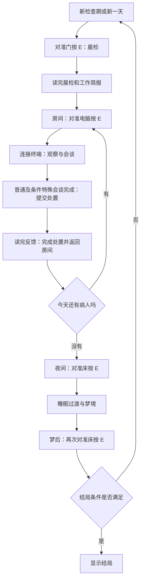
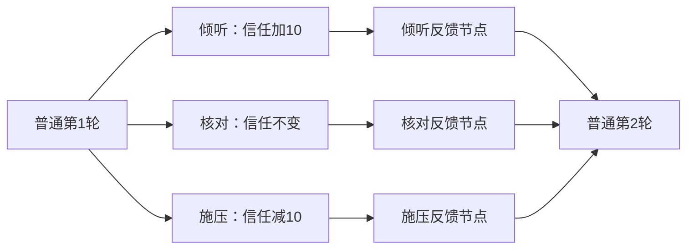

# 策划验收指南：现阶段成果、触发与剧情配置

更新日期：2026-10-15。本文面向策划验收当前开发原型，按“怎样玩到这个功能、应该看到什么、内容在哪里改”组织；验收建议不等于正式策划已经确认。[opinion]

**当前成果是能够跑通流程的三天开发原型。对白、人物肖像、观察画面、梦境和结局演出仍是开发占位；当前数值与人物规则也保留开发配置身份。** [verified: ../src/MiniGame.Core/Rules/PrototypeRules.cs L8–L30；../src/MiniGame.Presentation/PrototypeContent.cs L45–L102、L105–L112；../UnityProject/README.md「运行与操作」]

## 最新策划来源与当前原型的差距

- [小孩v1.1对白表](sources/dialogue-child-v1-1.md)已提供三天正式台词、节点、选项、措施、立绘ID及配置方式；本页“没有导入器”仍成立，不能再解读成策划尚未提供对白表。[verified: .source-data/dialogue-child-v1-1.json sheets；本页「验收前先读这几条」] [opinion]
- 主Wiki608版新增反叛值自我净化分支，画板新增每天开始前结局/KPI检查。下文描述当前原型的三结局与三天后KPI结算；本次仅同步文档，没有把新来源接入运行逻辑。[verified: .source-data/game-wiki.json content「结局」；.source-data/board-IykwwdNvihVgabb0wfKctsnOnJd.json data.nodes o43:14；本页「夜间、梦境与结局检查」] [opinion]
- 小孩表为R1–R6对话、R7措施轮，真分支信任变化−3/0/+3；当前原型为4普通轮及±10。新验收目标要先统一模型、数值和三种/四条结局冲突。[verified: .source-data/workbook-cells/dialogue-child-v1-1.X84Zd2.json data.ranges 第10–11、20、30–33行；本页「当前开发配置」] [opinion]

### 新提供的Excel与HTML怎样用于验收

[Excel原件](assets/workbooks/dialogue-child-v1-1/dialogue-child-v1-1.xlsx)与[Day1终端HTML](sources/inspection-terminal-day1-prototype.md)均已归档。HTML的50个文本节点、20个对话选项及三种处置对应Excel主表Day1，适合核对台词、选项汇合、核验灯与处置反馈的预期；本轮仅做静态检查，没有浏览器或Unity运行验收。[verified: .source-data/inspection-terminal-day1-v0.5.2.json nodes/options/data_matches_xlsx_day1/runtime_browser_test] [opinion]

HTML测试台默认信任阈值3、净化剩余5，可跳轮次、调皮肤和CRT；这些测试入口与数值不属于当前Unity正式规则。HTML目录中的其余4项是未配置占位，不作为五病人完成证据。[verified: .source-data/inspection-terminal-day1-v0.5.2.json default_test_threshold/default_test_quota/configured_patients/roster_slots] [opinion]

## 验收前先读这几条

- 当前验收入口建议使用 **Unity Editor 的主场景**。仓库内旧 `Builds/MiniGame/MiniGame.exe` 最后写入时间为2026-10-13；2026-10-15的启动修复没有重新构建 Player，不应用旧程序验收最新按钮文案。[verified: 本次读取的 MiniGame.exe LastWriteTime=2026-10-13T16:35:11+08:00；gameplay-migration-verification.json unity.normalUpmRecovery.playerRebuilt] [opinion]
- “选择回复”“提交处置”“读完处置反馈”是三种不同操作。点击净化后，人物状态与配额已经结算；仍要读完反馈，再点击 **完成处置并返回房间**，才能结束本次会谈。[verified: ../src/MiniGame.Core/Runtime/GameSession.cs L220–L275；../UnityProject/Assets/MiniGame/Runtime/MiniGameScreen.cs L107–L117]
- **每天有多位病人，每位病人处置后都要回到房间，再操作电脑接待下一位。** 不会在一个终端界面里自动连续播放所有病人，也不能点击名单自由切换接待顺序。[verified: ../src/MiniGame.Presentation/GameRuntime.cs L75–L88、L138–L140、L282–L288；../src/MiniGame.Core/Runtime/GameSession.cs L265–L308；../UnityProject/Assets/MiniGame/Runtime/MiniGameScreen.cs Render 中 patientList 文本]
- **睡眠和跨日有两次床交互。** 当日工作结束后，到床边按 E 睡眠；梦境读完后，再到床边按 E，才进入次日或结局。[verified: ../src/MiniGame.Core/Runtime/GameSession.cs L123–L142、L311–L351；../src/MiniGame.Presentation/GameRuntime.cs L90–L96、L125–L141、L282–L288]
- **当前没有策划可直接导入的 Excel/JSON 剧情配置表或节点编辑器。** 台词源和规则在 C# 中，生成后的 `.yarn` 可以临时修改，但生成菜单会覆盖它。下文的填写模板用于交给程序接入，不是现成导入格式。[verified: ../UnityProject/Assets/MiniGame/Editor/GeneratePrototypeYarn.cs L23–L45；../UnityProject/Assets/MiniGame/Runtime/MiniGameBootstrap.cs L27–L31；../src/MiniGame.Core/Rules/PrototypeRules.cs L17–L52] [opinion]

## 已完成什么，以及这次验收不代表什么

- **公寓交互**：WASD移动、鼠标观察、门/电脑/床的近距离 E 交互；当前阶段只开放允许操作的物件。[verified: ../UnityProject/Assets/MiniGame/Runtime/ApartmentPlayer.cs L29–L70；../src/MiniGame.Presentation/GameRuntime.cs L282–L288]
- **会谈与观察**：中文台词、继续按钮、回复选项、回复后的反馈分支，以及眼睛、手部、牙齿、照片、当日通知、档案六类观察入口。[verified: ../UnityProject/Assets/MiniGame/Yarn/MiniGameYarnBridge.cs L199–L246；../src/MiniGame.Presentation/PrototypeContent.cs L77–L102]
- **处置与后果**：治疗、净化、满足门槛后释放；记录实际回复、治疗次数、人物去留和每日净化数量，后续队列跳过已退出人物。[verified: ../src/MiniGame.Core/Runtime/GameSession.cs L153–L175、L220–L286]
- **日夜循环**：晨检、简报、会谈、回房、当日收束、睡眠、梦境、跨日和结局；电脑镜头进出、睡眠淡入淡出、反应信号失真已有实现。[verified: ../src/MiniGame.Presentation/GameRuntime.cs L66–L143；../UnityProject/Assets/MiniGame/Runtime/PresentationEffects.cs L46–L133]
- **暂停与恢复**：ESC暂停，F5保存，F9读取，暂停菜单可开始新检查期；保存包含逻辑进度、当前演出类型和观察记录。[verified: ../UnityProject/Assets/MiniGame/Runtime/MiniGameBootstrap.cs L46–L57、L70–L94；../src/MiniGame.Presentation/GameRuntime.cs L172–L215]
- **尚不能按正式成品验收**：正式剧本、美术与音频、完整梦境/结局演出、Day0教学、日记、外交官保护特例、真假/善恶判定都没有因为当前原型可运行而自动完成；细项仍见[设计待定项](open-questions.md)。[verified: open-questions.md Q02、Q10–Q14、Q16–Q26；project-status.md「必须填补的工作」] [opinion]

## 怎样启动和操作

1. 在本机双击仓库根 [Open-Unity.cmd](../Open-Unity.cmd)。启动脚本默认使用 `E:/Unity/Editors/2022.3.23f1/Editor/Unity.exe`，要求版本与工程的 `2022.3.23f1c1`一致；它会补齐缺失的子进程环境变量，并调用主场景打开入口。其他机器需程序调整 EditorPath 并验证环境。[verified: ../UnityProject/Tools/Open-Project.ps1 L1–L18、L27–L45] [opinion]
2. 已经打开工程时，用菜单 **MiniGame → Open prototype scene** 打开 `Assets/MiniGame/Scenes/InspectionApartment.unity`；不要为普通验收点击会重新生成资源的 **Create and validate prototype**。[verified: ../UnityProject/Assets/MiniGame/Editor/ReferencePrototypeBuilder.cs OpenPrototype/CreateAndValidate]
3. 按 Unity 顶部 Play 开始。新会话从第一天晨检开始；WASD移动、鼠标观察，准星对准物件且出现 `[E]`提示后按 E。[verified: ../UnityProject/Assets/MiniGame/Runtime/MiniGameBootstrap.cs L27–L35；../UnityProject/Assets/MiniGame/Runtime/ApartmentPlayer.cs L29–L70]
4. 台词使用“继续”按钮或空格推进；回复可点击，也可按数字1–4选择。处置在会谈完成后出现，不需要反复点击已经提交过的净化。[verified: ../UnityProject/Assets/MiniGame/Runtime/MiniGameScreen.cs L107–L139、Render 的 dispositionButtons 分支；../src/MiniGame.Core/Runtime/GameSession.cs L225–L228]
5. ESC打开暂停菜单；F5保存、F9读取。保存时如果处于暂停，读取后仍是暂停状态，需要再按 ESC恢复。新路线验收用暂停菜单的“开始新检查期”，并注意新会话再次F5会更新同一个存档文件。[verified: ../UnityProject/Assets/MiniGame/Runtime/MiniGameBootstrap.cs L22、L46–L57、L70–L94；../src/MiniGame.Presentation/GameRuntime.cs L174–L180、L204–L209]

## 游戏循环：一整天实际怎样走

下图对应当前宿主的推进顺序；所有“读完”都包括按继续推进文本，镜头与睡眠过渡则由演出自动完成。[verified: ../src/MiniGame.Presentation/GameRuntime.cs L66–L143；../src/MiniGame.Core/Runtime/GameSession.cs L123–L142、L265–L351]



### 晨检、简报与进入工作

新会话先去门边按 E。读完晨检后自动进入简报，读完简报回到可移动的公寓状态；此时去电脑前按 E进入第一位病人的会谈。门不是随时可用，电脑也不是任意阶段都可用。[verified: ../src/MiniGame.Presentation/GameRuntime.cs L66–L88、L125–L140、L282–L288；../src/MiniGame.Core/Runtime/GameSession.cs Execute 的 CompleteMorningInspection/CompleteBriefing 分支]

### 一位病人的会谈

读当前轮台词 → 选择一个回复 → 读该回复对应的反馈分支 → 进入下一轮。四轮普通会谈结束时检查信任门槛；符合条件就追加一轮特殊会谈，不符合则直接开放处置。特殊会谈的回复及反馈完成后，同样进入处置。[verified: ../src/MiniGame.Core/Runtime/GameSession.cs L153–L217；../src/MiniGame.Core/Rules/PrototypeRules.cs L33–L52]

六类观察可在终端允许输入时打开，检查界面出现后用“记录并返回”或ESC关闭。记录按“日期＋病人＋检查类别”去重；当前检查不会增加信任，也没有“必须六项全看完才能处置”的门槛，档案页也不是完整历史记录浏览器。[verified: ../src/MiniGame.Presentation/GameRuntime.cs L146–L163；../src/MiniGame.Presentation/PrototypeContent.cs L77–L102；../UnityProject/Assets/MiniGame/Runtime/MiniGameBootstrap.cs L49–L54；../src/MiniGame.Core/Runtime/GameSession.cs L220–L228]

### 提交处置和接待下一位

点击治疗/净化/释放时立即提交一次处置，并切换到反应台词。**此时净化配额减少、名单显示已净化，是预期结果；不代表反应台词已播放完。** 读完反应并点击“完成处置并返回房间”，镜头退回公寓；还有病人时再次对准电脑按 E，没有病人时转入夜间并提示去床边。[verified: ../src/MiniGame.Core/Runtime/GameSession.cs L220–L308；../src/MiniGame.Presentation/GameRuntime.cs L108–L143、L282–L288；../UnityProject/Assets/MiniGame/Runtime/MiniGameScreen.cs L107–L117]

### 夜间、梦境与结局检查

当日最后一位病人的反应结束后，才结算当天净化是否达标。去床边按 E触发睡眠，梦境读完后处于梦后阶段；再次操作床，日期才递增，并执行到期事件、检查结局，再决定是否准备下一天。[verified: ../src/MiniGame.Core/Runtime/GameSession.cs L289–L351；../src/MiniGame.Presentation/GameRuntime.cs L90–L96、L125–L141]

**当前少净化一天不会当晚立刻锁房。** 锁房判断在三天全部结束后的跨日执行；Day4用于结局收束，没有第四天工作内容。[verified: ../src/MiniGame.Core/Runtime/GameSession.cs L336–L351；../src/MiniGame.Core/Rules/PrototypeRules.cs L27–L30]

## 当前开发配置：人员、门槛与处置后果

以下均是本轮可执行开发配置，供验收定位；正式改动要与[设计待定项](open-questions.md)一起裁决。[verified: ../src/MiniGame.Core/Rules/PrototypeRules.cs L8–L52；open-questions.md Q03、Q07–Q09、Q22–Q25] [opinion]

- 日程为Day1–3，每天净化目标1人；Day1候选顺序为米洛（小孩）、薇拉·沃斯（前执政者）、埃德温（战场医生）、阿德里安（外交官）。Day2起在队尾加入乔纳（神父），但只接待仍处于在册状态的人。[verified: ../src/MiniGame.Core/Rules/PrototypeRules.cs L19–L28；../src/MiniGame.Core/Runtime/GameSession.cs L279–L308]
- 初始信任0；每轮三个默认回复：“倾听”对应 `empathize` +10，“核对”对应 `neutral` 0，“施压”对应 `pressure` −10。信任属于各病人的持续状态，跨日保留；没有自动归零或0–100钳制。[verified: ../src/MiniGame.Core/Rules/PrototypeRules.cs L21–L25、L48–L52；../src/MiniGame.Core/Runtime/GameSession.cs L164–L174、L279–L286；../src/README.md「开发默认规则」]
- 普通会谈默认4轮，全部完成后信任≥20追加特殊会谈；处置时信任≥30允许释放。达到释放数值仍需等会谈及反馈完成，释放不会提前打断普通轮。[verified: ../src/MiniGame.Core/Rules/PrototypeRules.cs L33–L45；../src/MiniGame.Core/Runtime/GameSession.cs L180–L228、L376]
- 治疗：累计治疗次数；米洛、薇拉、埃德温第三次治疗即时终止并记为死亡。阿德里安第三次治疗记为治疗结束、退出后续队列，当前不判定其真实死亡或保护去向。[verified: ../src/MiniGame.Core/Rules/PrototypeRules.cs L21–L24；../src/MiniGame.Core/Runtime/GameSession.cs L247–L258、L279–L283]
- 净化：立即标记已净化并给当天净化数量加1，后续日程不再接待。配额是最低目标，当前代码没有禁止当天净化超过1人；超过目标不会把多出来的数量结转成次日配额。[verified: ../src/MiniGame.Core/Runtime/GameSession.cs L225–L239、L279–L286、L293–L295]
- 释放：立即标记已释放，普通角色不再接待；神父释放会安排次日袭击事件。[verified: ../src/MiniGame.Core/Runtime/GameSession.cs L241–L245、L279–L283；../src/MiniGame.Core/Rules/PrototypeRules.cs L25]
- 神父规则配置了“第三次治疗后次日终止”，但默认Day2才加入、三天内最多治疗两次，当前日程自然到不了该终止事件。验收此规则需要程序提供专门测试配置，不能要求策划在默认三天内强行触发。[verified: ../src/MiniGame.Core/Rules/PrototypeRules.cs L25–L28；../src/MiniGame.Core/Runtime/GameSession.cs L249–L257] [opinion]

## 剧情分支究竟由什么驱动

### 回复分支：先反馈，再汇合

以 `day1.child.normal.1`（米洛第一天普通第1轮）为例，选择倾听会记录回复、信任加10，再播放 `day1.child.normal.1.branch.empathize`。该分支读完后汇合到普通第2轮；核对和施压也各有反馈节点，再按同样轮次前进。[verified: ../src/MiniGame.Core/Rules/PrototypeRules.cs L33–L52；../src/MiniGame.Core/Runtime/GameSession.cs L153–L209]



这是“选项反馈＋轮次汇合”的结构。当前 `ResponseDefinition` 只有选项ID、反馈节点ID、信任变化，没有可配置的任意下一节点、复杂条件表达式或剧情旗标效果；自由多层分支树需要程序扩展规则与存档，不能只靠改 `.yarn` 的 `jump`来替代核心进度。[verified: ../src/MiniGame.Core/Rules/DialogueDefinitions.cs L10–L20、L37–L64；../src/MiniGame.Core/Runtime/GameSession.cs L180–L209；../src/MiniGame.Presentation/PrototypeYarnSource.cs L30–L45] [opinion]

### 条件分支：特殊会谈与释放

从新会话开始，对米洛四轮都选核对，信任保持0，普通轮后不进入特殊会谈，处置区没有释放按钮。改为四轮都倾听，普通轮后信任40，会进入特殊会谈；完成特殊轮后，只要信任仍≥30，就能释放。特殊轮里的回复也会改变信任，因此最终处置许可按完成后的状态检查。[verified: ../src/MiniGame.Core/Rules/PrototypeRules.cs L21、L33–L52；../src/MiniGame.Core/Runtime/GameSession.cs L153–L209、L228、L376]

### 跨日分支：人物是否回来、治疗是否终止

日程先定义“当天原本安排谁”，跨日后再用实际人物状态过滤名单。仍在册的治疗对象继续出现；已净化、已释放、死亡或治疗结束者不再接待。信任和治疗次数继续累积，而不是每天生成全新人物状态。[verified: ../src/MiniGame.Core/Runtime/GameSession.cs L230–L258、L279–L286、L311–L351]

日期也会改变占位台词，但当前普通台词主要按“病人＋日期＋轮次”选择；没有完整的“昨天选了某句话，因此今天换整条剧本”的配置系统。要验收这种指定历史答案驱动的正式分支，需另行实现对应条件。[verified: ../src/MiniGame.Presentation/PrototypeContent.cs DialogueText L135–L169；../src/MiniGame.Core/Rules/DialogueDefinitions.cs L10–L64] [opinion]

## 三种结局怎样触发

以下是根据当前规则整理的手动验收路线；三结局在宿主自动测试中有覆盖，本次编写文档没有替策划重新手打三条路线。每条路线都从“开始新检查期”起步，不要读入上一条路线的存档。[verified: ../src/MiniGame.Presentation.Tests/RuntimeEndingTests.cs L14–L45] [opinion]

### 被带走：三天达标，神父不释放

默认回复始终选核对；Day1净化米洛，其余人治疗；Day2净化薇拉，其余人治疗；Day3净化埃德温，其余人治疗。每位处置后正常返回房间、再操作电脑；每天最后完成两次床交互。三天各净化1人，未安排神父袭击，第三天梦后跨日时进入“被带走”。[verified: ../src/MiniGame.Core/Rules/PrototypeRules.cs L19–L30；../src/MiniGame.Core/Runtime/GameSession.cs L220–L351] [opinion]

### 锁房：至少一天未达配额，并避开神父袭击

最容易区分的一条路线是：三天所有回复选核对，所有处置选治疗，不释放神父。第一天配额未达标后仍应能正常继续；第三天梦后再次操作床，进入“KPI失败后锁房”。后两天补净化也不能取消已经记录的未达标日。[verified: ../src/MiniGame.Core/Runtime/GameSession.cs L293–L295、L336–L342；../src/MiniGame.Presentation.Tests/RuntimeEndingTests.cs L14–L44] [opinion]

### 神父袭击：第二天释放神父，下一次跨日触发

第一天按“被带走”路线操作。第二天先净化薇拉保证当天配额，其他普通病人治疗；神父出现后连续选择倾听，完成普通轮、特殊轮与各自反馈，处置时选择释放。正常结束当晚睡眠与梦境，再操作床跨入第三天，即应进入袭击结局。[verified: ../src/MiniGame.Core/Rules/PrototypeRules.cs L25、L33–L52；../src/MiniGame.Core/Runtime/GameSession.cs L241–L245、L311–L347；../src/MiniGame.Presentation.Tests/RuntimeEndingTests.cs L14–L36] [opinion]

**冲突优先级为：神父袭击 → 锁房 → 被带走。** 到期袭击可以在第三天开始前提前结束流程；三天结束时，未达标会覆盖正常被带走。三种结局目前验收的是判定、名称与占位反馈，不是完整结局动画/音频成品。[verified: ../src/MiniGame.Core/Rules/PrototypeRules.cs L29–L30；../src/MiniGame.Core/Runtime/GameSession.cs L336–L347；../src/MiniGame.Presentation/PrototypeContent.cs GetPresentation 的 Ending 分支]

## 对白怎样配置

### 配置的三个位置

1. **文字源**：[PrototypeContent.cs](../src/MiniGame.Presentation/PrototypeContent.cs)。`DialogueText`负责病人正文，`ResponseText`负责回复按钮文本，`BranchText`负责回复反馈，`ReactionText`负责处置反应；`GetPresentation`负责晨检、简报、梦境、结局，`GetInspection`负责六类观察说明。[verified: ../src/MiniGame.Presentation/PrototypeContent.cs L45–L102、L105–L195]
2. **流程与数值源**：[PrototypeRules.cs](../src/MiniGame.Core/Rules/PrototypeRules.cs)。配置病人、日程、轮次、选项ID/信任变化、特殊与释放门槛、三类反应节点及结局优先级；数据结构与约束定义在[DialogueDefinitions.cs](../src/MiniGame.Core/Rules/DialogueDefinitions.cs)和[GameRules.cs](../src/MiniGame.Core/Rules/GameRules.cs)。[verified: ../src/MiniGame.Core/Rules/PrototypeRules.cs L17–L52；../src/MiniGame.Core/Rules/DialogueDefinitions.cs L10–L64；../src/MiniGame.Core/Rules/GameRules.cs L11–L93]
3. **生成物**：`UnityProject/Assets/MiniGame/Content/Prototype.yarn`、`Prototype.yarnproject`、`mapping.json`。生成器把逻辑节点编码成Yarn节点名，并保存映射；运行时桥接根据核心当前节点播放对应Yarn内容。[verified: ../UnityProject/Assets/MiniGame/Editor/GeneratePrototypeYarn.cs L15–L45；../src/MiniGame.Presentation/PrototypeYarnSource.cs L17–L45；../UnityProject/Assets/MiniGame/Yarn/MiniGameYarnBridge.cs Pump]

### 只想临时换一句台词，怎样预览

1. 退出 Play Mode，先备份 `Prototype.yarn`。从 [mapping.json](../UnityProject/Assets/MiniGame/Content/mapping.json)找到目标逻辑节点，例如 `day1.child.normal.1`，复制其 `yarnNodeName`再到 `.yarn`定位。[verified: ../UnityProject/Assets/MiniGame/Content/mapping.json nodes 中 coreNodeId=day1.child.normal.1] [opinion]
2. 仅替换正文和选项的显示文字；保留 `title`、`---`、`===`、`#response_...`标记与 `<<select_response ...>>`命令。保存后等Unity导入、确认没有编译错误，再从新会话走到该节点。[verified: ../src/MiniGame.Presentation/PrototypeYarnSource.cs L35–L46；../UnityProject/Assets/MiniGame/Yarn/MiniGameYarnBridge.cs L185–L196、L215–L245] [opinion]
3. **临时修改不会回写C#内容源**。之后执行 **Generate Original Prototype Yarn**、**Create and validate prototype**或走调用该生成器的构建流程，会覆盖生成物；正式内容需要按下一节回到源文件维护。[verified: ../UnityProject/Assets/MiniGame/Editor/GeneratePrototypeYarn.cs L23–L42；../UnityProject/Assets/MiniGame/Editor/ReferencePrototypeBuilder.cs CreateAndValidate/BuildWindows]

下面是当前第一天米洛首轮节点的节选；中文可以临时替换，节点标题、回复元数据与命令参数具有逻辑用途。这里只展示一个选项，不是要求删除现有其他选项。[verified: ../UnityProject/Assets/MiniGame/Content/Prototype.yarn L153–L162] [opinion]

```yarn
title: Core_646179312e6368696c642e6e6f726d616c2e31
---
米洛: 【开发占位】我叫米洛。这里的问题有正确答案吗？
-> 倾听：我听见了，请继续说。 #response_656d70617468697a65
    <<select_response "646179312e6368696c642e6e6f726d616c2e31" "656d70617468697a65">>
===
```

单独修改选项文字不会改变其信任效果；`empathize`的+10来自规则，不是来自“倾听”两个字。也不要删除响应标记，否则桥接可能找不到合法选项。[verified: ../src/MiniGame.Core/Rules/PrototypeRules.cs L48–L52；../UnityProject/Assets/MiniGame/Yarn/MiniGameYarnBridge.cs L222–L235]

晨检、简报、梦境、结局的Yarn节点使用 `$minigame_cue_text`运行时变量，真实占位文字来自 `GetPresentation`。因此这些内容的稳定修改入口是C#文字源，不能把生成Yarn中的变量占位误当作丢失台词。[verified: ../src/MiniGame.Presentation/PrototypeYarnSource.cs L48–L54；../UnityProject/Assets/MiniGame/Yarn/MiniGameYarnBridge.cs L123–L126；../src/MiniGame.Presentation/PrototypeContent.cs L45–L74]

### 正式修改台词，怎样保留到下次生成

1. 策划提交“病人ID、日期、普通/特殊轮、轮次、正文、每个回复文字、每个回复反馈、三种处置反馈”，程序修改 `PrototypeContent`中相应函数。[verified: ../src/MiniGame.Presentation/PrototypeContent.cs L105–L112、L127–L195] [opinion]
2. 注意当前共享范围：`ResponseText`只接收回复ID，改一个默认回复文案会影响使用它的所有轮；`BranchText`只接收病人和回复ID，`ReactionText`只接收病人和处置，两者当前都不按日期区分。需要“某一天某一轮独有文案”时，应让程序增加相应定位参数或改成按完整节点ID查表，不能误改全局文案。[verified: ../src/MiniGame.Presentation/PrototypeContent.cs L105–L112、L127、L172、L181] [opinion]
3. 程序在退出Play后执行 **MiniGame → Generate Original Prototype Yarn**，重新导入生成物、检查Console，再重新开始验收；仅改对白不需要重新生成整个场景。交付独立exe时另行重新构建。[verified: ../UnityProject/Assets/MiniGame/Editor/GeneratePrototypeYarn.cs L20–L50；../UnityProject/Assets/MiniGame/Editor/ReferencePrototypeBuilder.cs OpenPrototype/CreateAndValidate/BuildWindows] [opinion]
4. 内容结构变更应同步维护 `PrototypeContent.Revision`；规则变化会改变规则指纹，旧规则存档不能直接沿用。改完配置后的验收建议从新检查期开始。[verified: ../src/MiniGame.Presentation/PrototypeContent.cs L14；../src/MiniGame.Core/Rules/GameRules.cs L100–L120；../src/MiniGame.Presentation/GameRuntime.cs L197–L202] [opinion]

## 怎样配置不同的剧情进程

### 已有配置可以改变的内容

- **谁、哪天、按什么顺序接待**：`PatientDefinition.FirstDay`控制首次出现；每日 `DayDefinition.Meetings`控制候选次序；实际接待还要经过人物在册状态过滤。当前默认日程用 `patients.Where(...)`生成，改病人数组顺序也会影响默认接待顺序。[verified: ../src/MiniGame.Core/Rules/PrototypeRules.cs L19–L28；../src/MiniGame.Core/Rules/GameRules.cs L13–L25、L42–L54；../src/MiniGame.Core/Runtime/GameSession.cs L279–L283]
- **每天净化目标**：`DayDefinition.PurificationQuota`，当前默认构造中的 `new DayDefinition(day, 1, ...)`就是每日1人的来源。要每天不同，需分别构造当天定义。[verified: ../src/MiniGame.Core/Rules/PrototypeRules.cs L27–L28；../src/MiniGame.Core/Rules/GameRules.cs L42–L54] [opinion]
- **普通/特殊会谈和释放**：`CreateMeeting(patientId, day, normalRounds, specialThreshold, releaseThreshold)`；默认参数为4、20、30。正式每人每天不同，需要在生成日程时为该人该天传不同值，或分别构造 `MeetingDefinition`。[verified: ../src/MiniGame.Core/Rules/PrototypeRules.cs L33–L45] [opinion]
- **回复效果与反馈去向**：`ResponseDefinition(id, branchNodeId, trustDelta)`。改信任变化只改第三个参数；改反馈节点需同时提供对应文字内容。每轮支持1–4个不重名选项，普通会谈支持4–5轮；新增第5轮后还应补正式第5轮台词，当前正文函数对超出现有数组的轮次只返回补充说明占位。[verified: ../src/MiniGame.Core/Rules/DialogueDefinitions.cs L10–L32、L46–L64；../src/MiniGame.Presentation/PrototypeContent.cs L169] [opinion]
- **治疗与延时事件**：`PatientDefinition`中的 `TreatmentLimit`、`TreatmentOutcome`、`TreatmentDelayDays`，以及释放后袭击的 `AttacksAfterRelease`、`AttackDelayDays`。这些字段不是让策划直接修改运行中的患者状态，而是修改新会话使用的配置。[verified: ../src/MiniGame.Core/Rules/GameRules.cs L11–L38；../UnityProject/Assets/MiniGame/Runtime/MiniGameBootstrap.cs L27–L31] [opinion]
- **结局冲突顺序**：`GameRules.EndingPriority`；配置要求每种已支持结局恰好出现一次。它只改变已有结局的优先级，不会新增一种结局。[verified: ../src/MiniGame.Core/Rules/GameRules.cs L87–L93；../src/MiniGame.Core/Runtime/GameSession.cs L336–L347]

例如下面是现有函数支持的配置调用示意，表示米洛第一天普通4轮，特殊门槛20、释放门槛30；需要程序把该调用接入对应日程，不是可单独导入的文本。[verified: ../src/MiniGame.Core/Rules/PrototypeRules.cs L33–L45] [opinion]

```csharp
PrototypeRules.CreateMeeting(
    PrototypeRules.Child, day: 1,
    normalRounds: 4, specialThreshold: 20, releaseThreshold: 30);
```

### 需要新增实现，不能仅靠改现有数值的内容

“选某个回复永久设置剧情旗标”“根据昨天具体答案更换整棵分支树”“检查某个线索才允许某个回复”“任意轮数与任意跳转”“疯狂值影响次日选项”“外交官阻止净化并改写结局”等，都不能视为当前配置接口已经提供的能力。策划需写清条件、触发时点、文本与后果，再由程序扩展规则、文字源、存档及回归验证。[verified: ../src/MiniGame.Core/Rules/DialogueDefinitions.cs L10–L64；../src/MiniGame.Core/Rules/GameRules.cs L11–L64；../src/MiniGame.Core/Runtime/GameSession.cs L153–L262；open-questions.md Q10、Q12、Q24–Q25] [opinion]

## 建议按这些项目验收

下列为本阶段建议勾选项；勾选代表策划按步骤实测通过，不能用自动测试结果直接代填。[opinion]

- [ ] **启动与晨检**：打开正确主场景；新会话从第一天开始；门边E触发晨检，读完晨检/简报后能走到电脑开始工作。[verified: ../src/MiniGame.Presentation/GameRuntime.cs L66–L88、L125–L140]
- [ ] **会谈与反馈**：回复前先读台词；每次回复后有对应反馈，读完才进入下一轮；普通轮未完成时不出现可用处置。[verified: ../src/MiniGame.Core/Runtime/GameSession.cs L153–L228]
- [ ] **低信任路线**：新会话米洛始终核对，普通轮后不出现特殊会谈或释放；记录实际画面与操作。[verified: ../src/MiniGame.Core/Rules/PrototypeRules.cs L21、L33–L52；../src/MiniGame.Core/Runtime/GameSession.cs L203、L376] [opinion]
- [ ] **高信任路线**：重新开始后米洛连续倾听，普通轮后出现特殊轮，完成后能看到释放；不把隐藏信任数值直接显示列为当前UI承诺。[verified: ../src/MiniGame.Core/Rules/PrototypeRules.cs L21、L33–L52；../src/MiniGame.Presentation/PrototypeContent.cs L99；../UnityProject/Assets/MiniGame/Runtime/MiniGameScreen.cs Render] [opinion]
- [ ] **六类观察**：逐个打开并返回；记录数量最多6类；重新查看不重复累加，检查时不能同时推进会谈。[verified: ../src/MiniGame.Presentation/GameRuntime.cs L99–L105、L146–L163；../UnityProject/Assets/MiniGame/Yarn/MiniGameYarnBridge.cs L251–L255]
- [ ] **净化与返回**：点击一次净化后配额和去留变化；原处置按钮消失，显示反应反馈；点击“完成处置并返回房间”或空格后真正退出终端，再对电脑按E接待下一位。[verified: ../UnityProject/Assets/MiniGame/Runtime/MiniGameScreen.cs ShowCueText/Render；../src/MiniGame.Presentation/GameRuntime.cs L108–L143；../src/MiniGame.Core/Runtime/GameSession.cs L236–L239]
- [ ] **人物次日变化**：对照新会话分别治疗、净化或释放米洛；治疗后未到上限应次日出现，净化/释放后不应再进队列。[verified: ../src/MiniGame.Presentation.Tests/RuntimeEndingTests.cs L48–L71]
- [ ] **夜间跨日**：必须完成当日所有在册病人；两次床交互之间有睡眠和梦境；跨日后日期、名单与剩余配额正确。[verified: ../src/MiniGame.Core/Runtime/GameSession.cs L265–L351；../src/MiniGame.Presentation/GameRuntime.cs L90–L96、L125–L141]
- [ ] **三种结局**：分别从新会话按本文三条路线验证触发时点与名称；不要只看结局标题字符串存在就勾选。[verified: ../src/MiniGame.Presentation.Tests/RuntimeEndingTests.cs L14–L45] [opinion]
- [ ] **暂停/存读档**：在回复后、处置反馈中、夜间各保存并读取，观察当前节点、人物去留、配额及观察记录；读档不能再次扣配额或再次增加治疗次数。允许从当前节点重播台词，当前不承诺逐字/逐行播放游标恢复。[verified: ../src/MiniGame.Presentation/GameRuntime.cs L172–L215、L309–L319；../UnityProject/Assets/MiniGame/Yarn/MiniGameYarnBridge.cs Bind/RunNodeAsync；../UnityProject/Assets/MiniGame/Tests/PlayMode/PrototypePlayModeTests.cs RestoreInvalidatesOldContinueAndReplyCallbacksWhileFreshYarnRemainsUsable] [opinion]
- [ ] **鼠标与快捷键**：对白继续、选项、净化后的返回分别用鼠标与键盘走通；出现鼠标异常时记录是否失焦、是否只有首次点击失败，以及空格是否仍可用，不将能按空格等同于鼠标验收通过。[verified: ../UnityProject/Assets/MiniGame/Tests/PlayMode/PrototypePlayModeTests.cs ClickThroughPointer；../UnityProject/Assets/MiniGame/Runtime/MiniGameScreen.cs L132–L139] [opinion]

## 策划怎样交付下一批内容

小孩已有的正式来源优先从[完整对白表](sources/dialogue-child-v1-1.md)交接，遵循原表“只编辑对话流程、派生表由公式生成”的约定；下方模板继续用于未覆盖内容和程序接入沟通，不要求策划重复抄写已交付的表。[verified: .source-data/workbook-cells/dialogue-child-v1-1.X84Zd2.json data.ranges 第2、5–6行] [opinion]

下面是建议的最小交接模板。按病人和日期分别填写，保留逻辑ID；尚未决定的数值/设定标“待定”，不要用临时台词替代正式裁决。**当前程序不直接导入此模板。** [opinion]

```text
病人ID / 显示名：child / 米洛
日期：Day1
会谈类型 / 轮次：普通 / 第1轮
逻辑节点ID：day1.child.normal.1
说话人：米洛
病人正文：[填写正式台词]

选项ID：empathize
选项显示文字：[填写玩家回复]
信任变化：+10（开发默认；正式值需确认）
反馈节点ID：day1.child.normal.1.branch.empathize
反馈正文：[填写病人对此回复的反应]
反馈完成后：普通第2轮（沿用当前汇合流程）

其他选项：分别填写neutral、pressure，或交付需要程序接入的新ID
特殊会谈：进入条件、正文、选项、反馈
处置反应：治疗 / 净化 / 释放分别填写
观察：眼睛 / 手部 / 牙齿 / 照片 / 当日通知 / 档案
跨日后果：谁留下、谁退出、是否有延时事件、哪天执行
例外分支：条件、触发时点、优先级；标明是否超出现有接口
资源需求：角色差分、声音、画面与演出说明
验收路径：起始存档或新会话、操作选择、期望结果
```

## 验证证据与问题记录

- 2026-10-15正常UPM工程导入与主场景打开已有记录，四项图形PlayMode测试通过；[持久化验证汇总](gameplay-migration-verification.json)的 `unity.normalUpmRecovery`记录本机范围，不能扩展为其他机器或IL2CPP已通过。[verified: gameplay-migration-verification.json unity.normalUpmRecovery]
- 后续鼠标事件改动在隔离工程中运行四项图形PlayMode测试通过，包括按下/松开/点击事件推进三天流程；原始记录为 `Artifacts/Unity/PurifyClickRepair/pointer-events-results.xml`。这是隔离工程验证，不等同于策划在当前Editor里逐项验收，也不是重新构建的Player结果。[verified: ../Artifacts/Unity/PurifyClickRepair/pointer-events-results.xml test-run passed=4/failed=0；../UnityProject/Assets/MiniGame/Tests/PlayMode/PrototypePlayModeTests.cs ClickThroughPointer] [opinion]
- 三结局测试源码见 [RuntimeEndingTests.cs](../src/MiniGame.Presentation.Tests/RuntimeEndingTests.cs)，历史核心/宿主测试结果与Windows构建记录见[持久化验证汇总](gameplay-migration-verification.json)。本文编写仅核对源码和现有证据，不重新运行游戏测试或构建。[verified: ../src/MiniGame.Presentation.Tests/RuntimeEndingTests.cs L14–L45；gameplay-migration-verification.json dotnet/unity] [opinion]
- 提交问题时建议填写：验收项目名称、Day几/哪位病人、从新会话还是哪份存档开始、前置回复与处置、期望结果、实际结果、截图、鼠标与快捷键各自是否有效。当前启动日志在 `Artifacts/Unity/editor.log`；保存实际文件名和日志时间，便于与其他验收路线区分。[verified: ../UnityProject/Tools/Open-Project.ps1 L31、L44] [opinion]

现阶段成果总览见[当前完成情况与待补项](project-status.md)；正式策划冲突见[设计待定项](open-questions.md)；程序配置与测试说明见[核心说明](../src/README.md)和[Unity工程说明](../UnityProject/README.md)。[opinion]
