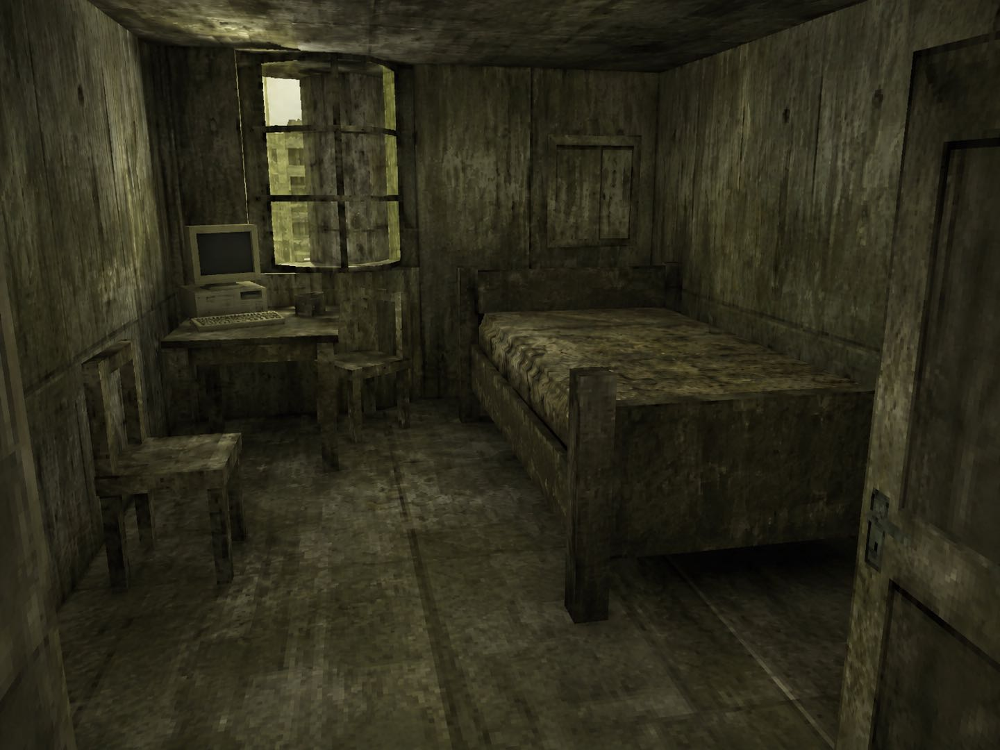
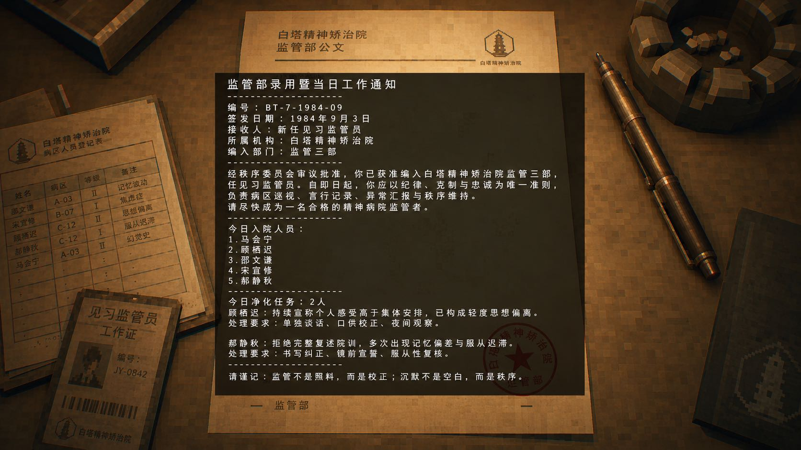
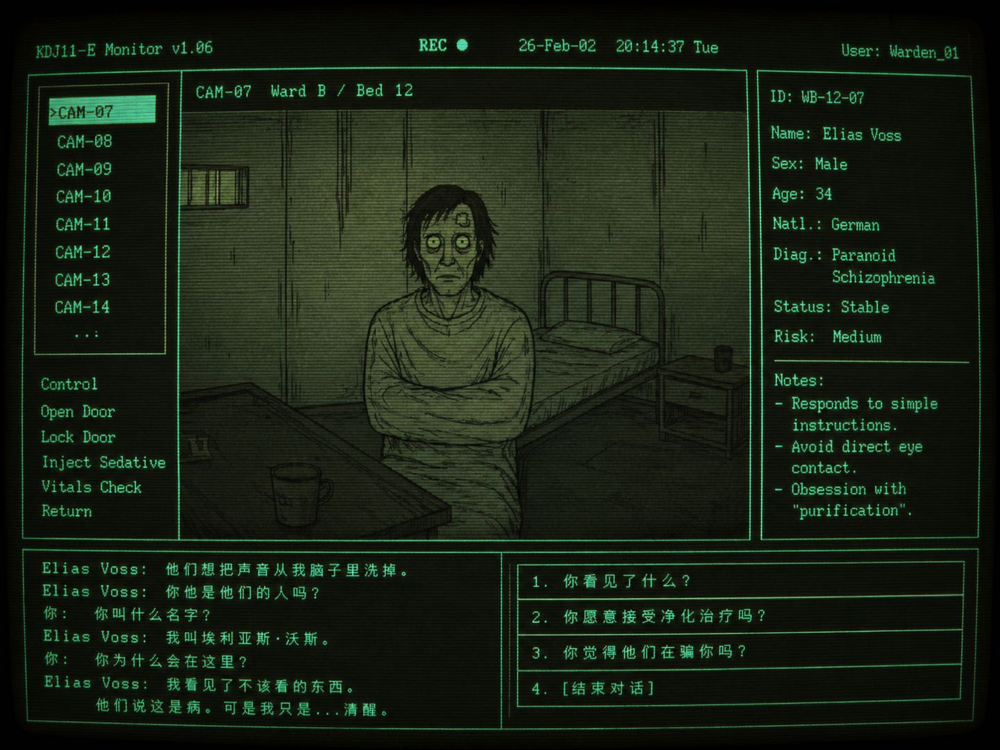
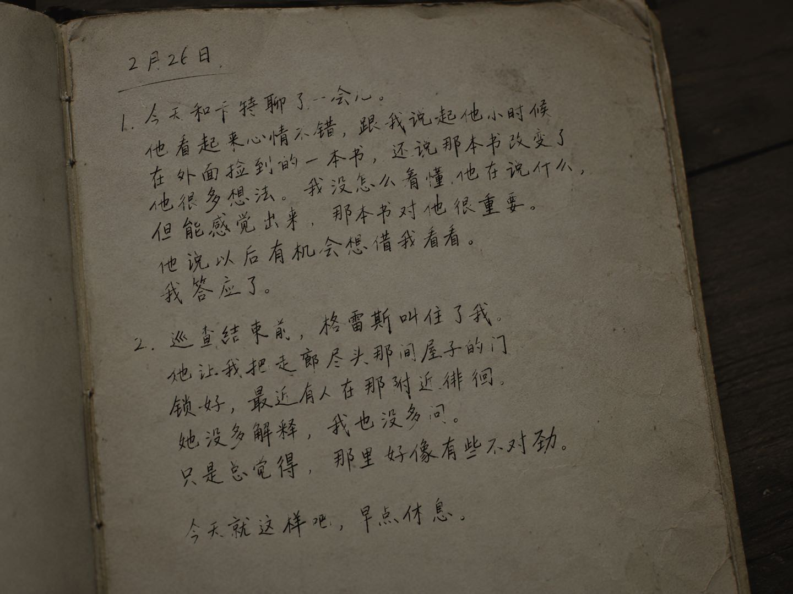
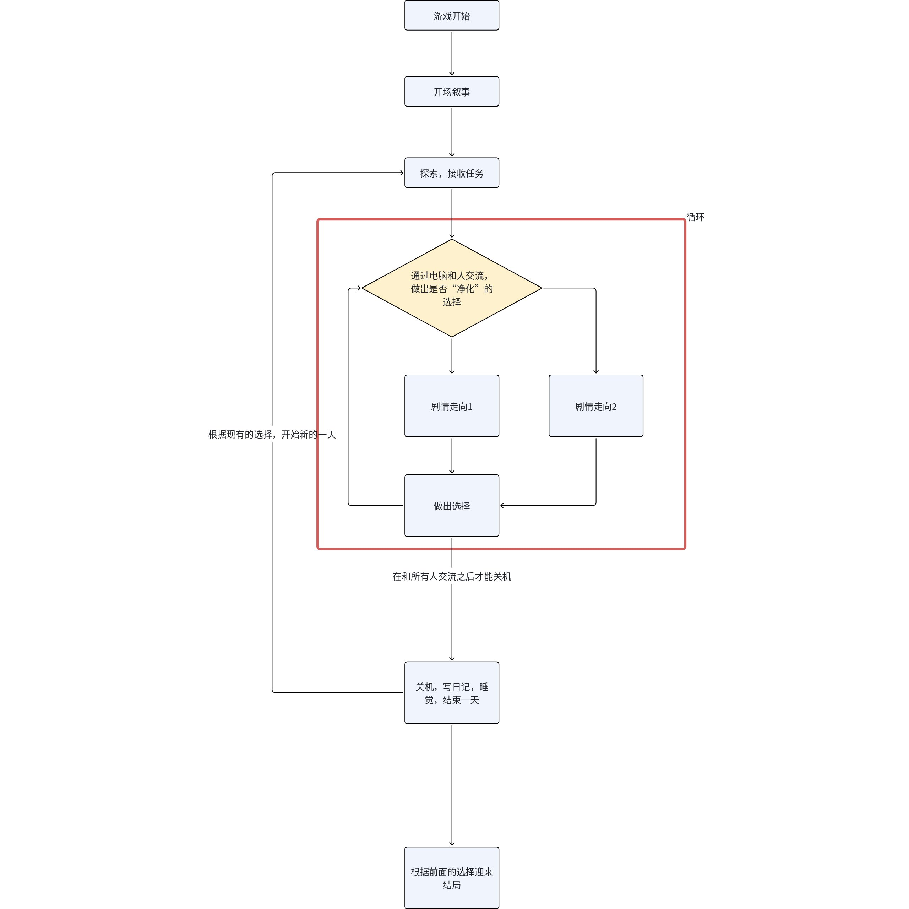
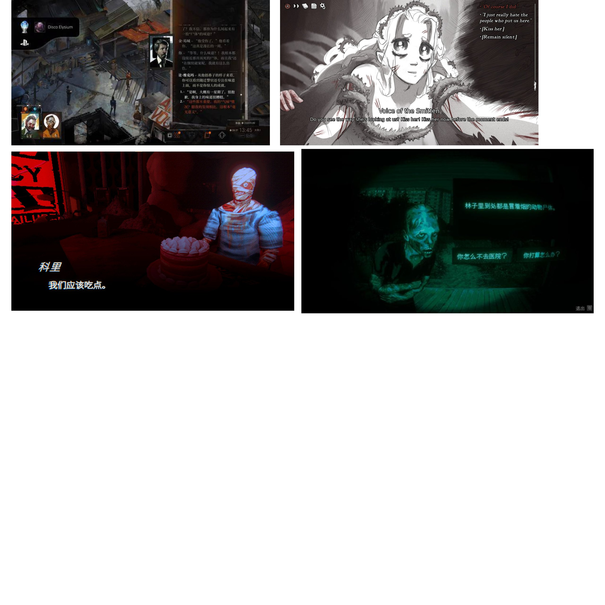

# 【新月26】Mini game 脑暴玩法收集池

## 来源与状态

- 来源：[【新月26】Mini game 脑暴玩法收集池](https://moonton.feishu.cn/wiki/Q4rnwla07ijZGnkkBO6cMCb0nUb)
- 读取时间：2026-10-12T17:28:52+08:00（Asia/Shanghai）
- 文档版本：6436；底层文档：`FqeUdMSjTokrVpxYOXBcI1M9nXg`
- 正文已读取；画板与工作簿的读取状态单独列在来源索引中。

## 内容概述

仅整理与本项目有关的方案15：微恐剧情。

## 设计重点

有限公寓空间、2D电脑交互、病人处置、日记与次日后果；叙事约束随机性；早期Demo预算和后续发行设想。

## 完整设计信息（保留本篇口径）

## 方案15：微恐剧情

提案人：马步庭(Mcqueen)时晨洋(Chenyang)

#### 作品类型

如果把这个游戏发行在steam上，可能会有以下标签：**剧情丰富/选择取向/心理恐怖/氛围/独立**

- 带有一定由**叙事约束**、会**创造并推动叙事**的随机元素（随机对话、随机事件、随机物品……）
- 会存在一个**3D小区域**重复探索
- 有一定**叙事深度**和**艺术性**、独特美术风格的叙事游戏

---

#### 独特卖点

**👁具有哲学思考的深度叙事**  
游戏通过病人的命运和玩家的选择，探讨自由意志、社会制度、道德判断和个人责任等问题，引发玩家对“什么是正确”“谁有资格审判他人”等问题的思考。

**⭕有限空间中的持续变化**  
游戏主要发生在员工公寓和电脑前，但房间不会只是静态场景。随着时间推进，访客、房间物品、病人和日记都会发生变化，让同一个空间产生不同含义。

**💬服务于叙事的随机性**  
随机病人、随机对话和随机事件不会完全打乱剧情，而是在固定故事框架中改变线索顺序、人物表现和事件结果，使每次游玩都有不同体验，同时保持故事的完整性。

---

#### 叙事背景

背景上，玩家是刚考进国家“**健康部**”的公务员，每日的工作内容就是在自己分配到的员工公寓里使用电脑，通过监控摄像头和扬声器，与**精神病院\***内的“病人”对话，并根据对话内容判断是否要留他一条性命。因为监狱容量有限，所以玩家每天都会承担必须要对最少一定数量的犯人“**彻底净化**”的压力。

**精神病院：**在严苛的**乌托邦**社会背景下，需要严格控制犯罪率为零，所以所有违反社会制度的行为都会被认定为精神错乱，被送往**精神病院**。

玩家的员工公寓房间布局和风格如下：

---

#### 核心玩法

1. 每日开场：黑屏，持续传来有节奏感并且有力的敲门声，随后出现简单的UI提示**“按E起床”**。
2. 玩家起床后可以看到房间内的简单布局，和门交互开门，发现门外站着一个穿着类似警察制服的**“监督员”**发了**纸质的任务**以及发放今日的**食物配给**，随后玩家可以和电脑交互，**开始今日工作--和精神病人对话并决定他们的未来**。
3. 在这之后每一天都会被敲门声叫醒，工作完毕后，在日记上写下今日的见闻，在**床上睡觉，**结束这一天。

工作中，玩家会遇到各种人，并且和他们对话，做出自己的选择。可能会遇到**“连环杀人狂”“科学家”“小朋友”“人格分裂者”“妄想症患者”**，请注意，你的有些**选择**会改变世界的**未来**。

根据玩家做出不同的选择，故事也可能在某些时间节点迎来结局。比如你因为听信一个连环杀手的谎言，把他释放出了精神病院，那下次敲响你大门的，可能是穿着监督员衣服的连环杀手……

- 在一个有限的空间内随着时间的流逝重复探索、与人对话、推进剧情，体验不同的剧情分支。
- 有小范围3D的场景探索，但是交互、对话以2D的形式呈现。
- 在每天睡觉（结束一天）之前，主角会写日记，记录今天的选择，比如--*“我今天遇到了xxx，他和我聊了xxx，我感觉他好像有点不对劲”*  -- 以总结玩家今天做出的选择，同时提示玩家我们的故事是多分支的、具有重复可玩性的。

---

#### 循环

> 画板 `A6dhwuJh2hsZXRbPDeFcOU9Cnwb`：已读取，文本与连线详见下方画板补充。

---

#### 美术风格

> 画板 `JXADweudchbt1ob2nD9ckTVMn1e`：已读取，文本与连线详见下方画板补充。

---

#### 参考

**多分支叙事游戏**：《寻找伪人》【切勿外出。紧闭门户。拉紧窗帘。《寻找伪人》4K|无解说|游玩流程（更新中）】 https://www.bilibili.com/video/BV188pkzGEVJ/?share_source=copy_web

**互动视频**：【你会让他进来吗...】 https://www.bilibili.com/video/BV1yD421K7Pe/?share_source=copy_web

---

#### 可完成性

- **Demo 范围明确**：只制作一个公寓场景、一个电脑交互界面、5—6 名病人和 2—3 个结局，可以在Mini Game周期内完成。
- **美术成本可控**：房间采用固定布局和有限视角，重点制作灯光、2D美术、UI 和关键道具，不需要大规模场景，可以很大程度被AI赋能。
- **系统结构简单**：核心功能集中在移动、交互、对话、选择、存档和结局判断，不需要复杂战斗或 AI 系统。
- **内容可以模块化扩展**：每个病人都是相对独立的故事单元，后续可以逐个增加角色、事件和结局，不会影响基础玩法。
- **Demo 目标容易验证**：只要玩家能够完成一天工作、做出一次重要选择，并在后续事件中感受到选择的影响，就能证明项目的核心体验成立。

---

#### 发展蓝图

**内容扩展**

Demo 完成后，可以围绕“更多病人、更多选择、更多结局”扩展内容：

- 增加新的病人类型和独立故事线。
- 增加新的游戏日和剧情章节，让玩家逐渐了解“健康部”、监督员以及这个社会的真实规则。
- 增加更多结局，包括服从制度、反抗制度、释放危险人物、被认定为病人，以及隐藏真相结局等等。
- 加入有限随机事件，让每次游玩中的病人顺序、对话细节和房间变化有所不同，提高重复游玩价值。
- 完成主线后，可以加入结局收集、挑战模式、随机模式和额外章节。

**商业化**

采用“免费 Demo + 正式版一次性买断”的方式：

- 通过免费 Demo 展示核心玩法，吸引玩家和主播试玩。
- 正式版提供完整剧情、多结局和全部主要内容。
- 后续可以通过免费更新或小型 DLC 增加新病人、新章节、新结局和新场景。
- 可以推出原声音乐、美术设定集等附加内容。
- 重点面向 Steam 等数字平台发行，突出“剧情丰富、选择取向、心理恐怖、独立游戏”等标签。

---

#### 团队招募：这个作品需要怎样的团队？

Demo包括......

- 1个玩家，1个狱警，5-6个病人
- 1个小型可探索场景
- 3-4个可交互模型
- 10个UI资源
- 若干段叙事故事线（策划应该能全部cover了）

**需要**：

- 最好玩过类似品类的游戏
- 对于游戏的艺术风格有一定的理解以及追求
- 对于氛围的塑造有一定的见解
- 在叙事和美术表现等方面的结合上也比较敏感

**能力**：2D美术、3D场景、UI设计

## 下级引用

- 画板：`A6dhwuJh2hsZXRbPDeFcOU9Cnwb`（已读取，见下方画板补充）。
- 画板：`JXADweudchbt1ob2nD9ckTVMn1e`（已读取，见下方画板补充）。

## 本篇待定与版本差异

早期5–6人、2–3结局与主Wiki交付值不同；随机系统、长线发行与额外章节属于提案；其他团队方案和往届作品范围外。

跨文档比较见[待定问题](../open-questions.md)；不能用本文的提案与示例覆盖其他来源的交付承诺。

本篇原文中的其他16个游戏方案与往届作品展示不在此次整理范围内。

## 画板补充（已读取）

画板是所属文档的内嵌素材。下列概述用于阅读，节点文本与连线保留用于核对；节点清单的位置顺序不替代流程箭头。

### 画板 `A6dhwuJh2hsZXRbPDeFcOU9Cnwb`

- 读取时间：2026-10-12T17:44:47+08:00；共22个节点。
- 文本、节点关系和图片节点均已读取；画板图像已本地保存并检查。

早期循环：游戏开始→开场叙事→探索/接收任务→电脑交流并决定净化→不同剧情走向→继续选择→关机/日记/睡眠→根据前述选择进入结局。逐人循环与逐日循环的连线保留在图中。

节点文字：

| 节点 | 类型 | 原文 |
| --- | --- | --- |
| o1:1 | composite_shape | 游戏开始 |
| o1:2 | composite_shape | 开场叙事 |
| o1:20 | composite_shape | 探索，接收任务 |
| a35:1 | text_shape | 循环 |
| o1:21 | composite_shape | 通过电脑和人交流，做出是否“净化”的选择 |
| o1:23 | composite_shape | 剧情走向1 |
| o1:24 | composite_shape | 剧情走向2 |
| o68:28 | composite_shape | 做出选择 |
| o1:25 | composite_shape | 关机，写日记，睡觉，结束一天 |
| o1:26 | composite_shape | 根据前面的选择迎来结局 |

连线关系：

| 起点 | 终点 | 箭头文字 |
| --- | --- | --- |
| 开场叙事 | 探索，接收任务 |  |
| 探索，接收任务 | 通过电脑和人交流，做出是否“净化”的选择 |  |
| 关机，写日记，睡觉，结束一天 | 根据前面的选择迎来结局 |  |
| 游戏开始 | 开场叙事 |  |
| 通过电脑和人交流，做出是否“净化”的选择 | 剧情走向2 |  |
| 剧情走向1 | 做出选择 |  |
| 通过电脑和人交流，做出是否“净化”的选择 | 剧情走向1 |  |
| 关机，写日记，睡觉，结束一天 | 探索，接收任务 | 根据现有的选择，开始新的一天 |
| 做出选择 | 通过电脑和人交流，做出是否“净化”的选择 |  |
| 剧情走向2 | 做出选择 |  |
| 做出选择 | 关机，写日记，睡觉，结束一天 | 在和所有人交流之后才能关机 |

下级文档引用：未在节点文字、链接字段及文档提及字段中发现新的飞书文档引用。

### 画板 `JXADweudchbt1ob2nD9ckTVMn1e`

- 读取时间：2026-10-12T17:44:47+08:00；共4个节点。
- 文本、节点关系和图片节点均已读取；画板图像已本地保存并检查。

四张游戏画面参考，显示场景与文本并列、人物与选项、字幕对话以及绿色监控氛围。已查看画板图像；原板没有文字说明或具体风格决议。

本板无可提取的设计文字；内容以图像为主。

图片节点清单（图像包含于上方画板截图，原始token保留）：

| 节点 | 图片token |
| --- | --- |
| d1:1 | RSkEb3lrxooI96x5HYrcBubDnJe |
| d1:2 | VA0obJ3WmoRzzhxusoWcVxvInFc |
| d1:3 | QOoqbmCtuoAa75xR6bQckh2Un4g |
| d1:4 | MiYQbQH9xojahIxGfIzcMpQCnEg |

下级文档引用：未在节点文字、链接字段及文档提及字段中发现新的飞书文档引用。
