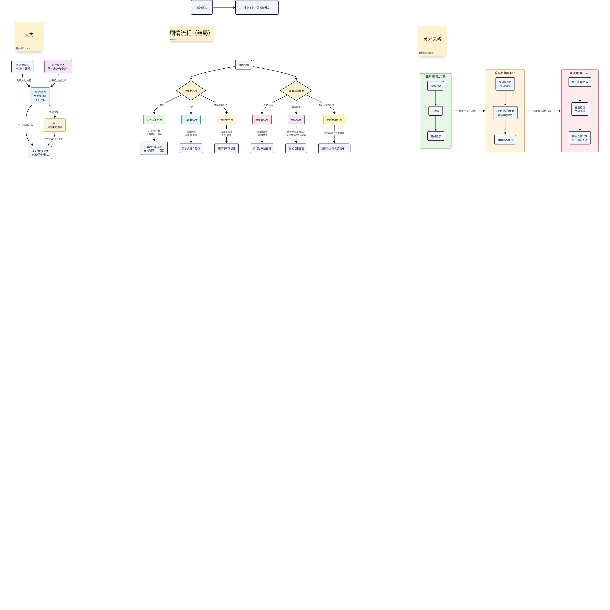

# 灵感墙

## 来源与状态

- 来源：[灵感墙](https://moonton.feishu.cn/wiki/VOF4we0RXiJK9Zk8ZtUcivFxnVc)
- 读取时间：2026-10-12T17:28:52+08:00（Asia/Shanghai）
- 文档版本：93；底层文档：`U3JXdhfLqoKmZZxJHALcMSVuncg`
- 正文已读取；画板与工作簿的读取状态单独列在来源索引中。

## 内容概述

主题建议、标签词库及视觉、音乐灵感白板。

## 设计重点

弱化可验证怪物身份，围绕谁定义正常；列出临床、行为、社会适应、思想制度、身份与行政等标签。

## 完整设计信息（保留本篇口径）

## 灵感墙

**平时看到的触发了自己灵感的点都可以贴上来。但是记得附带一个简短的描述，说一下想到了什么，或者这是什么，总之为了让别人了解你的想法。大家看到后也可以评论起来，畅所欲言。**

> 画板 `CgLkw84KhhxEP4bnCuRc3WMBnGb`：已读取，文本与连线详见下方画板补充。

伪人识别处理：是不是弱化“伪人是真实怪物”的明确设定，避免主题从“**谁有资格定义一个人是否正常**”滑向单纯的“找出谁是怪物”。可以保留官方宣称“伪人存在”，也让玩家不断遇到记忆矛盾、身份缺失、监控异常、数据对不上等可疑现象（瞎说的一些现象），但始终不给出100%可靠的验证方式。随着剧情推进，玩家会逐渐发现“精神异常者”“反社会者”“伪人”等分类标准本身就在被政府不断修改，最后让核心矛盾始终落在：**异常究竟是客观存在，还是权力对“不合格者”的定义**

**临床型标签**：认知失调、持续性幻觉、现实感知障碍、情绪失控、强迫行为、记忆缺损、人格解离。

 **行为型标签**：暴力倾向、自伤风险、拒绝服从、反复逃逸、攻击工作人员、破坏公共秩序、危险冲动。

 **社会适应型标签**：群体适应不良、持续性社会疏离、工作纪律障碍、家庭功能异常、社会协作缺陷、公共规范抵触。

 **思想/制度型标签**：权威认知偏差、秩序怀疑倾向、制度适应障碍、持续性反社会认知、集体价值拒斥、公共忠诚缺陷。

 **身份型标签**：身份记录异常、记忆履历不一致、社会关系缺失、来源不明、身份验证失败、生理信息矛盾。

 **行政型标签**：高风险观察对象、需持续隔离、不可公开、待复核、特殊收容、永久观察、记录封存。

 **被涂黑/模糊标签**： `████障碍` 、 `原因：内部指令` 、 `收容依据：权限不足` 、 `诊断记录已删除` 、 `类别：不适用` 。

> 画板 `PZ9dwGlCPhFQKxbP7u5c7MAwnMd`：已读取，文本与连线详见下方画板补充。

[外部嵌入媒体](https://www.youtube.com/embed/paxlqGUxffw)

特殊场景下的音乐参考

## 下级引用

- 画板：`CgLkw84KhhxEP4bnCuRc3WMBnGb`（已读取，见下方画板补充）。
- 画板：`PZ9dwGlCPhFQKxbP7u5c7MAwnMd`（已读取，见下方画板补充）。

## 本篇待定与版本差异

属于灵感建议，不能将所有标签直接认定为已采纳机制；白板中的设想需结合正式交付范围核对。

跨文档比较见[待定问题](../open-questions.md)；不能用本文的提案与示例覆盖其他来源的交付承诺。

## 画板补充（已读取）

画板是所属文档的内嵌素材。下列概述用于阅读，节点文本与连线保留用于核对；节点清单的位置顺序不替代流程箭头。

### 画板 `CgLkw84KhhxEP4bnCuRc3WMBnGb`

- 读取时间：2026-10-12T17:44:47+08:00；共68个节点。
- 文本、节点关系和图片节点均已读取；画板图像已本地保存并检查。

早期灵感树同时讨论心流、人物、分支结局和视觉异化。包含优秀员工、觉醒者、牺牲者、共谋者、伪人、第四面墙等结局，以及正常期第1–7天、畸变期第8–18天、崩坏期第19天+的长线设想。全部按灵感保留，不扩大当前3天/3结局目标。

节点文字：

| 节点 | 类型 | 原文 |
| --- | --- | --- |
| o2:32 | composite_shape | 上司/管理员 下达指令配额 |
| o2:33 | composite_shape | 神秘联络人 匿名纸条/加密邮件 |
| o1:19 | composite_shape | 畸变期 第8-18天 |
| o1:3 | composite_shape | 游戏开始 |
| o1:18 | composite_shape | 崩坏期 第19天+ |
| o1:20 | composite_shape | 正常期 第1-7天 |
| o1:24 | composite_shape | 饱和度下降 色温偏冷 |
| o1:21 | composite_shape | 高对比度/单色 |
| o1:27 | composite_shape | 色彩正常 |
| o1:4 | composite_shape | 对体制态度 |
| o1:5 | composite_shape | 真相认知程度 |
| o2:30 | composite_shape | 玩家/主角 文书管理员 身份存疑 |
| o1:22 | composite_shape | 画面撕裂 文字乱码 |
| o1:28 | composite_shape | UI稳定 |
| o1:25 | composite_shape | CRT扫描线加重 UI偶尔glitch |
| o1:6 | composite_shape | 优秀员工结局 |
| o1:7 | composite_shape | 觉醒者结局 |
| o1:8 | composite_shape | 牺牲者结局 |
| o1:9 | composite_shape | 共谋者结局 |
| o1:10 | composite_shape | 伪人结局 |
| o1:11 | composite_shape | 第四面墙结局 |
| o2:34 | composite_shape | 伪人 混在来访者中 |
| o1:29 | composite_shape | 房间整洁 |
| o1:23 | composite_shape | 房间几何异常 镜子倒影不对 |
| o1:26 | composite_shape | 房间物品错位 |
| o1:2 | composite_shape | 心流体验 |
| o1:1 | composite_shape | 重复日常中的微妙异常 |
| o1:12 | composite_shape | 最后一幕发现 在处理下一个自己 |
| o1:13 | composite_shape | 开放式逃亡结局 |
| o1:14 | composite_shape | 新周目有既视感 |
| o1:15 | composite_shape | 日记越来越空洞 |
| o1:16 | composite_shape | 测试结束画面 |
| o1:17 | composite_shape | 质问你为什么要玩这个 |
| o2:31 | composite_shape | 来访者/提交者 家属/医生/社工 |
| w2:1 | sticky_note | 人物 |
| w2:2 | sticky_note | 剧情流程（结局） |
| w2:3 | sticky_note | 美术风格 |

连线关系：

| 起点 | 终点 | 箭头文字 |
| --- | --- | --- |
| UI稳定 | 房间整洁 |  |
| 真相认知程度 | 共谋者结局 | 全知+顺从 |
| 觉醒者结局 | 开放式逃亡结局 | 揭露阴谋 被追捕/清除 |
| 画面撕裂 文字乱码 | 房间几何异常 镜子倒影不对 |  |
| 第四面墙结局 | 质问你为什么要玩这个 | 游戏直接与玩家对话 |
| 色彩正常 | UI稳定 |  |
| 对体制态度 | 牺牲者结局 | 反抗但证据不足 |
| 真相认知程度 | 第四面墙结局 | 特定元叙事条件 |
| 心流体验 | 重复日常中的微妙异常 |  |
| 游戏开始 | 真相认知程度 |  |
| 玩家/主角 文书管理员 身份存疑 | 伪人 混在来访者中 | 识别处理 |
| 伪人 混在来访者中 | 来访者/提交者 家属/医生/社工 | 外观正常/细节破绽 |
| 游戏开始 | 对体制态度 |  |
| 真相认知程度 | 伪人结局 | 表现异常 |
| 高对比度/单色 | 画面撕裂 文字乱码 |  |
| CRT扫描线加重 UI偶尔glitch | 房间物品错位 |  |
| 对体制态度 | 觉醒者结局 | 反抗 |
| 牺牲者结局 | 新周目有既视感 | 被康复处理 记忆清除 |
| 优秀员工结局 | 最后一幕发现 在处理下一个自己 | 升职/被净化 成为体制一部分 |
| 畸变期 第8-18天 | 崩坏期 第19天+ | 恐惧/解离/真相逼近 |
| 神秘联络人 匿名纸条/加密邮件 | 玩家/主角 文书管理员 身份存疑 | 暗示真相/违规选项 |
| 对体制态度 | 优秀员工结局 | 顺从 |
| 玩家/主角 文书管理员 身份存疑 | 来访者/提交者 家属/医生/社工 | 放行/拒绝/上报 |
| 伪人结局 | 测试结束画面 | 反转:玩家才是伪人 整个游戏是评估测试 |
| 饱和度下降 色温偏冷 | CRT扫描线加重 UI偶尔glitch |  |
| 正常期 第1-7天 | 畸变期 第8-18天 | 焦虑/怀疑/压迫感 |
| 共谋者结局 | 日记越来越空洞 | 成为受益者 内心被吞噬 |
| 上司/管理员 下达指令配额 | 玩家/主角 文书管理员 身份存疑 | 每日文件/施压 |

下级文档引用：未在节点文字、链接字段及文档提及字段中发现新的飞书文档引用。

### 画板 `PZ9dwGlCPhFQKxbP7u5c7MAwnMd`

- 读取时间：2026-10-12T17:44:47+08:00；共58个节点。
- 文本、节点关系和图片节点均已读取；画板图像已本地保存并检查。

Moodboard包含57个图片节点，已检查完整画板图像。画面覆盖公寓/室内空间、旧电脑与监控UI、病人形象、梦境与异常氛围等参考；没有新增文档链接，也没有最终风格选择的文字结论。

节点文字：

| 节点 | 类型 | 原文 |
| --- | --- | --- |
| a1:1 | text_shape | Moodboard |

图片节点清单（图像包含于上方画板截图，原始token保留）：

| 节点 | 图片token |
| --- | --- |
| d1:20 | CXlObuJaKodemAxGQ3qcBsi1n5c |
| d1:21 | KY2Xb6NhRojAcIxr2CNcpIgOnQw |
| d7:53 | C0u6bJU2coqiCpxHPPMcJJC4nMg |
| d1:16 | Idiubtw7koOsMrxrIvWcpQN3nEc |
| d7:47 | RBvbbnGmkozn7KxyXlZcqaITnKg |
| d12:58 | K6jHbCXFXo8jJDxAZdfcAQ2snAd |
| d7:37 | K2Evby55SoIohPxjGJycn0nNnwd |
| d7:46 | HnmJb4nrco2ZnGx7aBPc7GL7nBc |
| d7:51 | S4knbKGNToHKR3xus3ucSc9Znfd |
| d1:8 | Usc5blopuojPEixT3oschhWsn8b |
| d7:43 | D2AUb414uoPld9xj6oQczrNwnxg |
| d7:48 | AEbpbspX8oLOvVxDBi6c80fhnbH |
| d1:3 | KPqfbzx49oDOWRxarAUcIhxKnje |
| d1:6 | DUKubHxYjo1lS5xl54pcxCnBnYe |
| d1:7 | Q6NXbLzluoiNn2xTBVzcq2Fhncf |
| d4:23 | A9RybA3Q8opSOBxHyvHcfYzbnxg |
| d7:38 | XHzZbvgxjo6qa2xNGIVc2VHPnnf |
| d7:42 | CIeDbpQUWoj2kaxlzxacnIsYnjc |
| d7:52 | GMambwn0YopfFsxTBisc6cBinEg |
| d7:55 | Kio7bUT9ioO7nOxAxmHc5hJfntf |
| d1:1 | DirSbxWsOo7pN1xuiiMcY2cMnPg |
| d1:9 | WGtNbkm20orFSNxcMgAcltbCnJc |
| d7:27 | DCsOb1XhGofFe4xYBSgciYocnvb |
| d7:31 | AKYobf7Aaonh5yxxapTcjiZpnUe |
| d7:50 | PkIAb5xl0ovjzsxOC99cpK6gnig |
| d4:24 | PsFtb2dUTosDRwxlp0ocpsTOnlb |
| d7:35 | D9Nrb2TiXooyBbxFnarccWrqnkf |
| d7:40 | WILsbv2EPoXd7ixHS0kcrZ6znMd |
| d1:10 | VWESbgORrohYmBxbbufcBxsOnG4 |
| d1:15 | OjNBbB1Uxog9jbxz5jyc8KConYd |
| d1:17 | PuFcbQ5rio3HcQxVfbHcEwgfnzd |
| d7:57 | LkzWbI0WvoLoBMxRuOvcJS6Mnpc |
| d7:26 | G0hdbBvnMoRWY5xkrZEcnvQLnXg |
| d7:44 | ALFZbdsf1optxBxs860cOE5InDg |
| d7:45 | LxJnbMMnWoihw4xxzt1cWb3Snsg |
| d1:22 | Svz6bRjEXo1ruLxEMhTcGgYTnK5 |
| d6:25 | Mv8GbxmWao2je9xWD3Mc4InMnud |
| d7:28 | EsdtbRYD0ok6FfxiTdickEHPnyb |
| d1:4 | KCn2b845oocwlCxR196cFXJKnGf |
| d1:11 | DkrLbgDM8otf43xRFMUcHU7pngh |
| d1:13 | Wo1Xbwa9qoAIsqxyssncHFtknxd |
| d1:14 | NUlibxcCqo7XmaxFqrgcVDIPnvf |
| d1:18 | L0LlblOABojD54xWlbPcW1nonRd |
| d7:33 | LlGzbMlc8opxTRxNX20cXN7Ynpd |
| d1:5 | THqzbOQqxo00mUx8b12cGUtDnLd |
| d1:19 | OeEkbZ43xooSG2x234Xco7Zdnck |
| d7:36 | TxzEb5vRZo6cbaxt8hBcxRcOn4e |
| d7:30 | Cq2SbPABSog0DzxtQDdcyn0in0f |
| d7:49 | I4pKb0LbLoyPNcxYljucubWhnEn |
| d7:56 | WVXHb17aaoruvZxkTrccl8zqnMe |
| d7:34 | QzyhbmN76oN3LMxhHAhcidbTn0e |
| d7:39 | ZtAcbZspio2FWjxa65Pc5gKdn6c |
| d7:54 | EPl8bw2kUoNHEPxhVIjcWj5anL2 |
| d1:12 | LtGGbuPmtoVALpx8R3LcqNhUnJc |
| d1:2 | IjxQbbwEro3XPqxAjdVcG1HTnMO |
| d7:29 | NIvYbnDrWo2hjHx39DscO7cAnQR |
| d7:32 | Mfwwb41oQoX0mYxgwX8c35jXnSb |

下级文档引用：未在节点文字、链接字段及文档提及字段中发现新的飞书文档引用。
