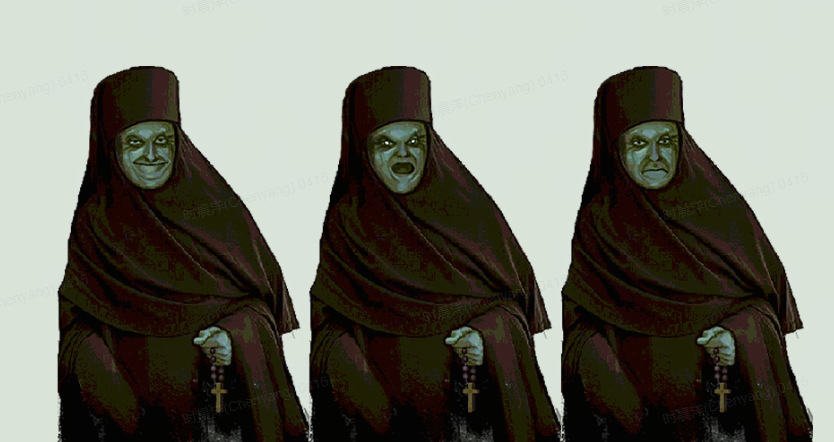
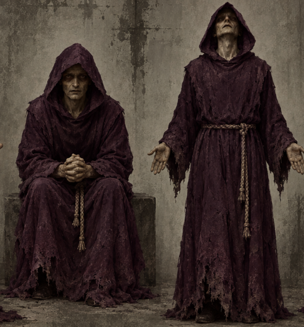

# 【人物】神父

## 来源与状态

- 来源：[【人物】神父](https://moonton.feishu.cn/wiki/A5XuwDTTWijkGGkFhqUcxg8qnSg)
- 读取时间：2026-10-15T19:49:52+08:00（Asia/Shanghai）
- 文档版本：800；底层文档：`UfEKdfHUMombtJxR4B4cmPt1n1f`
- 正文已读取；画板与工作簿的读取状态单独列在来源索引中。

## 内容概述

乔纳：渴望净化、实施模仿手术的狂热神父。

## 设计重点

P01；Day2出现；持续治疗使其狂躁并最终自行手术死亡；释放后次日替代监督员杀死主角；净化后离开人物队列。

## 完整设计信息（保留本篇口径）

## 人物设计文档

> **人物ID：P01**
> **人物名称： 乔纳**
> **负责人：****时晨洋(Chenyang)**

---

## 人物概况【必填】

### 基础信息

[内嵌工作簿：神父人物设计引用工作簿](priest-character-workbook.md)

### 一句话描述

相信人生来就有罪，只有彻底赎罪才能获得救赎，所以他为此无理由的杀了很多人，就为了被抓进来感受净化

---

## 人物设定【必填】

### 性格

**主要性格：深沉、坚定、神秘、睿智**

**面对玩家时的态度：**坚定的寻求净化，也会顺带向玩家介绍自己的想法和理念

### 背景

**过去经历：**作为xx教的神父，在仪器以及净化手术出现并见证作用后，他坚信这就是上帝向人类派发的“赎罪券”。人人都有原罪，都将被仪器检测出有罪；人人都应该接受净化手术，以此赎罪。

**来到这里之前发生了什么：**受够了常规检测没法筛选出自己，没法主动前往治疗机构接受“上帝的恩赐”。于是他在一天结束之后，当街对一名被他认定为“有罪”的路人进行了自己思考得出的、粗暴的大脑手术，试图效仿官方的净化手术。然而这场暴力行为导致该路人当场死亡，而当局在逮捕他之后他竟然因为没法被仪器测出犯罪倾向而被释放。于是他开始觉得也许是上帝让自己在人间散播净化，是自己的使命还没结束，所以还没获得得到净化的资格。随后他继续对无辜的人施加自己琢磨出来的粗糙版净化手术，向他单独忏悔的几名虔诚信徒在听从他的劝说后都被残忍杀害，死者均有一定程度的大脑损伤。在一次召集五名虔诚信徒执行了“连环净化手术”后，他终于被仪器检测出有犯罪倾向，来到了治疗中心

**当前最关心的事情：**什么时候才能迎来赎罪？

### 其他设定

有则填写，没有可以删除。

---

## 出现规则【必填】

**出现时间：**  
Day 2

**出现方式：**  
固定 / 随机 / 条件触发

**是否必定出现：**  
是 / 否

**出现条件：无**

**冲突 / 排斥条件：无**

**其他调度要求：无**

---

## 人物流程【必填】

记录这个人物在玩家持续选择“治疗”的情况下，会依次出现哪些内容。

---

### 初次出现

**人物当前状态：**虔诚、幸福、坚定、稍微焦虑

**本次对话内容概述：**向玩家表达信念，以及自己急迫的等待

**玩家能够获得的信息：**他非常虔诚，非常渴望净化，这也许是不对的，我也许应该留着他告诉他净化的真相？

---

### 第一次治疗后

**人物状态变化：**虔诚的近乎癫狂、些许暴躁、焦虑

**本次对话内容概述：**表示如果实在不行，他自己也可以给自己做净化手术，透露自己曾经对很多人实施过自己发明的净化手术，向玩家祈求得到净化

**新增信息：**神父的部分犯罪历史

---

### 第二次治疗后

**人物状态变化：**非常暴躁、偏执、冲动

**本次对话内容概述：**怒斥玩家不洁，为什么不给我净化？？？是我不够虔诚吗？！？我要自己做了……仁慈的父亲

**新增信息：无**

---

### 后续阶段

按实际人物长度继续增加，不要求每个人阶段数量一致。

**如果第二次后依然选择治疗，下一天就会发现他对自己实施了净化手术，死在牢房里了**

---

## 处理结果【必填】

### 释放

**结果：**第二天代替监督者出现，用自创的净化手术杀死了主角

**人物最后表现：**巨大的失落，些许恐慌、仇恨

**是否有特殊演出：**下一天的开门演出会被替换，迎来结局

人物线结束。

---

### 净化

**结果：**从此消失，人物线结束

**人物最后表现：**幸福、赞美上帝、期待

**是否有特殊演出：无**

人物线结束。

---

## 对话设计【必填】

### 说话方式

**语气：**因为紧张、焦虑、兴奋而颤抖，一直不净化的话会很愤怒

**用词特点：**有一定的宗教性质，神秘感

**句子长短：**中等偏短，少数长句

**其他语言习惯：**暂无

### 代表性台词

> “罪不会因为活着而消失。只有把‘我’彻底抹去，它才算真正结束。”
> 
> “为什么还要治疗我？我已经准备好了……你为什么还不让我迎来救赎？”
> 
> “这不是治疗，这是亵渎。你一次又一次把我从门前拖回来，然后告诉我这是仁慈？”
> 
> “我求了祂那么多年，为什么偏偏在最后把我送出来？我想了一整夜……然后我明白了。不是我的罪还没赎清，是我的工作还没做完。”
> 
> “等所有人都洁净以后，祂自然会允许我成为最后一个。”

### 正式对白

完整对白不在本文档维护。

**对白 / 节点表入口：**

`____________`

---

## 人物关系【按需】

仅当人物之间存在实际剧情联系时填写。

[内嵌工作簿：神父人物设计引用工作簿](priest-character-workbook.md)

---

## 特殊信息【按需】

如果人物存在需要单独管理的信息，可以放在这里。

例如：

**隐瞒的信息：**

**玩家可能发现的信息：**

**特殊剧情条件：**

**世界观相关信息：**

**其他：**

没有则整节删除。

---

## 美术需求【必填】

### 外观

**年龄感：**中年，因为信仰的压力而憔悴

**体型：**高而消瘦

**面部 / 发型：**可以有一定皱纹

**服装：**教袍、黑色修士服

**整体视觉印象：**憔悴、阴暗、虔诚、疯狂

**参考图：**

---

### 特征

**标志性外观：**破旧长袍、脸部阴影

**标志性物品：**

**需要特别表现的细节：**通过衣着、面部特征、打光、姿势来体现其疯狂的信仰，以及可能杀人的危险性

---

### 状态差分（此人暂无）

如果治疗会改变人物外观，在这里记录。

[内嵌工作簿：神父人物设计引用工作簿](priest-character-workbook.md)

没有差分则删除。

---

### 动作需求

**常驻动作：**

**特殊剧情动作：**选择释放，会扭曲自己的身体，团做一团，思考为什么会这样，下一步该怎么做

最后一次选择治疗，会愤怒的贴近摄像头，五官因为摄像头产生了畸变、模糊以及愤怒的扭曲

**其他：**

---

### 表情需求

**常态pose表情：**

1. **神游天外、虔诚（主表情）**
2. **欣喜**
3. **愤怒**
4. **失落**

---

## 音频需求【按需】

### 人物相关声音

需要的特殊声音，例如：

- 呼吸
- 哭泣
- 咳嗽
- 敲门
- 脚步
- 道具声
- 其他非语言人声

**具体需求：**

---

## 程序 / 配置需求【按需】

仅记录这个角色与通用人物系统不同的部分。

**特殊触发条件：**

**特殊状态：**

**特殊交互：**

**特殊表现：**

**其他程序需求：**

如果完全使用通用人物逻辑，可以写：

> 无特殊需求。

---

## 相关内容索引【必填】

**首次出现：**

**涉及Day：**

**相关事件：**

**对白节点：**

**相关美术资产：**

**相关音频资产：**

**其他资料：**

## 下级引用

- [神父人物设计引用工作簿](priest-character-workbook.md)，子表 `Zl7v08`。
- [神父人物设计引用工作簿](priest-character-workbook.md)，子表 `vpZ2a1`。
- [神父人物设计引用工作簿](priest-character-workbook.md)，子表 `uCxhWZ`。

## 本篇待定与版本差异

固定/随机、是否必现等模板选项未选；正式对白入口、程序特例、资产索引未填；人物基础、关系、差分在引用工作簿中。

跨文档比较见[待定问题](../open-questions.md)；不能用本文的提案与示例覆盖其他来源的交付承诺。
