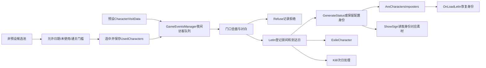

# 访客、身份与身体检查

本报告分析当前副本的真实反编译实现。函数语义为静态证据，不代表已经观测游戏运行；角色级序列化配置的恢复情况须同时阅读 unity-recovery.md。[verified: DecompiledCode/Assembly-CSharp；Analysis/Managed/Assembly-CSharp/coverage.json read_target_execution=false]

## 访客生成与刷新

`GameplayRandomizer.GetRandomCharactersForDay(day, charactersCount)` 从 RandomGenerationSettings 的日索引数组读取随机访客数量；`charactersCount` 形参未参与本方法的数量计算。候选必须不是预设角色、未存在于 UsedCharacters、允许当前日期，并满足完成游戏次数门槛。选中立即加入 UsedCharacters，再寻找没有被预设或额外访客占用的最小正整数顺序槽。[verified: DecompiledCode/Assembly-CSharp/_Code/Infrastructure/Randomization/GameplayRandomizer.cs L43-L65]

预设来访由 CharacterVisitData 的 DayNumber/GuestNumber 驱动。GameEventsManager 先构造固定夜间 CharacterDingDongEvent，随后根据条件移除特定访客，添加当天随机访客并重建敲门顺序。预设访客可以具有多条日期记录；随机池的 UsedCharacters 去重不能概括为所有访客永不重复。[verified: DecompiledCode/Assembly-CSharp/_Code/Infrastructure/GameEvents/GameEventsManager.cs L190-L246；_Code/Characters/CharacterVisitData.cs L7-L13]

`GetFirstEmptyVisitSlot` 将额外访客槽位保存到 ExtraCharactersVisitOrders；随机池已使用角色、额外槽位和开始本局时的已通关次数也都有存档字段。Seed 字段存在，但上述选择方法没有读取它；未验证全局随机种子初始化或跨进程随机序列可复现性。[verified: GameplayRandomizer.cs L68-L93；GameplayRandomizerSaveData.cs L12-L22][opinion]

已成功导出的 RandomGenerationSettings.asset 给出 `_minImpostersPercent=0.05`、`_maxImpostersPercent=0.4`，日索引 0–18 的随机访客数量为 `0,1,3,1,1,2,0,2,1,3,0,3,2,0,0,0,0,0,0`。这是随机访客数量，不是当天总访客数量。原始十六进制数组与解码结果都已保存。[verified: RecoveredUnityProject/ExportedProject/Assets/MonoBehaviour/RandomGenerationSettings.asset L15-L17；Analysis/random-generation-settings-decoded.json]

## 真人和伪人身份

`CharactersManager.LetIn` 先登记 CharactersInside/到达日期、FEMA评分和房间，再调用 GenerateStatus，最后将身份写入 AreCharactersImposters。对于 IsStatusRandomlyGenerated=true 的角色，GenerateStatus 根据当前屋内伪人比例决定：低于最小值则置真，高于最大值则置假，区间内使用 `UnityEngine.Random.Range(0,2)==0`。比例计算时刚接纳的角色已经在 CharactersInside 中，且其原有 IsImposter 值参与此次计数。[verified: _Code/Characters/CharactersManager.cs L90-L124、L156-L174]

因此 0.05/0.4 是自适应比例阈值，不能写成“每名访客有5%或40%概率是伪人”。只有进入中间分支才使用该二选一随机表达式；是否进入分支取决于已在屋内的人和角色配置。[verified: CharactersManager.cs L156-L174][opinion]

IsStatusRandomlyGenerated=false 的角色不会由 GenerateStatus 改写身份。CharacterSOData 同时保存 IsPreset、初始 IsImposter、IsStatusRandomlyGenerated；其 SetImposter 方法仅修改非预设角色，但 GenerateStatus 调用的是属性 setter，不能把 SetImposter 的保护条件扩展成所有赋值路径的规则。[verified: CharacterSOData.cs L88-L119、L214-L244、L329-L335；CharactersManager.cs L156-L174]

读取存档时 OnLoadLetIn/OnLoadLetInAndKill 从 AreCharactersImposters 恢复运行中的 SO 身份，而不是再次运行 GenerateStatus。角色身份字典与当前屋内/已杀/已拒绝/驱逐/明日自杀等集合都是真实存档状态。[verified: CharactersManager.cs L127-L154、L381-L394；CharactersManagerSaveData.cs L12-L48]

当前每个角色的初始身份、随机标志、允许日期、预设访问日程和美术引用，必须以已验证的 CharacterSOData 原始字段为准；初版AssetRipper对该类型的73个对象报告layout读取失败，不能用dummy输出填充这些值。替代读取结果见资源报告。[verified: Analysis/Logs/asset-ripper-internal.log CharacterSOData读取错误；Reports/unity-recovery.md][opinion]

## 检查与线索呈现

检查种类为 Eye、Hands、Teeth、AuraPhoto、Armpit、Ear。ShowSign 命令把人物名和检查名解析成真实类型，触发 SignShowed；DialogManager 转发至 DialogView/检查视图，并设置 HasCheckedSignsToday。AuraPhoto另触发ShowedAura事件。[verified: ECharacterSign.cs L3-L10；DialogCommandsInstance.cs L269-L279；DialogManager.cs L778-L786]

CharacterSOData 的手、眼、牙、耳、腋下、照片getter按当前 IsImposter 返回人类或伪人两套Sprite/AnimationData。DialogSignsView.ShowSign切换对应容器、填入这些素材并播放声音/动画；该路径是基于身份和素材的数据呈现，未见在此路径上对屏幕图像执行视觉识别或生物特征推理。[verified: CharacterSOData.cs L142-L212；DialogSignsView.cs L64-L123][opinion]

玩家也有独立检查标志：吸烟使牙齿标志变假并设置四天后重置；挖掘设置手部标志并设置一天后重置；咖啡设置眼部标志并设置三天后重置；洗澡清除手/腋下标志并设置五天后腋下重置。ShowPlayerSign返回的标志被临时写入Player的CharacterSOData用于选择显示素材，不能仅凭“Fake”属性名推断玩家身份的全局结论。[verified: PlayerSigns.cs L11-L69；DialogManager.cs L770-L775][opinion]

## NPC状态和决策接口

LetIn遇到相同Place已占用时可先驱逐旧角色，或打印占用错误后返回。Refuse保存拒绝记录。Kill移出屋内并保存死亡/无辜者误杀/非玩家击杀集合，更新房间、元进度及成就；ExileCharacter保存驱逐记录并通知房间。KillTomorrow与RunMorningOfSuicides构成次日处理链。[verified: CharactersManager.cs L90-L125、L176-L224、L235-L263、L335-L348]

非玩家击杀候选要求仍在屋内、到达日+1小于当前日，且不是伪人；KillRandom从该集合选择。这里确定的是该具体方法的筛选边界，其他剧情/玩家/整屋死亡入口有各自规则。[verified: CharactersManager.cs L351-L379、L405-L430]

图为上述静态语义关系；门口对白的实际指令和条件由编译Yarn节点决定，事件/回调边不能等同于全部已解析的直接IL调用。[verified: 上述函数实现；Analysis/Managed/Assembly-CSharp/coverage.json limitations][opinion]

## 后续入口与未知

- 角色级配置：查询资源报告的逐对象成功/失败清单，再将 CharacterType 与本报告函数关联，禁止使用读取失败对象的缺省零值。[verified: CharacterSOData.cs L17-L119；Reports/unity-recovery.md][opinion]
- 访客条件与对白：查询 Analysis/Gameplay 的节点、条件、命令和本地化索引；这些是编译程序恢复结果，不是原始作者Yarn文本。[verified: Analysis/Gameplay/yarn-program.json；Reports/gameplay-dialogue-progression.md]
- 全局RNG种子、运行时具体角色序列、动态Unity事件、视觉效果与判定的实际体感：本次静态调查未观测。[verified: Analysis/Managed/Assembly-CSharp/coverage.json read_target_execution=false][opinion]

Verification: 已读取并标注上述真实C#实现；随机访客数组从导出资产解码并保存；方法token、CIL和生成C++位置可在Analysis/Managed/Assembly-CSharp交叉检索。未启动游戏。[verified: source-copy-sha256.csv；random-generation-settings-decoded.json；coverage.json]
