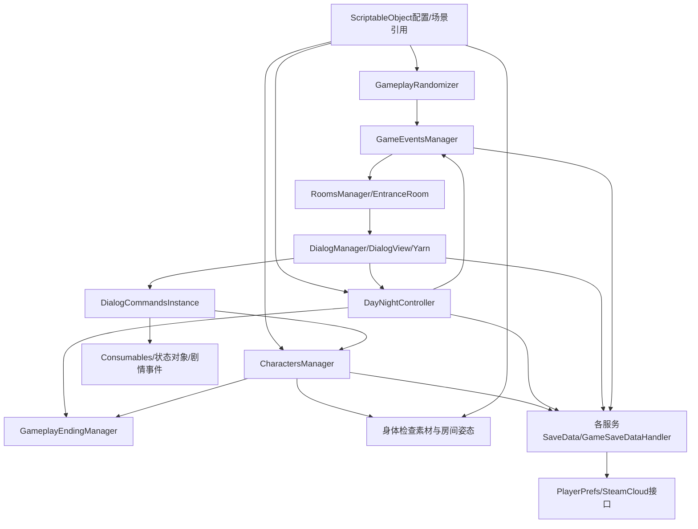

# 寻找伪人：本地逆向调查总报告

本次已实际恢复游戏主程序集的真实CIL/C#实现、类型/方法/字段/调用索引、编译对白、原生静态方法地址及一份带场景和资源的Unity工程。该工程尚不能宣称完整可玩：角色配置/灯光序列化、Shader占位、依赖和Editor验证仍有明确缺口。[verified: code-recovery.md；native-address-map.md；Analysis/Gameplay/yarn-program.json；Analysis/Assets/recovery-summary.json；unity-recovery.md]

## 输入身份和原文件保护

真实安装位置是 E:/steam/steamapps/common/No, I'm not a Human；请求的D盘SteamLibrary不存在。引擎为6000.3.10f1，玩家后端为x64 IL2CPP。研究只在本目录内使用副本；全部965个原安装文件在分析前后SHA256一致。[verified: path-discovery.md；engine-and-files.md；Analysis/Environment/source-immutability-verification.json FilesChecked=965/ChangedFiles=0]

## 真正恢复的代码和关系

- 主Assembly-CSharp：943 TypeDef、5855 MethodDef、5291 FieldDef，5126个可读取真实CIL方法体；729个无RVA且均抽象。49个单ret是空方法候选，不据此认定程序集为空壳。[verified: Analysis/Managed/Assembly-CSharp/summary.json]
- ILSpy原始分析导出587个主程序集C#文件与42个firstpass文件；同时保留10.3MB原始IL文本。另有629个CSharp9_0格式源文件供工程接入，分析报告行号继续指向原分析版本。[verified: DecompiledCode/Assembly-CSharp；DecompiledCode/Assembly-CSharp-firstpass；DecompiledCode/IL/Assembly-CSharp.il；Analysis/Environment/csharp9-export-provenance.json]
- 19045条IL调用/构造/函数指针引用、2026条类型聚合关系、35个AssemblyRef。callvirt仅恢复声明目标，ldftn不是执行证据；场景事件/反射不由该图自动完全解析。[verified: Analysis/Managed/Assembly-CSharp/coverage.json；verification.json]
- 所有4999个非NULL生成C++slot找到函数签名和源码范围；实际GameAssembly指针表也验证了5855槽、4999非零条目、3416不同首选映像地址。它们不是运行时ASLR地址，也不是已完成Ghidra反汇编。[verified: cil-cpp-map-summary.json；Analysis/Native/native-map-verification.json；native-map-review.md]
- 108个备份程序集有完整元数据/方法体数量清单；没有把全部第三方程序集都声称为已反编译的作者原始源码。[verified: Analysis/Managed/Assembly-CSharp/assemblies-inventory.json；code-recovery.md]

检索入口为 [methods.csv](../Analysis/Managed/Assembly-CSharp/methods.csv)、[调用边](../Analysis/Managed/Assembly-CSharp/call-edges.csv)、[CIL/C++映射](../Analysis/Managed/Assembly-CSharp/cil-cpp-map.csv)、[原生地址](../Analysis/Native/native-method-map.csv)。[verified: 这些产物存在，完整性见verification.json和native-map-review.md]

## 十个玩法系统

| 系统 | 已建立的真实入口 | 结论与边界 |
|---|---|---|
| NPC/访客生成 | GameplayRandomizer.GetRandomCharactersForDay、GameEventsManager.GenerateDingDongEventsForDayAsync | 已验证预设/随机池、允许日期、通关门槛、UsedCharacters与来访顺序；个体配置见资源恢复限制。[verified: npc-identity-checks.md「访客生成与刷新」] |
| 真人/伪人身份 | CharactersManager.LetIn/GenerateStatus/OnLoadLetIn | 已验证根据屋内比例自适应身份分配和读档恢复；最小0.05、最大0.4是比例阈值。[verified: npc-identity-checks.md「真人和伪人身份」] |
| 身体检查/线索 | DialogCommandsInstance.ShowSign、DialogSignsView.ShowSign、CharacterSOData getter | 已验证六种检查与身份对应素材、玩家特征标志；失败角色资产的具体引用不能用默认值代替。[verified: npc-identity-checks.md「检查与线索呈现」] |
| 对话树与条件 | DialogManager、FakeDialogRunner/DialogueRunner、YarnProgram | 已解析3255节点/276初始变量、56585指令与控制边；仍有1868栈跳转未静态确定、1个常量目标未找到，不宣称所有剧情可达。[verified: Analysis/Gameplay/summary.json nodes/initial_variables/instructions/unresolved_stack_jump_records/missing_constant_node_targets] |
| 昼夜/时间/资源 | DayNightController.Change/InitNewDay、ConsumablesController | 已验证行动、睡眠门槛、晨间处理、物资/咖啡/猫/快递；实际资产数值由对应成功导出的SO支持。[verified: gameplay-dialogue-progression.md「昼夜循环、行动与物资」] |
| 玩家开门/拒绝/接纳 | EntranceRoom、DialogCommandsInstance、CharactersManager | 已验证命令到状态修改、占位冲突和处置集合；选项可用性来自对白数据。[verified: gameplay-dialogue-progression.md「玩家决策与NPC状态」] |
| NPC状态机 | CharacterRoomObjectView、ERoomPeopleState、CharactersManagerSaveData | 已验证姿态/尸体/袋子/驱逐等数据驱动状态，未宣称所有场景监听器已运行。[verified: gameplay-dialogue-progression.md；npc-identity-checks.md] |
| 随机事件/难度/剧情 | GameEventsManager、GameplayRandomizer、GameEventConditions | 已验证门铃条件、前置事件、通关门槛与特殊剧情分支；完整事件概率曲线不由静态代码单独证明。[verified: gameplay-dialogue-progression.md「事件、剧情与难度边界」] |
| 存档 | ASavableClass、GameSaveDataHandler、EncryptedPrefsDataStorage、SteamCloudSaver | 已验证按服务类型保存JSON、PlayerPrefs与Steam云接口；没有读写用户现有存档或验证云同步运行。[verified: gameplay-dialogue-progression.md「存档与持久化」] |
| 结局 | GameplayEndingManager及10个注册实现 | 已验证条件、优先级与触发链；枚举13项/存在类不等于全部可达，编译对白和运行时验证边界保留。[verified: gameplay-dialogue-progression.md「结局条件与优先级」] |

## 主要架构

图概括已读静态调用、委托订阅及数据关系，不等于所有边都是直接IL call；完整逐指令图与状态流分别见Analysis/Managed与Analysis/Gameplay。[verified: npc-identity-checks.md和gameplay-dialogue-progression.md已读实现；coverage.json limitations][opinion]

## Unity恢复与验证

实际工程根为 [RecoveredUnityProject/ExportedProject](../RecoveredUnityProject/ExportedProject)。已导出7场景、38Prefab、1003PNG、359OGG、14AnimationClip、3AnimatorController及资源GUID/引用清单；数量表示本次导出，不冒充作者原始工程总量。[verified: Analysis/Assets/recovery-summary.json extensionCounts/scenes/limits]

匹配脚本和插件通过真实CIL来源替换免费导出的dummy，保留.meta身份：主585份、firstpass40份，合计625份CSharp9脚本，以及53个插件DLL；两份AssemblyInfo保持导出内容。Shader占位、73个CharacterSOData/49个URP灯光/1个PlayerSettings读取错误及替代路径结果保留在日志中。[verified: Analysis/Assets/script-merge-csharp9.json mergedByAssembly/metaPreserved/unmatched；plugin-merge.json；serialization-error-counts.json]

原样net40导出项目重编译失败83错误；net48诊断缺reference assemblies。629文件的解析零诊断和指定AST检查不能替代完整C#特性、符号绑定或Unity编译；没有找到匹配6000.3.10f1 Editor，未验证Editor导入或可玩版本。[verified: Analysis/Logs/decompiled-project-build.log；decompiled-project-net48-diagnostics.txt；unity-source-compatibility.md]

## 报告导航

- [引擎与文件](engine-and-files.md)、[实际REA工具及参数](rea-tool-catalog.md)、[依赖快照](dependencies.md)。[verified: 对应报告存在]
- [代码恢复](code-recovery.md)、[原生地址](native-address-map.md)、[访客/身份/检查](npc-identity-checks.md)。[verified: 对应报告存在]
- [对白/进展/状态/存档/结局](gameplay-dialogue-progression.md)、[资源和工程恢复](unity-recovery.md)、[源码格式及语法边界](unity-source-compatibility.md)。[verified: 对应报告/任务产物]
- [尚未解决的问题](remaining-questions.md)、[分析工具审查](analysis-review.md)、[原生映射复检](native-map-review.md)。[verified: 对应审查文件；问题清单]

本研究没有制作新的模仿游戏，没有启动原游戏或处理DRM，没有发布源码或素材。成果是本地静态研究和恢复工程，不能以“文件已导出”代替“完整游戏已复原”。[verified: source-immutability-verification.json；coverage.json read_target_execution=false；各任务执行边界][opinion]
