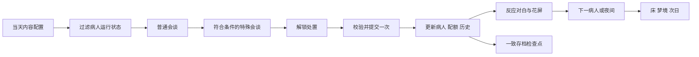

# Unity 2022借鉴与开发路线图

新增[Day1终端交互参考](../docs/sources/inspection-terminal-day1-prototype.md)及小孩Excel原件已同步；HTML只配置一位病人的Day1，不等同于Unity完成迁移，测试阈值与配额也不覆盖正式规则。[verified: ../docs/.source-data/inspection-terminal-day1-v0.5.2.json configured_patients/default_test_threshold/default_test_quota] [opinion]

2026-10-15飞书来源已更新：主Wiki新增反叛值结局，流程画板新增每日开始前结局/KPI检查，小孩已有完整对白表；当前原型仍保留开发配置。变动与待裁决项见[同步记录](../docs/feishu-sync-2026-10-15.md)。[verified: ../docs/.source-data/game-wiki.json content「结局」；../docs/.source-data/sync-2026-10-15.json changes] [opinion]

> 研究日期：2026-10-12。本文件是后续开发建议，没有创建游戏工程或导入任何第三方包。用户指定Unity2022，默认按2022.3 LTS研究；具体补丁版本与目标平台仍需在建工程时记录。

## 1. 技术选择与责任边界

建议建立自己的小型Unity2022.3工程，以URP14为视觉主候选，uGUI／TextMeshPro承载电脑会谈。优先使用固定版本的Yarn Spinner对话框架；Ink保留为备选，不同时引入两套叙事运行时。版本声明与真实导入结果分开记录。

[Yarn官方安装说明](https://docs.yarnspinner.dev/yarn-spinner-for-unity/installation-and-setup)支持2022.3及以上；本地研究包是3.2.8。[URP14官方兼容表](https://docs.unity3d.com/Packages/com.unity.render-pipelines.universal@14.0/manual/requirements.html)对应Unity2022.x。具体候选和固定提交见[Yarn研究](repositories/yarn-spinner-unity.md)、[Ink研究](repositories/ink-unity-integration.md)、[Retro CRT研究](repositories/urp-retro-crt-shader.md)。正式工程安装时使用研究固定SHA或已验证的明确发布版本，不跟随main／master／current浮动分支。

如果最终选Built-in，保留相同业务和对话层，只替换渲染路线，优先验证[CrowFX](repositories/crowfx-unity-image-effects.md)的少数效果。不要把Moral Matrix的Unity2023／URP15工程或The Guest的Unity6／URP17工程整体降级作为底座。

| 层次 | 负责什么 | 借鉴来源 | 需要自行完成的接口边界 |
| --- | --- | --- | --- |
| 游戏规则与状态 | 日期／阶段、五人状态、信任、治疗阶段、处置记录、配额、事件和结局资格 | DeathAndTaxes的角色ID和每日后果；Do-You-Trust-Them每日配置 | 纯C#规则可独立验证；配额、人物状态和一次性事件由同一状态来源管理 |
| 日流程控制 | 晨检、电脑工作、夜间、床、梦境、次日与结局 | Do-You-Trust-Them活动门控／切日 | 合法阶段切换；剧情内容完成与演出完成各有明确回调 |
| 对话适配 | 启动指定病人／日期会谈、展示文本选项、业务查询和命令、完成通知 | Yarn或Ink | 不让脚本直接写任意状态；普通、特殊、反应三段在流程上明确区分 |
| 世界与终端呈现 | 第一人称、E交互、摄像机过渡、2DUI、光标和屏幕 | The Guest交互职责、Moral Matrix呈现、Human, Please监控交接 | 自己开发连续电脑过渡；表现读取业务状态，不作为规则真相来源 |
| 输入与演出 | 世界／终端／过渡／弹窗／梦境／暂停的输入上下文，音效灯光故障 | MOD输入占用；Human, Please声音／遮挡 | 覆盖层释放后恢复正确上下文；梦后仅允许床交互 |
| 保存与调试 | 一致业务快照、对话检查点、场景状态、事件去重、开发期状态查看 | DeathAndTaxes保存时机、Yarn变量或Ink状态、NINAHSaveEditor字段视图 | 自己定义版本化快照，不能只保存框架变量或DontDestroyOnLoad对象 |

这些是建议职责，不表示现有工程已经存在对应类或公共API。

## 2. 最小数据流

不满足特殊对白条件时直接进入处置阶段。资格检查依据已确定规则；目前阈值与部分结局条件未定，不用示例值冒充正式参数。

建议将静态内容与运行状态分开：静态内容保存五人资料、逐日会谈入口、差分和反应资源；运行状态保存每位病人的信任、治疗次数、当前在场状态及实际处置记录。日期与阶段独立于画面；剧情查询只暴露该角色此刻应知道的信息。玩家疯狂值、偏离指数、狂热值的关系未定，在设计确认前不合并。

### 处置提交的关键约束

1. UI提出治疗／净化／释放请求，规则层核对当前病人、会谈完成、资格与是否已经处置。
2. 一次成功请求更新权威状态与记录；净化才影响当日净化配额，治疗增加对应病人的次数，释放／净化退出其常规队列。
3. 保存可恢复的提交结果与检查点，再播放反应和花屏；演出回调负责前进，不再次提交。
4. 读档后依据已提交记录恢复到对应检查点；一次性跨日事件、处置和奖励不重复执行。

不需要沿用Gatekeeper的SAFE／DANGEROUS答案，也不需要把DeathAndTaxes的原作世界指标复制为我们的情绪／道德分数。

### 会谈与存档的选择

Yarn默认更适合当前的固定会面UI、有限选项与完成通知。其现成JSON保存的是变量，需额外保存病人、日期、会谈段落／轮次及一次性动作状态。首个切片建议在每轮选项结算后及处置提交后设恢复检查点；行内打字效果恢复策略作为后续交互决定记录，不宣称可以自动恢复任意指令游标。

Ink的StoryState JSON可保存叙事运行状态，但仍需和我们的业务状态一起保存。若团队后续把任意叙事位置恢复作为核心要求，应先比较两者实际恢复成本，再决定是否改用Ink。

## 3. 按验证切片推进

| 阶段 | 要做出的验证内容 | 借鉴与对应需求 | 完成判定 |
| --- | --- | --- | --- |
| V0：工程与依赖 | 记录2022.3确切补丁、渲染管线、包版本／SHA；导入对话框架与一个CRT候选 | Yarn／Ink、Retro CRT；R07、R22 | 无阻断编译错误；示例文本选项可运行；Editor与目标平台构建分别记录。未确定平台前不承诺具体性能指标 |
| V1：一个病人的完整会面 | 公寓E进电脑、普通分支回流、特殊轮资格、三键处置、反应花屏、返回房间 | The Guest结构、Human, Please、Yarn；R01–R03、R07–R13、R23 | 输入切换正确；最多四选项；会谈结束前不能处置；连点只成功一次。缺正式台词时用明确标注的验证占位内容 |
| V2：跨日与恢复 | 当日配额、治疗后返场、释放／净化退出、床／梦境／次日、保存重载 | Do-You-Trust-Them、DeathAndTaxes；R04–R06、R14–R15、R19 | 同一状态加载得到同一队列；梦后仅床可交互；重载不重复扣配额、增加治疗次数或切日 |
| V3：五人三天与三结局 | 将已确认角色日程、对白、治疗阶段与结局配置扩展到完整Mini | 角色来源；R09–R10、R15–R18、R24–R25 | 五人状态互不串值，终止角色不返场，特殊对白只触发一次；三种结局可达且冲突时顺序确定。Q03／Q07／Q25未定时只能标为验证规则，不能判为正式内容完成 |
| V4：表现与发布验证 | 角色差分、音乐／音效、梦境与结局演出、CRT清晰度、构建与加载 | Moral Matrix、Human, Please、Retro／CrowFX；R06、R13、R21–R22 | 正式素材来源有记录，中文清晰，打包效果无缺失，窗口／分辨率变化和读档恢复正常；按实际目标设备测性能 |

每个阶段先解决阻断问题再扩大范围。参考工程仍保留原始版本；验证包或小模块在自己的工程中完成。研究阶段不安排整库升级、整库降级或把Godot工程自动转换为Unity。

## 4. 具体验证清单

下列测试供后续开发使用，本轮只创建清单，没有执行游戏测试。

| 编号 | 场景 | 必须观察到的结果 |
| --- | --- | --- |
| C01 | 房间、电脑过渡、终端、暂停之间连续切换 | 移动、视角、鼠标和E键始终只有对应上下文响应，恢复无卡死 |
| C02 | 四选项上限与两条回答分支汇合 | 没有第五选项，回应进入不同对白后正确回到公共轮次 |
| C03 | 分别改变五人信任，再保存重载 | 只影响指定病人，按确认后的规则恢复或重新计算特殊轮与释放资格，隐藏值不泄露到UI |
| C04 | 普通会谈结束但特殊轮未完成 | 处置仍锁定；没有特殊轮时合法进入处置阶段 |
| C05 | 红灯释放、过渡中处置、已处置再次点击 | 无非法状态变化；成功处置仅发生一次 |
| C06 | 净化、治疗、释放分别保存并读档 | 配额、治疗次数、人物去留和历史一致，不重复提交 |
| C07 | 梦境结束后移动，尝试门／电脑／床 | 可以按设计移动，只能与床交互，进入下一日一次 |
| C08 | 释放／净化角色后生成下一日队列 | 终止角色不出现；神父袭击作为条件事件而非普通病人返场 |
| C09 | 普通角色第三次治疗与外交官特例 | 按角色确认规则终止或保护；未定特例不静默采用普通规则 |
| C10 | 多个结局条件同时满足、Day3末释放神父 | 根据确认后的优先级与日程处理；Day4范围问题有显式结果 |
| C11 | 外交官对白引用玩家经历 | 仅引用实际对话、处置和已揭露事实，没有未来知识 |
| C12 | 一次性特殊对白／跨日事件后重载 | 不重复触发；恢复时不会重新产生副作用 |
| C13 | CRT强度切换、中文长句、屏幕尺寸变化 | 文本清晰，效果仅覆盖预定区域，RenderTexture尺寸正确 |
| C14 | 目标平台构建后首次启动和加载 | Shader变体存在、包引用正确、正式资产可用，保存与恢复成功 |

规则层测试优先覆盖处置去重、队列过滤、信任独立、条件事件和结局冲突；Play Mode覆盖输入与演出；构建测试覆盖Shader剥离、真实资源和目标设备。不要用仅重复实现的测试替代这些行为场景。

## 5. 开发前需要确认的内容

| 需要确认 | 本次保留的状态 | 对路线的影响 |
| --- | --- | --- |
| Day0／Day4预算与五人逐日调度 | Q02、Q03、Q22待定 | V3内容量与次日袭击能否在Mini内发生 |
| 配额、信任、特殊轮与释放门槛 | Q07–Q10待定，0–100／50只是示例 | V1可用验证配置，正式通过需确认数值 |
| 三结局条件与优先级、外交官保护 | Q24、Q25待定 | 不能仅凭三个结局名称宣称完整判定已完成 |
| 正式对白、差分、梦境和日记范围 | Q11–Q14、资产清单待定 | 不把参考视频、截图或临时文本当正式资源 |
| 具体Editor补丁、管线、平台与性能预算 | Unity2022方向已由用户指定；其余待工程记录 | V0与V4的可复现导入／构建条件 |

完整问题见[设计待定项](../docs/open-questions.md)。下一步执行顺序以V0–V4为准，源码入口见[借鉴矩阵](reuse-matrix.md)；所有参考仓库自身的运行状态仍是未运行。
