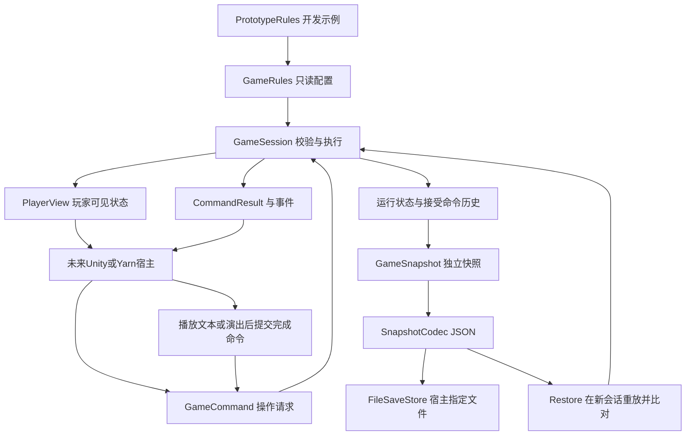

# 核心逻辑为什么这样写

> 本说明对应`src`中的实际首轮代码，日期2026-10-12。它解释文件职责、运行链路和借鉴来源；开发默认值与正式设计结论分开。Unity场景、UI、Yarn运行器和macOS应用尚未实现。

## 1. 要解决的具体问题

本游戏的关键不是把三个按钮画出来，而是让同一病人在不同日期的信任、治疗次数、返场状态和玩家历史保持一致。最容易发生的错误是：按钮连点重复扣配额，普通节点结束就提前处置，读档重新加信任，终止人物又返场，或多个结局同时成立却按不稳定顺序触发。

因此代码先建立一个可独立验证的状态所有者，再将文本、镜头和演出留给宿主。当前没有完整Unity工程，纯C#库让这些问题在这台Mac上即可测试，并为以后接入Unity保持明确边界。

## 2. 整体结构

`GameSession`是唯一修改运行状态的位置。配置、玩家视图、命令结果和捕获的快照都不能直接改写会话内部状态。宿主可以读取结果，再决定怎样表现；演出结束后仍需提交一个经过校验的完成命令。

## 3. 每个文件负责什么

| 文件 | 实际职责 | 为什么放在这里 |
| --- | --- | --- |
| [Contracts/GameTypes.cs](MiniGame.Core/Contracts/GameTypes.cs) | 日期阶段、会面阶段、三种处置、人物去留、结局、交互目标、拒绝原因和事件种类 | 用明确枚举表达合法语义，避免字符串错拼和不同系统各自定义处置 |
| [Contracts/GameCommand.cs](MiniGame.Core/Contracts/GameCommand.cs) | 九种操作请求：阶段完成、交互、回答、分支完成、处置、反应完成 | 每次请求携带必要的会面／节点ID，迟到回调不会误作用于下一病人 |
| [Contracts/GameResult.cs](MiniGame.Core/Contracts/GameResult.cs) | `CommandResult`、`GameEvent`和只读`PlayerView` | 把“是否成功”“该表现什么”“玩家可以看到什么”与隐藏状态分开 |
| [Rules/DialogueDefinitions.cs](MiniGame.Core/Rules/DialogueDefinitions.cs) | 回答、普通／特殊轮、分支节点、门槛与三种反应节点的只读定义 | 只描述会谈结构，不创建另一套剧本语言，也不绑定Unity文本组件 |
| [Rules/GameRules.cs](MiniGame.Core/Rules/GameRules.cs) | 人物定义、每日配置、结局顺序、完整规则校验与SHA256指纹 | 静态配置与运行结果分离；错误日程尽早发现，同名配置变化也能识别 |
| [Rules/PrototypeRules.cs](MiniGame.Core/Rules/PrototypeRules.cs) | 五人三天开发配置及测试节点ID，集中保留临时数值 | 未定数值不散落在流程代码里，以后策划改表不必改核心算法 |
| [State/GameSnapshot.cs](MiniGame.Core/State/GameSnapshot.cs) | 可序列化DTO：人物、日记录、会面、回答、事件与存档根对象 | DTO是运输格式；对外捕获深拷贝，不能拿到正在运行的可写对象 |
| [State/CommandRecord.cs](MiniGame.Core/State/CommandRecord.cs) | 接受命令的稳定存档表示，并恢复成具体命令 | 不序列化任意C#类型，恢复时还能拒绝错误或多余参数 |
| [Runtime/GameSession.cs](MiniGame.Core/Runtime/GameSession.cs) | 状态唯一所有者；命令校验、会谈推进、处置结算、队列、跨日、结局、快照恢复 | 三个按钮、剧情命令和宿主回调都走同一规则入口；当前规模下集中保持不变量更容易审查 |
| [Persistence/SnapshotCodec.cs](MiniGame.Core/Persistence/SnapshotCodec.cs) | 版本化JSON、格式校验、深拷贝、独立序列化设置、文件原子保存 | 文件系统由宿主指定，核心不依赖`Application.persistentDataPath`；JSON全局设置不影响格式 |

`GameSession`中的私有方法按行为拆分：`Select`／`FinishBranch`负责会谈；`Dispose`／`FinishReaction`负责处置；`PrepareDay`／`StartNextEncounterOrEndWork`负责调度；`AdvanceDay`负责事件和结局。它们共享同一私有状态，不建立互相可以任意写入的全局管理器。

随着场景与内容增加，可以把纯计算的策略继续拆出去。首轮没有建立大量空服务接口或通用事件DSL，因为当前的三天规则用明确类型已经能表达。

## 4. 一次回答实际怎样执行

以Day1小孩的第一轮为例：

1. 宿主读取`PlayerView`中的会面ID、普通节点ID和允许的回答ID。
2. `SelectResponse`先核对工作阶段、当前会面、当前轮次和回答是否存在，再计算信任变化；整数溢出会拒绝，状态保持原样。
3. 成功后写入该病人的独立信任与真实回答记录，进入`ResponseBranch`，返回对应分支节点事件。其他病人的信任不变。
4. 宿主播放分支内容；`CompleteResponseBranch`必须匹配当前会面和分支ID。
5. 核心清理待完成分支，再进入下一普通轮；所有回答都按当前轮次汇合，不复制整段后续剧情。
6. 最后普通轮结束时才检查特殊轮门槛。符合条件则进入特殊轮，不符合则进入处置。
7. 特殊轮的回答及反馈分支都完成之后，才返回可用处置。

这样，“选择回答”和“反馈播放结束”成为两个明确检查点。保存到分支中间可以恢复该分支，重复或迟到的完成通知会被拒绝。当前恢复粒度是逻辑节点／分支，不包含某行文字已经显示多少个字。

## 5. 三种处置为什么共用一个入口

`SubmitDisposition`不会直接播放演出。它先检查会面、阶段、动作是否合法、释放资格和是否已经处置，然后一次性写入结果。

| 动作 | 核心写入的状态 | 之后交给宿主 |
| --- | --- | --- |
| 治疗 | 该人治疗次数加一；达到规则上限时立即终止或安排次日终止 | 治疗反应节点与角色表现 |
| 净化 | 人物退出；当日实际净化数量加一 | 净化反应节点与花屏 |
| 释放 | 人物退出；若配置释放后袭击，则安排唯一跨日事件 | 释放反应节点与花屏 |

人物是否退出、配额如何变化由核心决定；镜头、花屏和声音不再次结算。`CompleteReaction`只完成会面并前进队列。因此点击、保存恢复和演出结束不会成为三个重复扣配额的入口。

当日保存实际净化数量和目标，显示层只拿`max(0,目标−数量)`。超额净化仍记入实际历史，不让可见剩余量变成负数。治疗和释放不扣净化配额。

## 6. 日期、角色队列与结局怎样连接

开始当天时，按照`DayDefinition.Meetings`的顺序筛选仍然在场的病人。神父Day2加入属于静态日程；释放、净化、第三次治疗等属于运行后果。两者结合，避免每天自动召回全部五人。

最后一个病人的反应完成后，核心记录当天配额是否达标并进入夜间。空队列也执行同样的日终路径，不停在等待一个不存在病人的状态。

睡眠结束进入梦境，梦境结束进入梦后。核心此时只允许床交互；以后Unity宿主可以恢复自由移动，但仍应根据允许交互列表锁住门和电脑。再次与床交互推进日期，执行到期事件，再选择结局或准备新的晨检。

跨日事件用会面ID和事件种类生成稳定ID。执行后从待执行列表移除并记录到已执行列表。神父Day2释放可在Day3晨间结束游戏；Day3释放则在Day4收束。默认优先级为袭击、配额失败锁房、正常被带走。Day4不会创建工作队列。

这些是开发配置下的可执行规则。正常结局条件、配额、阈值、结局冲突顺序等仍属于正式设计待定项，不能因为测试已经可达就说策划已经定稿。神父默认三天中只有两次治疗，不新增第四天会面来强行演出其长期死亡线。

外交官第三次治疗用`TreatmentEnded`表达人物线退出，没有宣布其死亡或上级保护。员工审查只保存已经发生的回答、处置和指标记录，没有把疯狂值、偏离指数与狂热值合并成一个分数。

## 7. 为什么快照还包含操作历史

只保存日期和几个Yarn变量，无法判断一次净化是否已经执行、某个特殊轮是否已经结束，或者现在应该恢复在哪位病人的哪一段。因此快照包含完整业务状态和接受命令历史。

历史由成功执行的同一个入口生成，不接受外部另写。恢复步骤为：核对存档版本和规则指纹→在新会话内部重放接受命令→比对重建状态与保存状态→返回拥有独立数据的新会话。

重放只重建内存，不通知Unity／Yarn，不写文件、不重新执行宿主演出。恢复后再接收到旧处置命令，仍会被已提交状态拒绝。完整快照与历史是状态缓存及其验证依据，不是两份可以分别改写的权威状态。

这对三天内容的代价是一次线性历史重放；首轮规模可接受。以后内容显著增长才需要评估分段检查点和迁移策略。本轮遇到未知版本或改变规则的存档会明确拒绝，尚无旧版本迁移。

快照包含隐藏信任，供保存和内部调试；玩家视图不包含这些字段。这是呈现接口的分离，不是存档加密或防篡改承诺。修改成另一段完全合法且状态一致的操作历史，可以形成另一份有效存档。

JSON序列化器使用自己的设置，不继承宿主的`JsonConvert.DefaultSettings`，不启用任意类型反序列化。文件保存先写同目录临时文件并刷新，再替换目标；不先删除原文件。主线程宿主决定何时保存，本库不偷偷在每次操作后写盘。

## 8. 具体借鉴了什么

本轮核心代码是根据需求原创实现，没有直接复制无明确许可的游戏脚本，也没有引入参考游戏的程序集或素材。下表区分借鉴的结构与实际接入。

| 来源与详细源码证据 | 借鉴的结构 | 当前对应实现 | 未采用的部分 |
| --- | --- | --- | --- |
| [DeathAndTaxes](../research/repositories/death-and-taxes.md) | 稳定角色ID记录处置、每日指标与后果分开、日终反馈和恢复时机 | `PatientSnapshot`、`EncounterSnapshot`、`DaySnapshot`及集中处置入口 | Articy、原作世界指标、28天内容、素材与BinaryFormatter |
| [Do-You-Trust-Them](../research/repositories/do-you-trust-them.md) | 每日静态内容和运行活动进度分离，完成活动才切日 | `DayDefinition`、阶段命令、结束工作与床／梦境门控 | 原工程缺失脚本、Unity ScriptableObject与原结局展示按钮 |
| [gatekeeper-insight](../research/repositories/gatekeeper-insight.md) | 操作结果与各类表现分离，日统计有独立数据 | `CommandResult.Events`、唯一状态所有者及独立配额记录 | Godot信号实现、随机访客、观察池和SAFE／DANGEROUS标准答案 |
| [The Guest](../research/repositories/the-guest.md) | 人物静态资料与运行记忆分离，交互模式明确 | `PatientDefinition`与`PatientSnapshot`，阶段限定操作资格 | costume维度、LLM增量、零增量强制+1、UI与Unity6依赖 |
| [Yarn Spinner](../research/repositories/yarn-spinner-unity.md) | 条件选项、分支汇合、整场完成与节点完成的区别 | 普通／特殊／反馈／处置阶段，以及为未来适配提供的节点ID和完成命令 | 运行器与Presenter尚未接入；没有把框架变量存档当完整业务存档 |
| [Human, Please](../research/repositories/human-please.md) | 会面交接时禁用控件，提交与离场演出分开 | 处置后固定进入`Reaction`，必须完成反应才切下一人 | 监控UI、灯光、GDScript与原游戏二维素材 |
| [无障碍MOD](../research/repositories/im-a-blind-human.md) | 不同交互上下文不应同时响应 | 核心返回允许交互；梦后仅床，工作期间不响应世界交互 | 原游戏反射与输入补丁；UI覆盖层占用计数留待宿主实现 |
| [NINAHSaveEditor](../research/repositories/ninah-save-editor.md) | 日期、对象和状态字段可以单独检查 | 可读的完整JSON快照与状态测试 | Windows Forms、原作类型名、密钥和重复序列化副本 |

Retro CRT、CrowFX和Moral Matrix的表现代码本轮没有接入；Ink保留在研究中的备选位置。当前唯一运行时第三方依赖是固定版本的Newtonsoft.Json；NUnit等只属于测试工程。

各研究页给出原仓库完整SHA、源码文件和行号，可沿着表格核对。未来真正复制许可明确的代码或引入框架时，另记录具体文件和版权，不把“借鉴结构”写成“已经移植整库”。

## 9. 测试文件怎样对应逻辑

| 测试文件 | 验证的行为 |
| --- | --- |
| [Scenario.cs](MiniGame.Core.Tests/Scenario.cs) | 只通过公开视图和命令驱动流程，提供完整路径和检查点助手 |
| [SessionTests.cs](MiniGame.Core.Tests/SessionTests.cs) | 五人调度、信任独立、分支回流、特殊轮、释放资格、一次性处置、治疗终止、空队列、梦后交互 |
| [EndingTests.cs](MiniGame.Core.Tests/EndingTests.cs) | 三种结局、历史配额失败、神父次日袭击、Day3释放与Day4优先级、可替换规则 |
| [PersistenceTests.cs](MiniGame.Core.Tests/PersistenceTests.cs) | 多种会面检查点恢复、无重复副作用、损坏／不一致存档拒绝、DTO隔离、JSON设置隔离、Mac文件替换 |
| [RulesTests.cs](MiniGame.Core.Tests/RulesTests.cs) | 4–5轮、1–4回复、日程／ID／门槛结构校验、配置复制与稳定指纹 |

测试验证行为和完整路径，不是只检查类是否存在。首轮.NET测试不能证明Unity加载、Mono／IL2CPP、字体、视觉、输入或打包已通过。

## 10. 后续如何接Unity

Unity宿主先建立一个会话，读取`PlayerView`构建界面，把按钮和完成回调转换成命令。Yarn适配器把节点ID映射为正式剧本，播放反馈与反应；它根据核心规则选择下一节点，不自己决定配额或病人是否返场。

当前原型节点没有台词正文；把正式文本接入不会改变状态入口。3D到2D的镜头、输入占用、音效和花屏消费核心事件，各自演出完成时通知核心。文件目录从Unity宿主注入`FileSaveStore`。

下一阶段首先验证.NET Standard2.1程序集／源码及JSON依赖在Unity2022.3中的实际接入，再完成一个病人的场景切片。正式数值、角色特例和结局条件仍需回到[待定问题](../docs/open-questions.md)，保持研究建议、开发配置、正式需求和运行证据分别可追踪。
